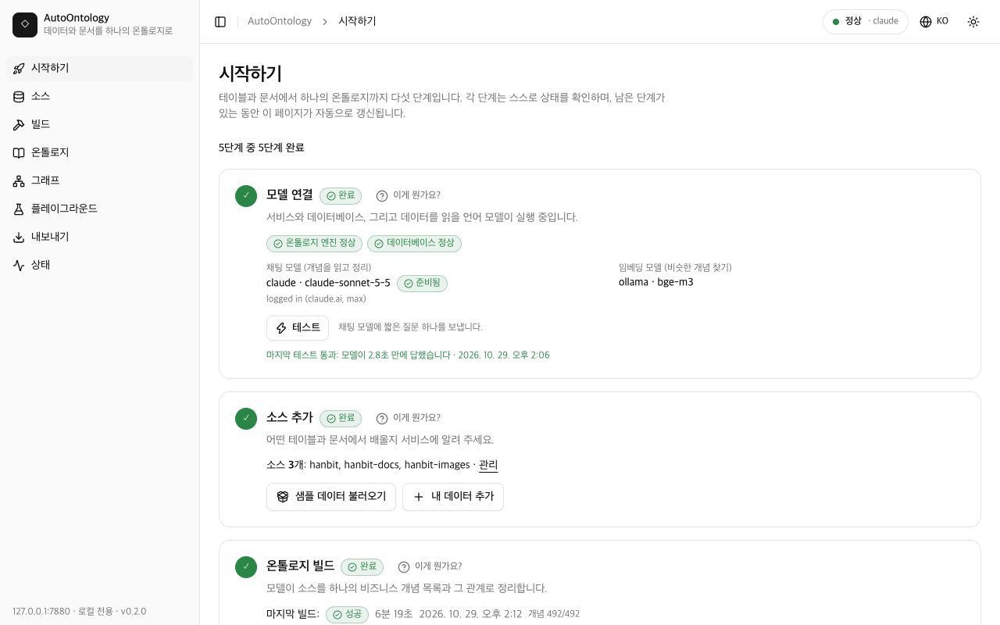
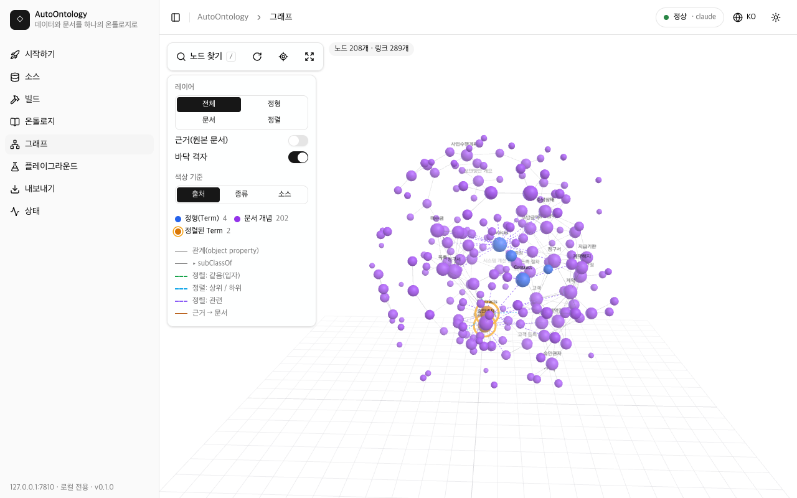
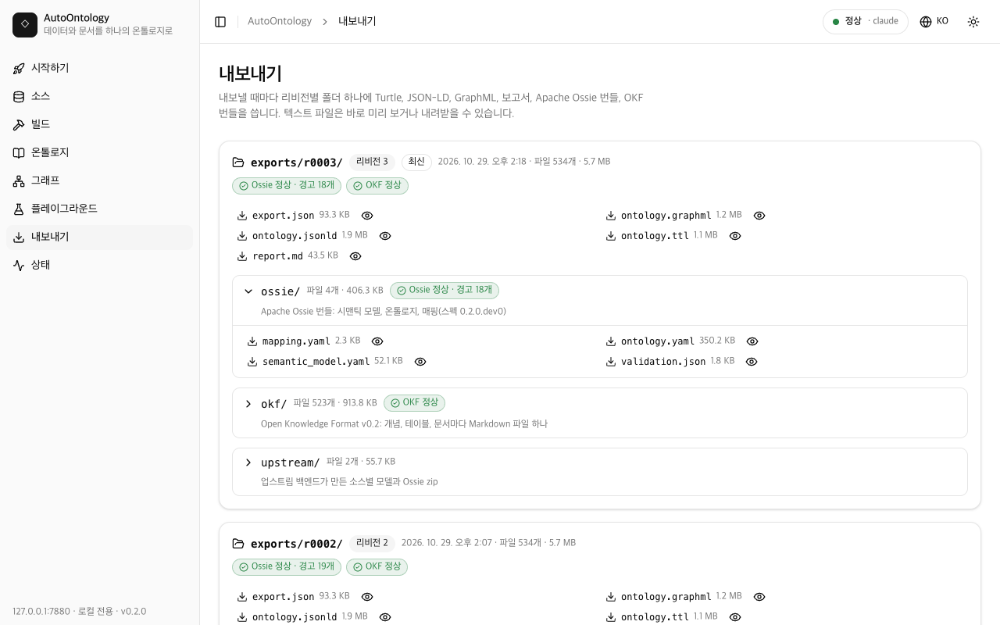

# AutoOntology

[English](README.md) | **한국어**

AutoOntology는 표와 문서를 함께 읽어 **하나의 온톨로지**를 만듭니다. 스프레드시트, 데이터베이스
내보내기 파일이나 Postgres 데이터베이스, 그리고 그것을 설명하는 규정, 매뉴얼, 회의록, 발표 자료,
스캔본(HWP/HWPX, PDF, Word, PowerPoint, Excel, Markdown, HTML, OCR을 거친 이미지)을 지정하면
됩니다. 양쪽에서 비즈니스 개념을 찾고, 문서 개념을 표의 용어(Term)에 매칭한 뒤, 버전이 매겨진
스냅샷 하나로 저장합니다. 스냅샷은 둘러보고 질의할 수 있으며 RDF/OWL, GraphML,
[Apache Ossie](https://github.com/apache/ossie),
[Open Knowledge Format(OKF)](https://github.com/GoogleCloudPlatform/knowledge-catalog/blob/main/okf/SPEC.md)로
내보낼 수 있습니다. 표를 비즈니스 용어로 컴파일하는
[NVIDIA Auto Ontology](https://github.com/NVIDIA/auto-ontology) 위에 만들어졌고, Postgres +
pgvector와 원하는 모델로 내 컴퓨터에서 실행됩니다. 모델은 로컬 Ollama, 내 Claude 또는 ChatGPT
구독, 또는 임의의 OpenAI 호환 API 중에서 고릅니다.

**처음이라면 [단계별 가이드](docs/GUIDE.ko.md)를 읽으세요** ([English](docs/GUIDE.md)). 데이터
엔지니어링 배경이 없는 현업 전문가를 위해 썼습니다. 용어 설명, 점검 목록, 10분 코스, 내 파일을
준비하는 방법, 문제 해결 표가 들어 있습니다.



## 빠른 시작

```
git clone --recurse-submodules https://github.com/kimtoma/AutoOntology.git && cd AutoOntology
docker compose up -d            # or point POSTGRES_* in .env at your own Postgres 17 + pgvector
uv sync
uv run autoontology init        # checks what is installed, picks a model, writes .env, runs setup
uv run autoontology demo        # builds the quickstart sample set, exports it and opens the web UI
```

필요한 것은 [uv](https://docs.astral.sh/uv/)가 있는 Python 3.12, Docker 또는
[pgvector](https://github.com/pgvector/pgvector)를 쓸 수 있는 직접 운영하는 Postgres 17,
[Ollama](https://ollama.com)(임베딩용이며, 구독이나 API를 쓰지 않으면 채팅용으로도 필요),
그리고 HWP/PDF/Office 문서와 이미지를 읽으려면 Node.js 20 이상입니다.
[가이드](docs/GUIDE.ko.md#3-시작하기-전에)에 "확인 방법" 명령이 붙은 점검 목록이 있습니다.

- `init`은 번호가 붙은 일곱 단계(Postgres, 채팅 제공자, 임베딩, 문서, `.env`, `setup`, 요약)를
  차례로 진행합니다. 쓸 수 있는 채팅 제공자를 감지해 준비된 첫 번째(claude, codex, ollama 순)를
  제안합니다. `.env`에는 필요한 키만 쓰고, 기존 파일은 `.env.bak-<시각>`으로 백업합니다. API 키는
  절대 묻지 않습니다. `--yes`는 감지한 기본값으로 진행하고, `--provider`, `--chat-model`,
  `--docs/--no-docs`, `--vision-model`로 답을 미리 정할 수 있습니다. 여러 번 실행해도 안전하며,
  `.env`에 이미 있는 제공자는 유지합니다.
- `demo`는 서비스를 시작하고, 샘플 세트를 등록하고(`quick`, `quick-docs`; `--set hanbit`이면
  `hanbit`, `hanbit-docs`, `hanbit-images`), 제공자별 예상 빌드 시간을 출력한 뒤, 단계마다
  소요 시간을 보여 주며 빌드하고, 내보내기를 하고 웹 UI를 엽니다. `--resume`은 중단된 빌드를
  이어 가고, `--replace`는 같은 이름에 다른 데이터를 가진 소스를 교체하며, `--no-open`은
  브라우저를 열지 않습니다. 그다음 **온톨로지 → 그래프 → 플레이그라운드** 순서로 살펴보세요.

<details>
<summary>수동 단계 (init/demo가 하는 일)</summary>

```
cp .env.example .env            # then edit the provider settings
uv run autoontology setup       # add --docs for HWP/PDF/DOCX/PPTX/XLSX and image OCR via kordoc
uv run autoontology up
uv run autoontology source add samples/quickstart/structured --name quick
uv run autoontology source add samples/quickstart/documents --name quick-docs --kind documents
uv run autoontology build
uv run autoontology export
uv run autoontology ui
```

- `up`은 엔진 백엔드(:3101)와 서비스(:7800)를 둘 다 백그라운드로 시작합니다. `down`은 둘을
  멈추고, `status`는 상태를 보여 줍니다.
- kordoc이 없으면(`--docs` 없이 `setup`) `build`는 샘플 문서 중 `.pdf`, `.hwp`, `.docx`를
  건너뛰고, 그 파일 이름과 설치 명령을 담은 경고를 출력한 뒤 그래도 성공(종료 코드 0)으로
  끝납니다. kordoc 사용 가능 여부가 문서 소스의 지문(fingerprint)에 포함되므로,
  `uv run autoontology tools install-kordoc` 후 다음 `build`(또는 `build --resume`)가 그 문서를
  읽습니다.
- `export`는 자신이 쓴 폴더를 출력합니다(예: `exports/r0001/`). `ui`는
  http://127.0.0.1:7800/ui/ 를 엽니다.

</details>

### 언어

웹 UI는 영어와 한국어를 지원합니다. 헤더의 지구본 메뉴에서 고르거나 `/ui/?lang=ko`로 열면
됩니다. 고른 언어는 브라우저에 저장되며, 고르지 않았다면 브라우저 언어를 따릅니다. 온보딩
명령(`init`, `demo`, `provider`, `setup`, `doctor`)은 `AUTOONTOLOGY_LANG=ko`(셸 또는 `.env`)를
설정하거나 로캘(`LANG`, `LC_ALL`)이 한국어이면 한국어로 출력하고, `AUTOONTOLOGY_LANG=en`이면
영어로 출력합니다. 명령어와 오류 코드는 두 언어에서 같습니다.

## 프롬프트 한 번으로 시작하기

[Claude Code](https://docs.claude.com/en/docs/claude-code/overview)를 쓰면 위 명령을
직접 입력하지 않아도 됩니다. 프롬프트 하나를 붙여 넣으면 Claude가 저장소를 클론하고, 사전 조건을
점검하고, 설치하고, Claude 제공자(내 Claude 로그인, API 키 없음)를 설정하고, quickstart 샘플
세트를 빌드한 뒤 UI 주소를 알려 줍니다. 프롬프트 뒤에서 도는 것은
[`scripts/bootstrap.sh`](scripts/bootstrap.sh)이고, 저장소의 [`CLAUDE.md`](CLAUDE.md) /
[`AGENTS.md`](AGENTS.md)와 프로젝트 스킬
[`setup-autoontology`](.claude/skills/setup-autoontology/SKILL.md)가 결과별 대처법을
에이전트에게 알려 줍니다.

**터미널의 Claude Code.** 홈 폴더에서 `claude`를 실행하고 다음을 붙여 넣습니다.

```text
https://github.com/kimtoma/AutoOntology 를 ~/AutoOntology 에 클론하고 그 폴더에서 `scripts/bootstrap.sh --yes --provider claude --lang ko` 를 실행해 줘. 약 10분 걸리니 백그라운드로 실행하고 끝날 때까지 기다려 줘. 끝나면 출력된 UI 주소를 열고 무엇이 만들어졌는지 한국어로 설명해 줘.
```

`--yes`는 묻지 않고 진행합니다. uv가 없으면 공식 설치 스크립트로 설치하고, `init`의 기본값을
받아들이고, 예전 `quick`/`quick-docs` 샘플 소스(와 그 데이터베이스)를 교체합니다. 먼저
확인받고 싶으면 `--yes` 없이 직접 터미널에서 실행하세요. 빈 폴더에서 실측한 전체 시간은 9분 34초였습니다(Apple M4 Mac
mini, 2026-10-29, uv 캐시 있음, quickstart 빌드만 547초).

영어로는:

```text
Clone https://github.com/kimtoma/AutoOntology into ~/AutoOntology and run `scripts/bootstrap.sh --yes --provider claude` there. It takes about 10 minutes: run it in the background and wait for it to finish. Then open the UI URL it prints and tell me what was built.
```

**Claude 데스크톱 앱.** **Code** 탭(데스크톱 앱 안의 Claude Code)을 열고, 작업 폴더로 홈
폴더를 고르고 로컬 환경을 선택한 다음(서비스가 클라우드 샌드박스가 아니라 내 컴퓨터에서 돌아야
합니다) 같은 프롬프트를 붙여 넣습니다. Claude 제공자는 `claude` 명령줄 도구를 쓰므로,
데스크톱 앱을 쓰더라도 그 컴퓨터에 Claude Code(CLI)를 설치하고 `claude auth login`으로
로그인해 두어야 합니다. Cowork에서는 시험해 보지 않았고, 내 컴퓨터의 Docker·Postgres·Ollama에
접근하지 못할 수 있습니다.

이미 클론했다면 저장소에서 Claude Code를 열고 `/setup-autoontology`를 입력하거나,
`scripts/bootstrap.sh --yes --provider claude`를 직접 실행합니다. `--dry-run`은 아무것도
바꾸지 않고 계획만 출력하고, `--provider codex|ollama|openai`, `--set hanbit`,
`--no-demo`, `--lang ko`로 기본값을 바꿉니다. 같은 폴더에서는 여러 번 실행해도 안전합니다(같은 Postgres를 쓰는 두 번째 체크아웃은 첫 번째
체크아웃의 샘플 데이터베이스 `autoontology_src_quick*`를 교체합니다). 셸에서
`AUTOONTOLOGY_PORT`/`BACKEND_PORT`로 준 포트는 `.env`에 저장됩니다. 종료 코드가 다음 할
일을 알려 줍니다. 3은 제공자 CLI에 로그인되어 있지 않다는 뜻이고, 4는 빠진 사전 조건(Docker
또는 `POSTGRES_*`로 지정한 내 Postgres, 임베딩용 Ollama, uv, git)과 설치 방법을 출력합니다.

**Claude Enterprise(그리고 Team, Pro, Max).** API 키가 필요 없습니다. AutoOntology는
로그인되어 있는 `claude` CLI를 호출합니다. claude.ai 로그인만 지원하며, Amazon Bedrock,
Google Vertex AI, API 키로 설정한 Claude Code는 여기서 `loggedIn: false`로 나옵니다.

- `claude auth login`으로 한 번 로그인하면서 **조직 계정**을 고르고, `claude auth status`로
  확인합니다(`loggedIn: true`). 로그인되어 있지 않으면 스크립트가 이 안내와 함께 종료 코드 3으로
  멈춥니다.
- Anthropic으로 보내는 것: 빌드 프롬프트입니다. 여기에는 표·컬럼 이름, 샘플 값, 문서 본문이
  들어가며 조직의 약관이 적용됩니다. 나머지(Postgres, Ollama 임베딩, 파일, 스냅샷, 내보내기)는
  모두 내 컴퓨터에 남습니다.
- 사용량은 다른 Claude Code 사용과 똑같이 조직 플랜 한도에 포함됩니다. quickstart 빌드는 실측에서
  호출 139번, hanbit 전체 샘플은 약 520번이었습니다.
- 관리자가 Claude Code 사용을 제한했다면 로그인이나 호출이 실패합니다. `uv run autoontology
  doctor`의 `chat provider` 행에 해결 방법이 나옵니다.

**Claude Code가 없다면** 같은 스크립트를 직접 실행합니다. 먼저
[`scripts/bootstrap.sh`](scripts/bootstrap.sh)를 읽어 보세요. 인터넷의 스크립트를 `bash`로
파이프하면 그 안의 내용이 그대로 실행됩니다.

```bash
curl -fsSL https://raw.githubusercontent.com/kimtoma/AutoOntology/main/scripts/bootstrap.sh | bash -s -- --yes --provider claude
```

`./AutoOntology`에 클론합니다(`--dir`로 바꿀 수 있습니다).

## 모델 제공자 고르기

채팅 제공자는 표를 컴파일하고, 문서 개념을 추출하고, 매칭을 판정하는 모델입니다. 임베딩(비슷한
개념 찾기)에는 항상 Ollama의 `bge-m3`(1.2 GB)나 OpenAI 호환 임베딩 엔드포인트를 씁니다.

| 제공자 | `AUTOONTOLOGY_CHAT_PROVIDER` | 비용 | 데이터가 컴퓨터 밖으로 나감 | quickstart / hanbit 첫 빌드 | 준비 방법 |
|---|---|---|---|---|---|
| Ollama, 로컬 `qwen3:8b` | `ollama`(기본값) | 무료 | 아니요 | 46분 / 4~5시간(추정) | Ollama 설치, 모델은 `init`이 받음 |
| Claude 구독(Claude Code CLI) | `claude` | 요금제 사용 한도 안에서 | 예, Anthropic으로 | 8~11분 / 37분 | `claude auth login` |
| ChatGPT 구독(Codex CLI) | `codex` | 요금제 사용 한도 안에서 | 예, OpenAI로 | ~15분(추정) / ~75분(추정) | `codex login` |
| 임의의 OpenAI 호환 API | `openai` | 사용량만큼 | 예(엔드포인트가 내 컴퓨터에서 돌면 아니요) | 엔드포인트에 따라 다름 | `.env`에 기본 URL, 모델, 키 |

시간은 2026-10-29에 Apple M4 Mac mini(16 GB)에서 새로 클론한 상태로 측정했습니다
([샘플 세트](#샘플-세트) 참고). "추정"은 직접 실행하지 않은 값입니다.
`uv run autoontology provider status`는 모든 제공자(사용 가능 여부, 로그인, 모델, 마지막 테스트,
해야 할 일)를 보여 주고, `provider test`는 테스트 호출을 한 번 하며, `provider use <name>`은
`.env`의 제공자를 바꿉니다(이후 `uv run autoontology down && uv run autoontology up`으로
재시작).

### Claude 또는 ChatGPT 구독 쓰기

AutoOntology는 이미 로그인해 둔 `claude`(Claude Code) 또는 `codex`(Codex CLI) 명령줄 도구로
채팅 호출을 보낼 수 있습니다. 그러면 API 키 대신 Claude 또는 ChatGPT 구독을 씁니다.
AutoOntology는 호출마다 CLI를 하위 프로세스로 실행하며, 로그인 토큰을 보내거나 기록하지 않습니다.
codex의 경우 로그인 파일을 전용 codex 홈에 링크만 하고, codex가 그곳에서 토큰을 갱신하면 그
파일을 내 `auth.json`으로 다시 복사합니다(모드 0600, 원자적 교체).

1. AutoOntology를 실행할 사용자로 CLI를 설치하고 한 번 로그인합니다.
   - Claude: `claude auth login`(또는 `claude`를 실행하고 `/login` 입력). `claude auth
     status`가 `loggedIn: true`를 보여야 합니다.
   - ChatGPT: `codex login`(ChatGPT 계정 선택). `codex login status`가
     `Logged in using ChatGPT`를 보여야 합니다.
2. `.env`에서 선택하고 재시작합니다(`uv run autoontology down && uv run autoontology up`).

   ```
   AUTOONTOLOGY_CHAT_PROVIDER=claude          # or codex
   # AUTOONTOLOGY_CLAUDE_MODEL=claude-sonnet-5-5
   # AUTOONTOLOGY_CODEX_MODEL=gpt-6-astra
   # If `claude` / `codex` on PATH is a wrapper or shim, name the real binary:
   # AUTOONTOLOGY_CLAUDE_BIN=/path/to/claude
   # AUTOONTOLOGY_CODEX_BIN=/path/to/codex
   ```
3. 확인합니다. `uv run autoontology doctor`는 `chat provider` 행(CLI가 없거나 로그아웃되어
   있으면 로그인 명령과 함께 FAIL)과 `chat endpoint` 행(테스트 호출 한 번)을 보여 줍니다.
   서비스가 켜져 있으면 `curl -X POST http://127.0.0.1:7800/api/providers/test`가 같은 테스트를
   서비스를 거쳐 실행합니다.

알아 둘 점:

- **데이터가 컴퓨터 밖으로 나갑니다.** 프롬프트에는 표와 컬럼 이름, 샘플 값, 문서 본문이
  들어가며, 내 계정의 약관에 따라 Anthropic(claude)이나 OpenAI(codex)로 전송됩니다. 데이터가
  로컬에 머물러야 한다면 Ollama를 쓰세요.
- **사용 한도가 적용됩니다.** 모든 호출이 요금제 한도에 포함됩니다. 한도에 닿으면 라우터가
  429 `usage_limit`로 응답합니다. 초기화를 기다리거나 제공자를 바꾸세요. quickstart 빌드는
  호출 139번(2026-10-29 실측), hanbit 전체 샘플은 약 520번입니다.
- **임베딩에는 여전히 Ollama나 OpenAI 호환 엔드포인트가 필요합니다**
  (`AUTOONTOLOGY_EMBED_PROVIDER=ollama`와 `bge-m3`가 기본값, 또는 `openai`). 이때 `setup`은
  임베딩 모델만 받습니다.
- **스트리밍은 없습니다.** `stream: true` 요청은 답 전체를 청크 하나로 받습니다.
- 각 호출은 도구, MCP 서버, 설정 파일, `@file` 언급, 사용자 개인 지침을 모두 끈 상태로 빈 임시
  디렉터리에서 실행됩니다. codex는 내 `auth.json`만 링크한 전용 `CODEX_HOME`으로 실행됩니다.
  동시에 실행되는 호출은 최대 `AUTOONTOLOGY_PROVIDER_MAX_INFLIGHT`(2)개이고, 각 호출은
  `AUTOONTOLOGY_PROVIDER_TIMEOUT_S`(120초) 안에 끝나야 합니다.

### OpenAI 호환 API 쓰기

`.env`에 아래 값을 설정합니다. 키는 파일에 직접 입력하세요. 채팅에 붙여 넣거나 커밋하면 안
됩니다. 예시는 NVIDIA의 호스팅 엔드포인트를 쓰며, 모델 id는 자리표시자입니다.

```
AUTOONTOLOGY_CHAT_PROVIDER=openai
AUTOONTOLOGY_OPENAI_BASE_URL=https://integrate.api.nvidia.com/v1
AUTOONTOLOGY_OPENAI_API_KEY=your-api-key-here
AUTOONTOLOGY_OPENAI_CHAT_MODEL=<chat model id from build.nvidia.com>
# keep local embeddings (bge-m3 via Ollama) ...
AUTOONTOLOGY_EMBED_PROVIDER=ollama
# ... or embed through the same endpoint:
# AUTOONTOLOGY_EMBED_PROVIDER=openai
# AUTOONTOLOGY_OPENAI_EMBED_MODEL=<embedding model id>
```

그다음 `uv run autoontology doctor`로 설정을 확인하고 `down` / `up`으로 다시 시작합니다. 두
제공자를 모두 `openai`로 설정하면 `setup`은 Ollama를 완전히 건너뜁니다. 모델 id는 엔드포인트가
아는 이름 그대로 적으세요. 엔진에 필요한 `openai/` 접두사는 AutoOntology가 붙이고 라우터에서
다시 떼어 냅니다. 임베딩 차원은 첫 소스를 적재(ingest)한 시점에 고정됩니다(문제 해결 참고).

## 샘플 세트

샘플 데이터는 가상의 한국 무역회사 "한빛상사"이며, 내용은 한국어입니다. `demo --set <set>`(또는
웹 UI의 **시작하기 → 샘플 데이터 불러오기**)으로 세트를 등록합니다.
[samples/README.md](samples/README.md)([English](samples/README.en.md))에 모든 파일과 표 사이의
관계가 설명되어 있습니다.

| 세트 | 소스 | 표 | 문서 | 이미지 | 문서 청크 | 첫 빌드: ollama | claude | codex |
|---|---|---|---|---|---|---|---|---|
| `quickstart` | `quick`, `quick-docs` | CSV 파일 3개, 155행 | 5개(MD, PDF, DOCX, HWP) | - | 28개(kordoc 없이 9개) | 46분 | 8~11분 | ~15분(추정) |
| `hanbit` | `hanbit`, `hanbit-docs`, `hanbit-images` | 7가지 형식의 파일 9개, 표 11개, 5,603행 | 12가지 형식의 15개 | 6개(OCR) | 132개 + 이미지에서 9개(kordoc 없이 42개) | 4~5시간(추정) | 37분 | ~75분(추정) |

시간을 잰 방법(Apple M4 Mac mini, 16 GB, 2026-10-29, 첫 빌드, kordoc과 OCR 설치, 임베딩은
Ollama의 `bge-m3`):

- **quickstart / ollama, 46분**: 새로 클론해 `init --yes --provider ollama --docs`(7초) 후
  `demo --set quickstart`: 빌드 2,732초(컴파일 126초, 문서 추출 2,322초(청크 28개, 개당 약
  83초), 통합 41초, 매칭 237초), demo 합계 2,748초. 대부분의 시간 동안 리허설 B가 같은 컴퓨터에서
  동시에 돌았습니다.
- **quickstart / claude, 8~11분**: 작업 사본에서 두 번 잰 빌드 461초(demo 479초)와
  637초(느린 쪽은 오래된 문서 소스도 다시 매칭).
- **hanbit / claude, 37분**: 새로 클론해 `init --yes --provider claude --docs`(9초) 후
  `demo --set hanbit`: 컴파일 97초(표 11개), 추출 734초(청크 132개) + 39초(이미지), 통합 360초 +
  36초, 매칭 645초 + 228초. 2,164초 지점에서 구독의 5시간 사용량 한도에 걸려 이미지 개념 58개 중
  마지막 3개의 판정이 멈췄고, `demo --resume`이 34초 만에 마무리했습니다. 모델 호출은 모두 약
  520번입니다.
- **codex**: `provider test`가 6.8초에 응답했고, quickstart 표 3개 컴파일에 53초(claude 약 25초,
  ollama 126초), 판정 하나에 약 7초(claude 약 3.5초)가 걸렸습니다. codex 행은 이를 바탕으로 한
  추정입니다.

## 지원 형식

파일을 읽는 방식은 확장자가 아니라 소스 종류가 정합니다. 정형 소스의 `.csv`는 표이고, 문서
소스의 `.csv`는 문서입니다. `GET /api/status`는 같은 목록을 `formats`로 돌려줍니다.

| 소스 종류 | 확장자 | 읽는 엔진 | 참고 |
|---|---|---|---|
| structured | `.csv` `.tsv` `.parquet` `.pq` `.json` `.jsonl` `.ndjson` `.sqlite` `.sqlite3` `.db` | DuckDB / sqlite3 | 파일마다 표 하나(SQLite는 표마다 하나). |
| structured | `.xlsx` `.xlsm` `.xls` | openpyxl / python-calamine | 시트마다 표 하나(`<file>_<sheet>`, 시트가 하나면 `<file>`). 첫 행이 헤더입니다. |
| documents | `.md` `.markdown` `.txt` `.html` `.htm` | 기본 리더 | 제목 트리. 본문은 UTF-8 또는 CP949. |
| documents | `.csv` `.tsv` | 기본 리더 | 표 섹션 하나. 첫 행이 헤더이며, 최대 `AUTOONTOLOGY_DOC_TABLE_MAX_ROWS`행까지 담고 그 뒤에는 "… N more rows (M total)" 줄이 붙습니다. |
| documents | `.doc` | 기본 리더(olefile) | Word 97-2003 본문과 표, 이미지는 제외. 암호화되었거나 읽을 수 없는 파일은 해결 방법(`.docx`로 저장)과 함께 실패합니다. |
| documents | `.hwp` `.hwpx` `.hml` `.hwpml` `.pdf` `.docx` `.pptx` `.xls` `.xlsx` | kordoc | Node.js 20 이상과 `tools install-kordoc`이 필요합니다. PDF는 `--ocr`로 실행되어 스캔한 페이지도 인식합니다. |
| documents | `.png` `.jpg` `.jpeg` `.webp` | kordoc OCR | OCR 모델이 필요합니다(`tools install-kordoc`). `AUTOONTOLOGY_VISION_MODEL`을 설정하면 Ollama 비전 모델이 OCR 텍스트 앞에 "이미지 설명" 섹션을 붙입니다. |

OCR 모델이 없어 건너뛴 이미지와 이미지로만 된(스캔) PDF는 kordoc이 필요한 문서처럼 경고로
처리됩니다. 빌드는 성공하고, `uv run autoontology tools install-kordoc` 후 다음 빌드가 그 파일을
읽습니다. 텍스트 레이어도 있는 PDF 안의 스캔 페이지는 그때까지 텍스트를 내지 않습니다. 나중에
`AUTOONTOLOGY_VISION_MODEL`을 설정하면 이미 저장된 이미지를 다시 읽어 설명을 붙입니다.

## 빌드가 하는 일

```
 tables: CSV, TSV, XLSX, XLS, JSON,                 documents: HWP/HWPX, PDF, DOCX, PPTX,
 Parquet, SQLite, or a database URL                 XLS/XLSX, DOC, CSV, MD, TXT, HTML; images
            |                                                    |
   load -> register -> ingest -> compile               read -> extract -> consolidate
   (into    (engine     (catalog  (LLM: Terms,          (native,  (LLM: concepts,  (merge
   Postgres) connection) + vectors) semantic FKs)        kordoc,   relations,       duplicates)
            |                                           OCR)      verbatim quotes)  |
            +------------------ align: embeddings + LLM judge + identity policy ----+
                                             |
                                   merge -> snapshot (revision N)
                                             |
                  web UI: Ontology, Graph, Playground      export -> exports/rNNNN/
                                                           (TTL, JSON-LD, GraphML, Ossie, OKF)
```

`uv run autoontology build`(또는 웹 UI의 **빌드 시작**)는 등록된 모든 소스를 한 번의 실행으로
처리하고 스냅샷 하나를 저장합니다. 각 단계의 소요 시간은 CLI와 빌드 페이지에 실시간으로
표시됩니다.

1. **용어(Term, 정형).** 정형 소스는 각자 자신의 Postgres 데이터베이스에 적재됩니다. 엔진이
   카탈로그를 적재(ingest)하고 시맨틱 레이어를 컴파일합니다. 시맨틱 레이어는 설명, 컬럼 속성,
   용어 간 시맨틱 외래키를 가진 비즈니스 용어들입니다.
2. **문서 개념.** 문서를 읽고(기본 리더 또는 kordoc), 섹션을 고려한 청크로 나눈 뒤, 채팅 모델에
   보냅니다. 모델은 개념(entity, attribute, metric, process, rule, other), 유형이 있는 관계,
   원문 그대로의 근거를 추출합니다. 통합(consolidate) 단계는 임베딩 유사도와 LLM 병합 판정으로
   청크와 문서를 가로지르는 중복을 병합합니다.
3. **매칭.** 매칭 대상 문서 개념(entity, metric, attribute)마다 임베딩 코사인으로 상위 5개 용어를
   찾습니다(하한 `AUTOONTOLOGY_ALIGN_MIN_SIM`). LLM 판정자는 `same`, `broader`, `narrower`,
   `related`, `none` 중 하나를 신뢰도, 이유와 함께 반환하며, 판정은 fail-closed로 검증됩니다.
4. **동일성 정책 `identity-v2.2`.** `same` 판정은 신뢰도가 max(`AUTOONTOLOGY_ALIGN_MIN_CONF`,
   0.90) 이상이고, **동시에** 개념의 별칭(이름, 영문 이름, 동의어) 하나가 통째로 용어의 신뢰할 수
   있는 별칭과 정확히 일치할 때만 수용됩니다. 별칭은 NFKC 정규화, 대소문자 접기, 공백 제거 후
   비교합니다. 3자보다 긴 라틴 문자 별칭은 영어 단수형으로도 일치합니다(`Contracts` = `Contract`,
   `categories` = `category`; `-ss`, `-us`, `-is`로 끝나는 단어는 그대로 둡니다). 서로 다른 단어인
   쌍은 금지 목록이 갈라놓습니다: goods/good, customs/custom, news/new, arms/arm, glasses/glass,
   means/mean. 금지 목록은 별칭 전체와, 여러 단어 별칭의 마지막 단어에 적용됩니다(`Trade Goods`는
   `Trade Good`이 아닙니다). 부분 문자열은 절대 인정하지 않습니다. 인스턴스 같은 이름(`S037`
   같은 레코드 ID, 숫자·날짜, `주식회사`·`㈜`·`Inc.` 같은 법인 표기가 붙은 회사 이름)은 근거도
   동의어도 되지 않고(제외 목록에 따로 남습니다), 그런 이름의 개념은 `same`이 되지 않습니다.
   이 조건 중 하나라도 통과하지 못한 `same`은 `related`로 낮추고 검토 제안으로 남깁니다.
5. **병합.** 수용된 `same`은 개념을 해당 용어로 **접습니다**. 개념의 이름들은 용어의
   동의어(`skos:altLabel`)가 되고, 문서 정의와 근거가 용어에 붙습니다. `broader` 판정은 개념을
   용어의 하위 클래스로 만들고(개념이 용어를 extends), `narrower` 판정은 용어를 개념의 하위
   클래스로 만들며(용어가 개념을 extends), `related`는 `related_to`(`skos:related`) 링크가
   됩니다. 나머지 entity, metric, attribute 개념은 각자 클래스가 되고, 규칙과 절차는
   `ao:BusinessRule`과 `ao:Process`의 개체가 됩니다. 모든 노드에는 출처(origin)가 붙습니다:
   `document`, `structured`(문서가 건드리지 않은 용어), `aligned`(접힌 개념이 있거나 수용된 매칭
   공리가 있는 용어).
6. **스냅샷.** 병합된 모델은 새 리비전과 함께 `ontology_snapshots`에 JSON으로 저장됩니다. UI,
   플레이그라운드, 모든 내보내기는 스냅샷을 읽으며, 읽을 때 아무것도 다시 빌드하지 않습니다.

샘플에서는 판정자가 계약 → Contracts, 고객 → Customers, 청구서 → Invoices를 수용하므로, 용어
세 개가 모두 `aligned`로 표시됩니다.

### 빌드 이어 가기

`build --resume`은 입력이 바뀌지 않은 단계만 유지합니다.

- 파일과 문서는 해시합니다. 문서 소스의 지문에는 kordoc 사용 가능 여부와, 이미지나 PDF가 있으면
  OCR 모델 준비 여부도 들어갑니다.
- 데이터베이스 URL 소스의 지문에는 실제 스키마가 들어가며, Postgres는 `information_schema`에서
  읽습니다. 데이터베이스를 읽을 수 없거나 MySQL, Snowflake(드라이버 미포함)라면 그 단계는 항상
  다시 실행됩니다.
- 등록된 소스 집합이 바뀌면 align, merge, snapshot도 다시 실행됩니다.
- 업스트림 용어가 바뀌면(이름·설명·동의어·표 편집, 용어 추가·삭제; align 자신이 쓴 동의어와
  설명은 제외) align을 다시 실행하고, 후보 용어가 바뀐 개념만 다시 판정합니다.

## 레퍼런스

### 아키텍처

```
                 browser (/ui/)                  autoontology CLI
                       |                                |
                       v                                v
  +--------------------------------------------------------------------------+
  | AutoOntology service  127.0.0.1:7800   (FastAPI, autoontology.web)       |
  |   /api  REST + SSE   /api/playground   /ui  React app   /v1 model router |
  |   in-process: build pipeline, SQLite store (data/autoontology.db),       |
  |               exporters (RDF, GraphML, Ossie, OKF), SPARQL (rdflib)      |
  +--------------------------------------------------------------------------+
        | HTTP /api/...         | imports auto_ontology        | /v1/chat/completions
        v                       v  (ingest, compile, vectors)  v
  +-----------------------+   +-----------------------+   +-------------------------+
  | NVIDIA Auto Ontology  |   | Postgres 17+pgvector  |   | Ollama :11434, an       |
  | backend 127.0.0.1:3101|-->| autoontology (catalog)|   | OpenAI-compatible API,  |
  | (vendor/auto-ontology)|   | autoontology_src_<n>  |   | or the claude / codex   |
  |                       |   |                       |   | CLI (chat only)         |
  +-----------------------+   +-----------------------+   +-------------------------+
```

엔진은 수정하지 않은 git 서브모듈입니다. AutoOntology는 연결, 내보내기, 자연어→SQL은 HTTP로
엔진을 호출하고, 적재, 시맨틱 컴파일, 벡터 테이블은 엔진을 프로세스 안에서 import해 실행합니다.
백엔드와 서비스 모두 채팅 호출을 서비스의 `/v1` 라우터로 보내고, 라우터가 이를 Ollama,
설정된 OpenAI 호환 엔드포인트, 또는 로그인된 `claude` / `codex` CLI로 전달합니다. 자세한 내용은
[docs/ARCHITECTURE.md](docs/ARCHITECTURE.md)(영문)에 있습니다.

### CLI 레퍼런스

| 명령 | 하는 일 |
|---|---|
| `autoontology init [--provider ollama\|claude\|codex\|openai] [--chat-model M] [--docs/--no-docs] [--vision-model M] [--yes] [--env PATH]` | 단계별 설정: Postgres 확인(`docker compose up -d` 후 재시도), 채팅 제공자·임베딩·문서 감지와 선택, `.env` 작성(다른 줄은 유지, 기존 파일은 백업), `setup` 실행. `.env`에 이미 있는 제공자·임베딩 선택은 유지합니다(추천은 힌트로만 표시). `--yes`는 아무것도 묻지 않으며, Postgres가 꺼져 있거나 고른 CLI가 로그인되지 않았으면 해결 방법과 함께 종료 코드 2로 끝납니다. |
| `autoontology demo [--set quickstart\|hanbit] [--no-open] [--resume] [--replace]` | 서비스 시작(`autoontology_src_*` 데이터베이스가 사라진 업스트림 연결은 정리하고, 살아 있지만 이 체크아웃의 소스가 소유하지 않은 연결은 다른 체크아웃이 카탈로그를 공유할 수 있으므로 알리기만 함), 샘플 세트 소스 등록(이미 등록된 것은 유지, 같은 이름에 다른 데이터를 가진 소스는 데이터베이스와 추출된 개념이 삭제되므로 확인을 받거나 `--replace`일 때만 교체), 제공자별 예상 빌드 시간 출력, 단계별 시간과 함께 빌드, 내보내기, 웹 UI 열기. |
| `autoontology provider status` / `test [--provider P]` / `use <ollama\|claude\|codex\|openai> [--chat-model M]` | 모든 채팅 제공자 표시(사용 가능, 로그인, 모델, 마지막 테스트, 해결 방법), 테스트 호출 한 번, 또는 `.env`의 제공자 전환(셸 변수가 파일보다 우선하면 경고). |
| `autoontology setup [--docs] [--skip-models] [--force-alias] [--skip-ocr-models]` | 멱등 준비 작업: 카탈로그 데이터베이스와 `vector`, `pg_trgm` 확장을 만들고, 마이그레이션을 실행하고, Ollama 모델(설정했다면 `AUTOONTOLOGY_VISION_MODEL`도)을 받아 `openai/qwen3:8b` 별칭을 만들며, `--docs`를 주면 kordoc과 OCR 모델을 설치합니다(`--skip-ocr-models`는 모델을 뺍니다). |
| `autoontology doctor [--skip-models]` | Postgres, pgvector, 마이그레이션, 모델 엔드포인트, 벡터 테이블, 포트, (서비스가 켜져 있으면) 고아 업스트림 연결을 점검합니다. |
| `autoontology up` / `down` / `status` | 엔진 백엔드와 서비스를 시작, 중지하거나 상태를 보여 줍니다. |
| `autoontology ui [--no-browser]` | 웹 UI URL을 출력하고 엽니다. |
| `autoontology source add <path\|db-url> --name N [--kind structured\|documents] [--recursive]` | 소스를 등록합니다. 정형 소스는 `autoontology_src_<name>`에 적재됩니다. |
| `autoontology source list` | 소스 목록을 보여 줍니다. |
| `autoontology source rm N [--drop-db] [--force]` | 소스를 제거합니다. `--drop-db`는 그 데이터베이스도 삭제합니다. 문서 소스라면 먼저 그 소스의 매칭이 업스트림 용어에 추가한 동의어를 지웁니다(수동 별칭, 다른 소스의 별칭, 다른 소스의 수용된 `same` 매칭이 여전히 덮는 별칭은 유지). 이 작업에는 엔진 데이터베이스가 필요하며, 실패하면 `--force`를 주지 않는 한 소스를 유지합니다. `--force`로도 업스트림 연결을 지우지 못하면(백엔드 꺼짐) `--drop-db`는 데이터베이스를 남기고, 나중에 `tools prune-connections <database> --include-unowned --drop-db`를 실행하라고 안내합니다. |
| `autoontology build [--source N ...] [--resume]` | 모든 소스를 스냅샷 하나로 빌드합니다. `--source`는 지정한 소스만 다시 빌드합니다(align, merge, snapshot은 여전히 전체를 대상으로 합니다). `--resume`은 최근 빌드를 이어 가며, 입력이 바뀌지 않은 단계는 유지합니다([빌드 이어 가기](#빌드-이어-가기) 참고). |
| `autoontology ontology` | 최신 스냅샷의 리비전, 소스, 개수를 보여 줍니다. |
| `autoontology runs [--limit N]` | 최근 실행과 그 단계들을 보여 줍니다. |
| `autoontology export [--revision R] [--format all\|rdf\|ossie\|okf] [--out DIR]` | 스냅샷을 `exports/r<rev>/`(또는 `DIR/r<rev>/`)에 씁니다. |
| `autoontology tools install-kordoc [--version V] [--omit-optional] [--force] [--skip-ocr-models]` | npm으로 kordoc을 `<home>/kordoc`에 설치한 뒤, OCR 모델(PP-OCRv5 korean, 약 18 MB)을 kordoc 모델 캐시에 내려받습니다. kordoc 호출 중 네트워크를 쓸 수 있는 것은 이것뿐입니다. 다시 실행하면 빠진 모델을 받습니다. |
| `autoontology tools build-ui` | 웹 UI를 `autoontology/web/static/dist`로 다시 빌드합니다(pnpm 필요). |
| `autoontology tools status` | 사용 중인 kordoc 엔진과 Node 바이너리를 보여 줍니다. |
| `autoontology tools prune-connections [NAME ...] [--dry-run] [--include-unowned [--drop-db]]` | 데이터베이스가 사라진 `autoontology_src_*` 업스트림 연결을 지웁니다. 데이터베이스는 있지만 이 체크아웃의 소스가 소유하지 않은 연결은 목록에만 나오고 `--include-unowned`일 때만 지웁니다(카탈로그를 공유하는 다른 체크아웃이 쓸 수 있음). 그때 `--drop-db`는 그 데이터베이스도 삭제합니다. |
| `autoontology version` | 버전을 출력합니다. |

실행이 부분 실패(partial)하면(예: 문서 하나를 읽지 못했거나 청크 추출이 실패한 경우) `build`는
1로 종료하고 `--resume` 힌트를 출력합니다. 부분 실패한 실행도 스냅샷은 저장합니다. kordoc이
설치되지 않아 건너뛴 문서는 실패가 아니라 경고입니다. 실행은 성공하고 0으로 종료합니다.

### HTTP API

서비스는 `http://127.0.0.1:7800`에서 대기합니다. JSON 경로는 모두 `/api` 아래에 있습니다. 모든
오류는 `{"error": <code>, "detail": <message>}` 형태입니다.

| 메서드와 경로 | 용도 |
|---|---|
| `GET /api/status` | 버전, 백엔드와 Postgres 상태, Ollama 모델, `kordoc_available`, `ocr_ready`, `vision_model`, `formats`(소스 종류별로 지원하는 모든 확장자와 그 엔진), 그리고 제공자 요약(키는 절대 포함하지 않음): `providers.chat`(`name`, `model`, `available`, `logged_in`, `detail`, `remedy`, `last_test`)과 `providers.embed`. |
| `POST /api/providers/test` | 현재 채팅 제공자로 테스트 호출 한 번(`{"answer": "pong"}`). 다른 테스트가 진행 중이면 409. 결과는 `last_test`로 보관됩니다. |
| `GET /api/samples` | `samples/`의 샘플 세트(`quickstart`, `hanbit`): `[{set, path, sources: [{name, kind, path, files, bytes, formats}], registered, durations}]`. `durations`는 채팅 제공자별 예상 첫 빌드 시간 `{provider: {text, measured}}`입니다. |
| `POST /api/samples/load` | `{"set": "quickstart"}`: 그 세트의 소스를 `autoontology demo`와 똑같이 등록합니다(`action`: `created`, `kept`, `replaced`와 함께 반환). 모르는 세트나 JSON 객체가 아닌 본문은 400, 실행이 진행 중이면 409, 샘플 이름의 소스가 다른 데이터를 가지고 있으면 본문에 `"replace": true`가 없는 한 409 `sample_conflict`(`conflicts`에 서로 다른 위치). |
| `GET /api/sources` | 소스 목록. |
| `POST /api/sources` | 소스 추가: JSON `{name, kind: files\|database\|documents, locator, recursive?}` 또는 multipart 업로드. |
| `DELETE /api/sources/{name}` | 소스 제거(`?drop_db=true`는 데이터베이스도 삭제, `&force=true`는 `source rm --force`처럼 엔진의 그래프 삭제나 별칭 정리가 실패하거나 끝나지 않아도 로컬에서 제거). 문서 소스는 `source rm`과 마찬가지로 먼저 업스트림 용어에서 그 소스가 추가한 별칭을 지웁니다. |
| `POST /api/runs` | 실행 시작: `{kind: "build", sources?, resume?}` 또는 `{kind: "export", revision?, format?}`. |
| `GET /api/runs`, `GET /api/runs/{id}` | 실행 목록, 그리고 단계가 포함된 실행 하나. |
| `GET /api/runs/{id}/events` | 서버 전송 이벤트(SSE): 실행의 실시간 로그와 단계 갱신. |
| `POST /api/runs/{id}/cancel` | 실행 취소. |
| `GET /api/ontology[?revision=]` | 스냅샷 헤더: 리비전, 워크스페이스, base IRI, 소스, 개수(첫 빌드 전에는 404 `no_snapshot`). |
| `GET /api/ontology/graph?layer=all\|structured\|documents\|aligned&evidence=&revision=` | 통합 그래프. 모든 노드에 `origin`이 있습니다. |
| `GET /api/ontology/concepts?q=&kind=&origin=&source=&page=&size=&revision=` | 용어와 문서 개념을 한 목록으로 페이지 단위 제공. |
| `GET /api/ontology/concepts/{term-…\|concept-…}[?revision=]` | 개념 하나: 정의, 동의어, 컬럼, 매칭, 관계, 근거. |
| `GET /api/exports` | 내보내기 폴더와 파일 목록. |
| `GET /api/exports/{rev}/{path}` | 내보낸 파일 하나(`?inline=true`는 미리보기). |
| `POST /api/playground/chat` | 온톨로지와 대화(SSE, 인용 포함). |
| `GET /api/playground/conversations[/{id}]`, `DELETE …/{id}` | 저장된 대화. |
| `GET` / `POST /api/playground/index` | 검색 인덱스 상태 조회와 재구축. |
| `POST /api/playground/sql` | 엔진을 통한 자연어→SQL(SSE): `{question, source?}`. |
| `GET /api/playground/sparql/examples` | 예시 쿼리. |
| `POST /api/playground/sparql` | `{query, limit?}`로 스냅샷에 읽기 전용 SPARQL 쿼리를 실행합니다. |
| `POST /v1/chat/completions`, `GET /v1/models` | 엔진이 쓰는 모델 라우터. 클라이언트용이 아닙니다. |
| `POST /ingest`, `POST /ingest/delete?database_name=` | 내부용: 연결이 등록되거나 삭제될 때 엔진이 호출하는 콜백. 적재나 그래프 삭제를 큐에 넣습니다. 클라이언트용이 아닙니다. |
| `GET /health/live`, `GET /health` | 생존 확인과 준비 상태 확인. |

### 내보내기 형식

`autoontology export`는 아래 파일을 모두 `exports/r<rev:04d>/`에 쓰고, 함께 `export.json`을
씁니다. `export.json`은 워크스페이스, 리비전, 각 형식을 어느 내보내기 실행이 썼는지, 그리고
내보내기가 쓴 모든 파일의 `files` 목록을 기록하는 마커입니다.

| 파일 | 형식 | 내용 |
|---|---|---|
| `ontology.ttl` | [RDF 1.1 Turtle](https://www.w3.org/TR/turtle/) | 용어와 문서 개념의 OWL 클래스, 객체·데이터타입 속성, 개체(규칙, 절차), `rdfs:subClassOf`와 `skos:related` 공리, `skos:altLabel` 동의어, 인용이 담긴 근거 노드. 모두 `ao:` 네임스페이스(`AUTOONTOLOGY_BASE_IRI`) 아래에 있습니다. 파싱 왕복 검사를 거칩니다. |
| `ontology.jsonld` | [JSON-LD 1.1](https://www.w3.org/TR/json-ld11/) | 같은 그래프의 JSON-LD 표현. |
| `ontology.graphml` | [GraphML](http://graphml.graphdrawing.org/specification.html) | 문자열 속성을 가진 노드와 엣지. Gephi, yEd, networkx용. 엣지 id는 `e0`, `e1`, ...이며 파일 전체에서 고유합니다. |
| `ossie/semantic_model.yaml`, `ossie/ontology.yaml`, `ossie/mapping.yaml` | [Apache Ossie](https://github.com/apache/ossie) spec 0.2.0.dev0 | 정형 소스들의 데이터셋을 하나로 병합한 시맨틱 모델, 통합 온톨로지(용어와 문서 개념은 `EntityType`, 컬럼·문서 관계는 서술문 포함, 하위 클래스 공리는 `extends`), 데이터셋이 키를 선언한 용어의 객체 매핑. `validation.json`에는 JSON 스키마 결과, 구조 검사, 엔진 Ossie 변환기를 통한 왕복 결과가 담깁니다. |
| `okf/` | [OKF v0.2](https://github.com/GoogleCloudPlatform/knowledge-catalog/blob/main/okf/SPEC.md) | YAML 머리말이 붙은 Markdown 번들: `index.md`, `log.md`, `concepts/*.md`(type `Business Concept`), `tables/<source>.<table>.md`(type `Table`), `documents/*.md`(type `Document`). 관계는 번들 링크로, 근거는 각주로 표현합니다. `validation.json`에 적합성 보고서가 담깁니다. |
| `report.md` | Markdown | 사람이 읽는 요약: 개수, 소스, 병합된 개념, 그리고 sha256이 붙은 모든 파일. |
| `upstream/<source>.model.yaml`, `upstream/<source>.ossie.zip` | 엔진 고유 형식 | 정형 소스별 엔진 자체 내보내기. 내보내기 시점에 받아 옵니다. |
| `export.json` | JSON | 마커: 워크스페이스, 리비전, 각 형식을 쓴 내보내기 실행, 내보내기가 쓴 모든 파일의 목록 `files`, 그리고 파일별 해시 `file_sha256`. |

옵션:

- `--format rdf|ossie|okf`는 그 형식만 다시 쓰고(`rdf`는 ttl, jsonld, graphml, `upstream/`),
  나머지 형식의 파일은 같은 리비전의 직전 내보내기에서 유지합니다.
- `--out DIR`은 `DIR/r<rev>/`에 씁니다.

리비전을 다시 내보낼 때는 그 폴더의 모든 파일이 깊이와 상관없이(`okf/`, `ossie/`, `upstream/`
안까지) `export.json`의 `files` 목록에 있고 기록된 내용(`file_sha256`)과 같을 때만 폴더를
교체합니다. `--out`뿐 아니라 `exports/` 아래에서도 같습니다. 다른 파일이 있거나, `export.json`이
없거나, `export.json`에 `files` 목록이 없는(목록이 생기기 전의 내보내기) 폴더는 거부하며
아무것도 지우지 않습니다. 교체하는 동안 이전 폴더는 `r<NNNN>.prev-<timestamp>-<run>`으로 이름이
바뀌고 새 폴더가 자리 잡은 뒤 삭제됩니다. 내보내기 실행은 그다음에야 `succeeded`가 됩니다(지우지
못한 백업은 경고와 함께 남습니다). 두 이름 변경 사이에서 중단된 내보내기는 서비스가 시작될 때,
또는 다음 내보내기가 `.prev-*` 백업에서 복원합니다.

### 플레이그라운드

- **채팅**은 최신 스냅샷에 대한 질문에 답합니다. 가장 관련 있는 요소(용어, 개념, 규칙, 관계,
  근거)를 찾아 인용하며, 인용을 누르면 온톨로지 페이지나 그래프에서 그 개념이 열립니다. 시스템
  프롬프트는 샘플 데이터처럼 한국어로 답합니다. 대화는 워크스페이스별로 저장됩니다.
- **SQL**은 엔진의 자연어→SQL 에이전트로 질문을 SQL로 바꾸고, 정형 소스에서 실행해 표로
  보여 줍니다.
- **SPARQL**은 스냅샷의 Turtle을 대상으로 rdflib로 최대 두 개의 워커 프로세스(spawn
  컨텍스트)에서 읽기 전용 쿼리를 실행합니다. 제한은 쿼리당 10초, 500행, 동시 쿼리 2개입니다.
  기한을 넘기면 워커를 종료하고 408로 응답하므로, 그래프를 읽지 않는 쿼리도 멈춥니다. 상주
  메모리가 1024 MB를 넘은 워커는 종료되고, 쿼리는 413 `sparql_memory_limit`으로 응답합니다.
  `SERVICE`, `FROM`, `LOAD`는 거부합니다. 예:

  ```bash
  curl -s http://127.0.0.1:7800/api/playground/sparql -H 'content-type: application/json' \
    -d '{"query": "SELECT ?class ?label WHERE { ?class a owl:Class ; rdfs:label ?label } LIMIT 5"}'
  ```

### 설정

`.env.example`을 `.env`로 복사합니다. 모든 값에는 기본값이 있습니다. 우선순위는 셸 환경, `.env`,
내장 기본값 순입니다.

| 변수 | 기본값 | 의미 |
|---|---|---|
| `AUTOONTOLOGY_HOME` | `<repo>/data` | 데이터 디렉터리: SQLite 저장소, 로그, PID 파일, kordoc, 업로드. |
| `AUTOONTOLOGY_EXPORTS_DIR` | `<repo>/exports` | 내보내기 루트(리비전마다 `r<rev>/` 폴더 하나). |
| `AUTOONTOLOGY_ENV_FILE` | `<repo>/.env` | 읽을 `.env`(셸에서 설정). |
| `AUTOONTOLOGY_WORKSPACE` | `default` | 이 홈이 빌드하는 온톨로지 하나의 이름. |
| `AUTOONTOLOGY_BASE_IRI` | `http://example.com/autoontology#` | 발급하는 모든 IRI의 네임스페이스(접두사 `ao:`). |
| `AUTOONTOLOGY_PORT` | `7800` | 서비스 포트(UI, `/api`, `/v1`). |
| `BACKEND_PORT` | `3101` | 엔진 백엔드 포트. |
| `INGESTION_SERVICE_URL` | 자동 계산 | 항상 `AUTOONTOLOGY_PORT`에서 계산되며, 직접 설정한 값은 덮어씁니다. |
| `APP_URL` | 설정 안 됨 | 엔진 자체 웹 프런트엔드만 읽는 값이며, AutoOntology는 그 프런트엔드를 실행하지 않습니다. |
| `AUTOONTOLOGY_UPLOAD_MAX_MB` | `200` | 웹 UI 요청당 업로드 한도. |
| `AUTOONTOLOGY_GRAPH_MAX_NODES` | `1500` | 그래프 뷰가 받는 최대 노드 수(연결이 많은 노드를 남깁니다). |
| `AUTOONTOLOGY_DEBUG` | `0` | `1`이면 예상하지 못한 CLI 오류의 전체 트레이스백을 출력합니다. |
| `AUTOONTOLOGY_LOCK_TIMEOUT_S` | `300` | 벡터 테이블 설정을 감싸는 Postgres 권고 잠금(advisory lock)의 최대 대기 시간. |
| `AUTOONTOLOGY_STORE_LOCK_TIMEOUT_S` | `120` | SQLite 저장소 잠금의 최대 총 대기 시간. |
| `POSTGRES_HOST` / `POSTGRES_PORT` | `localhost` / `5432` | Postgres 서버. |
| `POSTGRES_USER` / `POSTGRES_PASSWORD` | `autoontology` / `autoontology` | Postgres 자격 증명. 이 사용자에게 데이터베이스 생성 권한이 있어야 합니다. |
| `POSTGRES_DATABASE` | `autoontology` | 카탈로그 데이터베이스. 소스 데이터베이스 이름은 `autoontology_src_<source>`이며, AutoOntology는 다른 이름을 모두 거부합니다. 카탈로그 이름은 `autoontology_src_`로 시작할 수 없으며(소스 데이터베이스용으로 예약), 그런 값은 설정을 읽을 때 거부됩니다. |
| `AUTOONTOLOGY_CHAT_PROVIDER` | `ollama` | `ollama`, `openai`(임의의 OpenAI 호환 엔드포인트), `claude` 또는 `codex`(로그인된 CLI, 위 참고). |
| `AUTOONTOLOGY_EMBED_PROVIDER` | `ollama` | `ollama` 또는 `openai`. |
| `AUTOONTOLOGY_OLLAMA_ENDPOINT` | `http://localhost:11434/v1` | Ollama의 OpenAI 호환 엔드포인트. |
| `AUTOONTOLOGY_OLLAMA_CHAT_MODEL` | `openai/qwen3:8b` | 채팅 모델: `setup`이 만드는 `qwen3:8b`의 별칭(`num_ctx` 16384, 사고 모드 끔). `openai/` 접두사는 별칭 이름의 일부입니다. |
| `AUTOONTOLOGY_OLLAMA_EMBED_MODEL` | `bge-m3` | 임베딩 모델(1024차원). |
| `AUTOONTOLOGY_OLLAMA_NO_THINK` | `1` | 라우터가 `reasoning_effort: none`을 추가해 Ollama가 JSON 스키마를 강제하게 합니다. |
| `AUTOONTOLOGY_OPENAI_BASE_URL` | 설정 안 됨 | `/v1`을 포함한 기본 URL. |
| `AUTOONTOLOGY_OPENAI_API_KEY` | 설정 안 됨 | API 키(모든 곳에서 마스킹). |
| `AUTOONTOLOGY_OPENAI_CHAT_MODEL` | 설정 안 됨 | 엔드포인트가 아는 채팅 모델 id. |
| `AUTOONTOLOGY_OPENAI_EMBED_MODEL` | 설정 안 됨 | 임베딩 모델 id(`AUTOONTOLOGY_EMBED_PROVIDER=openai`일 때). |
| `AUTOONTOLOGY_OPENAI_TIMEOUT_S` | `180` | 라우터 openai 패스스루의 요청 전체 타임아웃. |
| `AUTOONTOLOGY_CLAUDE_BIN` / `AUTOONTOLOGY_CODEX_BIN` | PATH의 `claude` / `codex` | claude / codex 제공자가 실행하는 CLI. |
| `AUTOONTOLOGY_CLAUDE_MODEL` | `claude-sonnet-5-5` | `claude-opus-5-5`, `claude-fable-5-1`, `claude-haiku-5-5`, `sonnet`, `opus`, `fable`, `haiku`도 됩니다. |
| `AUTOONTOLOGY_CODEX_MODEL` | `gpt-6-astra` | `gpt-5.5`도 됩니다. |
| `AUTOONTOLOGY_CODEX_REASONING_EFFORT` | 설정 안 됨 | 설정하면 codex에 `model_reasoning_effort`로 전달합니다. |
| `AUTOONTOLOGY_PROVIDER_TIMEOUT_S` | `120` | claude/codex 요청 하나의 기한(슬롯 대기, 호출, 스키마 재질문 한 번 포함). |
| `AUTOONTOLOGY_PROVIDER_MAX_INFLIGHT` | `2` | 서비스 안에서 동시에 실행되는 claude/codex 호출 수. |
| `AUTOONTOLOGY_SCHEMA_VALIDATION_TIMEOUT_S` | `2` | 답 하나를 JSON 스키마로 검증하는 데 주는 시간(별도 프로세스에서 실행). |
| `LLM_INVOKE_TIMEOUT_S` / `LLM_MAX_INFLIGHT` / `SEMANTIC_LLM_MAX_INFLIGHT` | `180` / `2` / `1` | 엔진 LLM 한도. ollama 채팅 제공자일 때 직접 설정하지 않으면 적용됩니다(claude/codex: `2 x AUTOONTOLOGY_PROVIDER_TIMEOUT_S + 30` / `2` / `2`). |
| `KORDOC_CLI` | 설정 안 됨 | 다른 kordoc 설치 사용(`dist/cli.js` 경로). |
| `KORDOC_NODE` | PATH의 `node` | kordoc용 Node 바이너리. |
| `AUTOONTOLOGY_KORDOC_TIMEOUT` | `300` | 문서당 초(kordoc은 항상 오프라인으로 실행). |
| `AUTOONTOLOGY_DOC_TABLE_MAX_ROWS` | `200` | CSV/TSV 문서가 담는 행 수. |
| `AUTOONTOLOGY_DOC_MAX_BYTES` | `52428800`(50 MB) | 기본 리더가 받아들이는 CSV/TSV, 텍스트, Markdown, HTML, `.doc` 문서의 최대 크기. 이보다 큰 파일은 `FILE_TOO_LARGE`로 실패합니다. |
| `AUTOONTOLOGY_SAMPLES_DIR` | `<repo>/samples` | `demo`와 `/api/samples`가 쓰는 샘플 세트 폴더. |
| `AUTOONTOLOGY_LANG` | 한국어 로캘이면 `ko`, 아니면 `en` | CLI 메시지 언어(`en` 또는 `ko`). 웹 UI는 따로 바꿉니다. |
| `AUTOONTOLOGY_VISION_MODEL` | 설정 안 됨 | 이미지 문서를 OCR 텍스트 앞에서 설명하는 Ollama 비전 모델(예: `gemma4:e4b`). `setup`이 받습니다. 설정하지 않으면 OCR 텍스트만 씁니다. |
| `AUTOONTOLOGY_CHUNK_TOKENS` / `_CHUNK_OVERLAP_TOKENS` / `_CHUNK_PACK_TOKENS` | `1200` / `100` / `400` | 청크 크기, 섹션을 나눌 때의 겹침, 작은 이웃 섹션을 묶는 한도(tiktoken `cl100k_base` 토큰). |
| `AUTOONTOLOGY_LLM_WORKERS` | ollama면 `1`, 그 외 `3` | 병렬 청크 추출 호출 수. |
| `AUTOONTOLOGY_EXTRACT_MODE` | `auto` | 추출 출력 방식: `auto`, `structured`, `json`. |
| `AUTOONTOLOGY_MERGE_THRESHOLD` | `0.80` | 두 개념을 병합 판정에 보내는 임베딩 코사인 기준. |
| `AUTOONTOLOGY_MERGE_MAX_JUDGE` | `100` | 통합 한 번당 최대 병합 판정 호출 수. |
| `AUTOONTOLOGY_ALIGN_MIN_SIM` | `0.55` | 후보 용어 코사인 하한. |
| `AUTOONTOLOGY_ALIGN_MIN_CONF` | `0.7` | 판정을 적용하는 데 필요한 신뢰도(`same`은 0.90도 필요, 위 참고). |
| `AUTOONTOLOGY_ALIGN_ALLOW_METRIC_SAME` | `0` | `1`이면 metric 개념도 용어와 `same`으로 판정될 수 있습니다. |
| `AUTOONTOLOGY_INTEGRATION` | `0` | `1`이면 통합 테스트를 실행합니다(실제 Postgres와 Ollama, 셸에서 설정). |

엔진 자체의 모델 변수(`DEFAULT_MODELS_*`, `REASONING_*`, `NON_REASONING_*`, `EMBED_*`,
`RERANK_*`)는 제공자 설정에서 계산됩니다. 직접 설정한 값은 덮어씁니다.

## 한계

- **Postgres가 필요합니다.** 엔진은 카탈로그와 벡터를 pgvector가 있는 Postgres에 보관하며,
  SQLite만으로 동작하는 모드는 없습니다.
- **작은 로컬 모델은 보수적으로 병합합니다.** `qwen3:8b`로는 추출이 느리고(청크당 1~2분),
  동일성 정책은 잘못된 `same`보다 `related`를 의도적으로 선호합니다. 접히는 개념이 많기보다는
  검토 제안이 많을 것으로 예상하세요.
- **OCR은 생성한 이미지로만 테스트했습니다.** kordoc 내장 OCR(PP-OCRv5 korean)은 렌더링한 HWP
  페이지와 hanbit 이미지 6개(기울고 잡음이 낀 계약서·청구서 스캔, 조직도, 순서도, 막대/꺾은선
  차트, 화이트보드 형태의 표)로 통합 테스트하고, 이미지로만 된 PDF로 수동 확인했습니다. 실제
  카메라 사진과 손글씨는 테스트하지 않았습니다. 작은 오인식이 생기며(`ID`를 `D`로 읽음), 차트에서는
  의미가 아니라 레이블과 숫자만 나옵니다.
- **구형 `.doc`는 텍스트만 읽습니다.** 이미지, 텍스트 상자, 머리글·바닥글, 각주는 읽지 않으며, 빈
  표 셀이 있으면 표의 한 행이 둘로 나뉠 수 있습니다.
- **Ossie와 OKF는 1.0 이전 규격**(Ossie 0.2.0.dev0, OKF v0.2)이라 바뀔 수 있습니다. 벤더링한
  스키마는 `third_party/ossie/`에 고정되어 있습니다.
- **매핑에는 키가 필요합니다.** Ossie 객체·링크 매핑은 업스트림 시맨틱 모델이 키를 선언한
  데이터셋에만 작성됩니다. 샘플에서는 `customers`만 키를 선언합니다.
- **스냅샷은 정리되지 않습니다.** 빌드가 성공할 때마다 전체 모델 JSON을 가진 리비전이 하나씩
  추가됩니다.
- **`build --resume`이 데이터베이스 스키마를 항상 볼 수는 없습니다.** Postgres 소스는 실제
  스키마를 읽지만, MySQL·Snowflake 소스나 연결할 수 없는 데이터베이스는 재사용하지 않고 이어 갈
  때마다 단계를 다시 실행합니다.
- **`files` 목록이나 `file_sha256` 이전의 내보내기 폴더는 다시 내보내기를 거부합니다.**
  `export.json`이 파일 목록과 해시를 기록하기 전에 쓴 `exports/rNNNN/`(또는 `--out`) 폴더는 교체할
  수 없습니다. 한 번 옮기거나 삭제한 뒤 다시 내보내세요.
- **내보내기 폴더 안의 다른 파일은 다시 내보내기를 막습니다**(의도된 동작). 내보내기가 쓰지 않은
  파일을 `exports/rNNNN/`에 두면 그 리비전의 다음 내보내기는 파일을 지우는 대신 거부합니다. 메모는
  리비전 폴더 밖에 두세요.
- **SPARQL은 Unix 호스트가 필요합니다.** 워커 메모리 제한이 Python `resource` 모듈을 쓰므로, 이 모듈이 없는 곳(Windows)에서는 쿼리가 501 `sparql_unsupported`로 응답합니다.
- **SPARQL은 메모리와 콜드 스타트 비용이 있습니다.** 서비스와 워커가 각각 그래프를 파싱하므로
  메모리는 파싱된 그래프의 약 두 배입니다. 타임아웃 뒤 첫 쿼리는 프로세스 시작 한 번과 Turtle 파싱
  한 번의 비용을 치릅니다.
- **완료된 실행에는 실행된 단계만 나열됩니다.** 도달하지 못한 단계는 대기(pending)로 나타나지
  않습니다.
- **정식 공개 이전 홈을 업그레이드할 때:** 저장소 마이그레이션 v2는 이전 플레이그라운드 대화를
  삭제하고, 업그레이드 후 첫 `build --resume`은 모든 소스를 한 번 다시 빌드합니다. 저장소 스키마
  v3 이전에 기록된 별칭 레코드에는 소스가 없으므로, `source rm`은 그 레코드가 추가한 동의어를
  지우지 않습니다. 필요하면 엔진에서 직접 지우세요.
- 이름은 원래 언어로 유지됩니다. 한국어 개념 이름은 Ossie 식별자와 OKF 파일 이름에 그대로
  남습니다.

## 보안 참고

- 서비스와 엔진 백엔드는 `127.0.0.1`에 바인딩됩니다. 로컬이 아닌 `Host`나 교차 사이트
  `Origin`을 가진 요청은 거부합니다. **인증은 없습니다.** 두 포트 모두 외부에 노출하지 말고,
  공개 프록시 뒤에 두지 마세요.
- 문서 텍스트는 신뢰하지 않는 입력으로 다룹니다. 구분된 프롬프트 블록 안에 인용하고, 모델 출력은
  스키마로 검증하며(fail-closed), OKF 번들은 추출한 텍스트의 Markdown과 HTML을 이스케이프합니다.
  `.md` 파일을 다른 곳에서 HTML로 렌더링한다면 직접 정화(sanitize)하세요.
- SPARQL 콘솔은 읽기 전용이며 `SERVICE`, `FROM`, `LOAD`를 거부합니다.
- API 키는 로그, 상태 응답, 업스트림에서 전달되는 오류 본문에서 마스킹됩니다.
- 데이터베이스 이름은 `autoontology`와 `autoontology_src_*`로 제한되므로, 공유 Postgres 서버의
  다른 데이터베이스는 절대 건드리지 않습니다.
- `docker-compose.yml`은 Postgres를 `127.0.0.1`에만 게시하며, 기본 자격 증명
  (`autoontology` / `autoontology`)은 로컬 사용용입니다. 바꾸려면 처음 `docker compose up -d`를
  실행하기 전에 `.env`의 `POSTGRES_USER`와 `POSTGRES_PASSWORD`를 설정하세요(Compose도 같은
  `.env`를 읽습니다). 비밀번호는 데이터 볼륨이 처음 만들어질 때 고정됩니다. 기존 볼륨이라면
  `psql`에서 `ALTER USER ... PASSWORD ...`를 실행하거나, `docker compose down -v`로 볼륨을 다시
  만드세요(데이터가 삭제됩니다).

### Tailscale로 원격 접속

내 [Tailscale](https://tailscale.com) 네트워크(tailnet)의 다른 기기에서 UI를 열려면,
`tailscale serve`가 HTTPS를 로컬 서비스로 전달하게 합니다(기본 포트 7800, `AUTOONTOLOGY_PORT`를
바꿨다면 그 값):

```bash
tailscale serve --bg --https=8444 http://127.0.0.1:7800
tailscale serve status          # https://<machine>.<tailnet>.ts.net:8444 -> 127.0.0.1:7800 이 보입니다
```

그다음 `.env`에 호스트 이름(그리고 필요하면 허용할 로그인)을 넣고 다시 시작합니다:

```bash
AUTOONTOLOGY_TAILSCALE_HOSTS=box.example.ts.net
AUTOONTOLOGY_TAILSCALE_LOGINS=you@example.com   # 선택; 비우면 tailnet의 누구나
```

```bash
uv run autoontology down && uv run autoontology up
```

다른 기기에서 `https://box.example.ts.net:8444/ui/`를 엽니다. 공유를 멈추려면
`tailscale serve --https=8444 off`를 실행하세요.

안전한 이유: 서비스는 여전히 `127.0.0.1`에 바인딩되므로 이 컴퓨터의 프로세스만 접근할 수 있고,
네트워크에서 tailnet `Host`로 요청을 전달할 수 있는 것은 tailscaled뿐입니다. 그 호스트 이름의 요청은
`Tailscale-User-Login` 신원 헤더가 있을 때만 받습니다. `tailscale serve`는 이 헤더를 tailnet
클라이언트에만 붙이고 공개 Funnel 트래픽에는 붙이지 않으므로, 인터넷에 노출된 요청은 거부됩니다
(`tailscale_identity_required`, tailscaled가 Funnel 트래픽으로 표시한 요청도 마찬가지).
`AUTOONTOLOGY_TAILSCALE_LOGINS`에 없는 로그인은 `access_denied`를 받습니다. 태그 기기(사용자 대신
ACL 태그로 로그인한 서버)는 신원 헤더가 없으므로 같은 방식으로 거부됩니다. 사용자 계정으로 로그인한
기기에서 UI를 여세요. 그 호스트 이름에서도 교차 출처 쓰기는 계속 거부됩니다.
`/api/status`의 `remote`에 호스트 이름이 나옵니다(로그인은 나오지 않습니다).
**AutoOntology에는 `tailscale funnel`을 절대 쓰지 마세요.** 자체 인증이 없습니다.

취약점 신고 방법은 [SECURITY.md](SECURITY.md)를 보세요.

## 문제 해결

[가이드의 문제 해결 표](docs/GUIDE.ko.md#9-문제-해결)에 `doctor`와 `init`의 모든 해결 방법이
원인과 함께 정리되어 있습니다. 가장 흔한 것들:

| 증상 | 해결 |
|---|---|
| `up`이 포트가 사용 중이라고 함 | `.env`에서 `AUTOONTOLOGY_PORT`와/또는 `BACKEND_PORT`를 바꾸고(예: 7820과 3121) `up`을 다시 실행합니다. |
| `docker compose up -d`가 5432 포트에서 실패 | 로컬 Postgres가 이미 그 포트를 쓰고 있습니다. `docker compose up -d` 전에 `.env`에 `POSTGRES_PORT=5433`을 설정하거나, 그 Postgres를 직접 사용하세요. |
| `setup`: `extension "vector" is not available` | 사용하는 Postgres에 pgvector를 설치하거나(`brew install pgvector`, 또는 `postgresql-17-pgvector` 패키지), pgvector가 포함된 `docker compose`를 사용하세요. |
| `setup`: 데이터베이스 생성 권한 없음 | 사용자에게 `CREATEDB` 권한을 주거나, `autoontology` 데이터베이스를 직접 만드세요. |
| 채팅 모델 `openai/qwen3:8b`를 찾을 수 없음 | `uv run autoontology setup`(또는 `setup --force-alias`)을 실행하세요. `openai/` 접두사는 Ollama 별칭 이름의 일부이며, `ollama list`에 보여야 합니다. |
| `doctor`의 "vector tables" FAIL: 임베더가 N차원을 출력 | 적재 후에 임베딩 모델을 바꿨습니다. 이전 `*_EMBED_MODEL`로 되돌리거나, 벡터 테이블이 비도록 모든 소스를 제거(`source rm`)하세요. 빈 테이블은 자동으로 다시 만들어집니다. |
| `build`가 "N document(s) need kordoc and were skipped" 경고 | 실행은 그 문서 없이 성공했습니다. kordoc을 설치하고(`uv run autoontology tools install-kordoc`, Node 20 이상) `build` 또는 `build --resume`으로 읽으세요. |
| `build`가 "N image(s) need the OCR models and were skipped" 경고 | `uv run autoontology tools install-kordoc`(모델 약 18 MB를 내려받음)을 실행한 뒤 `build` 또는 `build --resume`을 실행하세요. `doctor`의 `ocr models` 행에서 확인할 수 있습니다. |
| `/ui/`가 503 `ui_not_built`를 반환 | 커밋된 UI가 없습니다(예: 소스 아카이브). `uv run autoontology tools build-ui`를 실행하세요(Node와 pnpm 필요). |
| `doctor`의 "chat provider" FAIL: claude/codex 로그인 안 됨 | AutoOntology를 실행하는 사용자로 로그인한 뒤(`claude auth login` 또는 `codex login`) `down` / `up`을 실행하세요. PATH의 CLI가 shim이라면 `AUTOONTOLOGY_CLAUDE_BIN` / `AUTOONTOLOGY_CODEX_BIN`을 설정하세요. |
| 빌드 호출이 429 `usage_limit`로 실패 | Claude 또는 ChatGPT 요금제 한도에 닿았습니다. 초기화를 기다린 뒤 `build --resume`을 실행하거나, `AUTOONTOLOGY_CHAT_PROVIDER`를 바꾸세요. |
| 적재가 `PoolTimeout: couldn't get a connection after 30.00 sec`로 실패 | 업스트림 연결이 삭제된 `autoontology_src_*` 데이터베이스를 가리킵니다. 서비스를 켠 상태에서 `uv run autoontology tools prune-connections`를 실행하세요(`doctor`의 "upstream connections" 행에 나옵니다). |
| 빌드가 멈춘 것 같음 | `uv run autoontology runs`를 실행하고 `data/logs/`를 읽어 보세요. `qwen3:8b`로는 청크 하나에 1~2분이 걸립니다. |

## 개발

```bash
uv run ruff check . && uv run ruff format --check . && uv run pytest -q   # unit tests
AUTOONTOLOGY_INTEGRATION=1 uv run pytest -m integration                    # real PG + Ollama
cd ui && pnpm install && pnpm lint && pnpm test && pnpm build
```

[CONTRIBUTING.md](CONTRIBUTING.md)(영문)를 보세요.




## 크레딧과 라이선스

AutoOntology 자체 코드는 [MIT 라이선스](LICENSE)로 배포합니다. Copyright (c) 2026 kimtoma.

AutoOntology는 **NVIDIA Auto Ontology**(Apache-2.0) 위에 만들어졌으며, 이를 수정하지 않은 git
서브모듈로 포함합니다. **Apache Ossie** JSON 스키마(Apache-2.0)를 벤더링하고, 복사하지 않고
참조만 하는 **Open Knowledge Format** 규격(Apache-2.0)을 따릅니다. **kordoc**(MIT, 실행 시
설치하며 재배포하지 않음), **shadcn/ui** 컴포넌트(MIT), **rhwp**의 샘플 HWP 파일(MIT)을
사용합니다. AutoOntology는 독립 프로젝트이며 NVIDIA, Apache 소프트웨어 재단, Google과 제휴하거나
그들의 보증을 받지 않았습니다. [NOTICE.md](NOTICE.md)와
[THIRD_PARTY_NOTICES.md](THIRD_PARTY_NOTICES.md)를 보세요.
