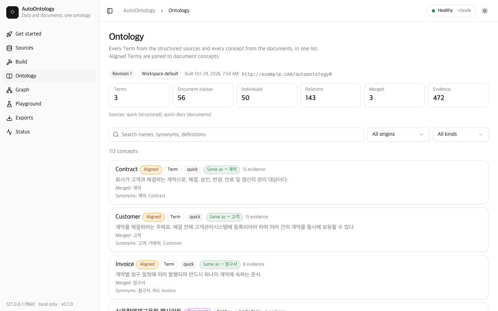
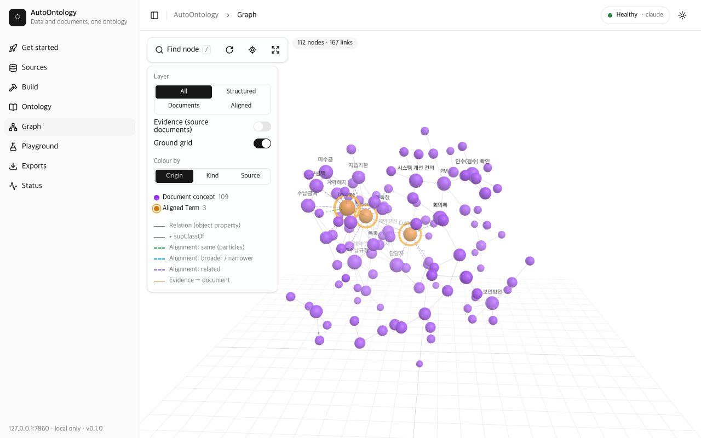
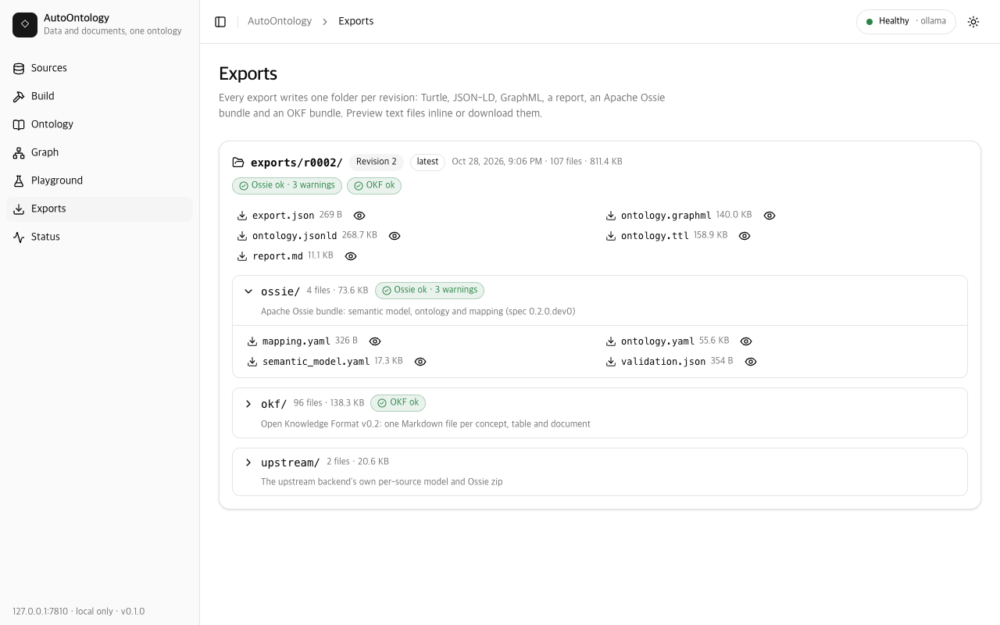

# AutoOntology

[English](README.md) | **한국어**

AutoOntology는 정형 데이터(CSV, TSV, XLSX, XLS, JSON, Parquet, SQLite, 또는 Postgres/MySQL/Snowflake
데이터베이스)와 비정형 문서(Markdown, 텍스트, HTML, CSV/TSV, 구형 Word `.doc`, 그리고 선택 구성요소인
kordoc 엔진을 쓰면 HWP/HWPX/HWPML, PDF, DOCX, PPTX, XLS/XLSX와 스캔 PDF·PNG/JPEG/WebP 이미지의 OCR)를 **하나의 온톨로지**로 만듭니다. 테이블을 비즈니스 Term으로 컴파일하는
[NVIDIA Auto Ontology](https://github.com/NVIDIA/auto-ontology) 위에 만들어졌습니다.
AutoOntology는 여기에 문서 개념 추출을 더하고, 문서 개념을 그 Term들에 정렬(align)한 뒤, 둘을
버전이 매겨진 스냅샷 하나로 병합합니다. 스냅샷은 RDF/OWL(Turtle, JSON-LD), GraphML,
[Apache Ossie](https://github.com/apache/ossie) 번들,
[Open Knowledge Format(OKF)](https://github.com/GoogleCloudPlatform/knowledge-catalog/blob/main/okf/SPEC.md)
번들로 내보냅니다. 모든 것이 Postgres + pgvector와 Ollama, 또는 임의의 OpenAI 호환 엔드포인트로
내 컴퓨터에서 실행됩니다.



## 기능

- **빌드 한 번, 온톨로지 하나.** `autoontology build`는 등록된 모든 소스를 실행합니다. 정형
  소스(load, register, ingest, compile)와 문서 소스(read, chunk, extract, consolidate)를 처리한
  다음 정렬, 병합을 거쳐 리비전 번호가 붙은 스냅샷을 만듭니다.
- **정형 경로**는 NVIDIA Auto Ontology 엔진을 거칩니다. 테이블은 컬럼 속성을 가진 Term이 되고,
  파일에 제약조건이 선언되어 있지 않아도 시맨틱 외래키를 찾아냅니다.
- **문서 경로**는 로컬 LLM을 사용합니다. 개념, 관계, 업무 규칙, 업무 절차를 원문 그대로의 근거
  인용과 함께 추출한 뒤, 청크와 문서를 가로질러 병합합니다.
- **정렬.** 문서 개념은 임베딩 검색과 LLM 판정으로 Term에 매칭되며, 보수적이고 버전이 매겨진
  동일성 정책(`identity-v2.1`)을 따릅니다. `same`으로 수용된 개념은 해당 Term으로 접힙니다(fold).
- 모든 스냅샷을 `exports/r<rev>/`로 **내보내기**: `ontology.ttl`, `ontology.jsonld`,
  `ontology.graphml`, `ossie/`(Ossie JSON 스키마로 검증하고 엔진의 변환기로 라운드트립),
  `okf/`(OKF v0.2 적합성 검증), `report.md`, `upstream/`의 소스별 엔진 자체 내보내기,
  그리고 `export.json` 마커.
- `/ui/`의 **웹 UI**: Sources, Build(실시간 로그), Ontology(origin 배지가 붙은 검색 가능한 개념
  목록), Graph(3D, 2D 대체 화면), Playground, Exports(미리보기와 다운로드), Status.
- **플레이그라운드**: 온톨로지와 대화(인용이 붙은 검색 기반 답변), 정형 소스에 대한 자연어→SQL,
  스냅샷에 대한 읽기 전용 SPARQL 콘솔.
- **모델 제공자**: 기본은 Ollama(`qwen3:8b` + `bge-m3`), 또는 임의의 OpenAI 호환 API(OpenAI,
  NVIDIA build.nvidia.com, vLLM, LM Studio).
- **로컬 전용 설계**: 서비스는 127.0.0.1에 바인딩되고, 다른 호스트나 오리진에서 온 요청은
  거부합니다.

## 아키텍처

```
                 browser (/ui/)                  autoontology CLI
                       |                                |
                       v                                v
  +--------------------------------------------------------------------------+
  | AutoOntology service  127.0.0.1:7800   (FastAPI, autoontology.web)       |
  |   /api  REST + SSE   /api/playground   /ui  React app   /v1 model router |
  |   in-process: build pipeline, SQLite store (data/autoontology.db),       |
  |               exporters (RDF, GraphML, Ossie, OKF), SPARQL (rdflib)      |
  +--------------------------------------------------------------------------+
        | HTTP /api/...         | imports auto_ontology        | /v1/chat/completions
        v                       v  (ingest, compile, vectors)  v
  +-----------------------+   +-----------------------+   +-------------------------+
  | NVIDIA Auto Ontology  |   | Postgres 17+pgvector  |   | Ollama :11434, or an    |
  | backend 127.0.0.1:3101|-->| autoontology (catalog)|   | OpenAI-compatible API   |
  | (vendor/auto-ontology)|   | autoontology_src_<n>  |   | (chat + embeddings)     |
  +-----------------------+   +-----------------------+   +-------------------------+
```

엔진은 수정하지 않은 git 서브모듈입니다. AutoOntology는 연결, 내보내기, NL→SQL은 HTTP로
엔진을 호출하고, ingest, 시맨틱 컴파일, 벡터 테이블은 엔진을 프로세스 안에서 import해 실행합니다.
백엔드와 서비스 모두 채팅 호출을 서비스의 `/v1` 라우터로 보내고, 라우터가 이를 Ollama 또는
설정된 OpenAI 호환 엔드포인트로 전달합니다. 자세한 내용은
[docs/ARCHITECTURE.md](docs/ARCHITECTURE.md)(영문)에 있습니다.

## 빠른 시작

사전 준비:

- Python 3.12와 [uv](https://docs.astral.sh/uv/).
- Docker, **또는** [pgvector](https://github.com/pgvector/pgvector) 확장을 쓸 수 있는 직접
  운영하는 Postgres 17.
- 로컬에서 실행 중인 [Ollama](https://ollama.com). `setup`이 `qwen3:8b`(약 5 GB)와 `bge-m3`를
  받습니다. 호스팅 API를 쓰려면 다음 절을 보세요.
- 선택: kordoc으로 HWP/PDF/DOCX/PPTX 문서를 읽으려면 Node.js 20 이상.

```
git clone --recurse-submodules https://github.com/kimtoma/AutoOntology.git
cd AutoOntology
docker compose up -d            # or point POSTGRES_* in .env at your own Postgres
uv sync
uv run autoontology init        # checks what is installed, writes .env, runs setup
uv run autoontology demo        # builds the quickstart sample set and opens the web UI
```

실행하면 이렇게 됩니다:

- `init`은 번호가 붙은 일곱 단계를 차례로 진행하고 단계마다 상태를 한 줄씩 출력합니다:
  Postgres, 채팅 제공자, 임베딩, 문서, `.env`, `setup`, 요약. 쓸 수 있는 채팅 제공자(로그인된
  `claude`·`codex` CLI, 실행 중인 Ollama)를 감지해 claude, codex, ollama 순서로 준비된 첫
  번째를 제안합니다. `.env`에는 필요한 키만 씁니다(직접 쓴 줄과 주석은 그대로 두고, 기존 파일은
  먼저 `.env.bak-<시각>`으로 복사합니다). API 키는 절대 묻지 않습니다. `openai` 제공자를 쓰려면
  `AUTOONTOLOGY_OPENAI_API_KEY=…`를 `.env`에 직접 입력하세요. `--yes`는 아무것도 묻지 않고
  감지한 기본값으로 진행합니다. `--provider`, `--chat-model`, `--docs/--no-docs`,
  `--vision-model`로 답을 미리 정할 수 있습니다. 여러 번 실행해도 안전합니다.
- `demo`는 서비스를 시작하고, 샘플 세트를 등록하고(`quick`, `quick-docs`; `--set hanbit`이면
  회사 전체 데이터인 `hanbit`, `hanbit-docs`, `hanbit-images`), 채팅 제공자별 첫 빌드 예상
  시간을 보여 준 뒤 빌드(단계별 소요 시간 포함)·내보내기를 하고 웹 UI를 엽니다. 그다음
  **Ontology → Graph → Playground** 순서로 살펴보세요. `demo --resume`은 중단된 빌드를 이어
  가고, `--no-open`은 브라우저를 열지 않습니다.
- `uv run autoontology provider status`는 모든 채팅 제공자(사용 가능 여부, 로그인, 모델, 마지막
  테스트, 해결 방법)를 보여 주고, `provider test`는 테스트 호출을 한 번 하며,
  `provider use claude`는 `.env`의 제공자를 바꿉니다(이후
  `uv run autoontology down && uv run autoontology up`으로 재시작).

<details>
<summary>수동 단계 (init/demo가 하는 일)</summary>

```
cp .env.example .env            # then edit the provider settings
uv run autoontology setup       # add --docs for HWP/PDF/DOCX/PPTX/XLSX and image OCR via kordoc
uv run autoontology up
uv run autoontology source add samples/quickstart/structured --name quick
uv run autoontology source add samples/quickstart/documents --name quick-docs --kind documents
uv run autoontology build
uv run autoontology export
uv run autoontology ui
```

실행하면 이렇게 됩니다:

- `up`은 엔진 백엔드(:3101)와 서비스(:7800)를 둘 다 백그라운드로 시작합니다. `down`은 둘을
  멈추고, `status`는 상태를 보여 줍니다.
- 가장 오래 걸리는 것은 `build`입니다. 로컬 `qwen3:8b`로는 문서 청크 하나에 1~2분이 걸립니다.
  샘플 문서는 kordoc 없이 9개, kordoc을 쓰면 28개 청크가 되므로, Apple Silicon 머신에서 첫
  빌드는 kordoc 없이 대략 20분, kordoc을 쓰면 50분쯤 걸립니다. 이후 빌드는 바뀌지 않은 것을
  모두 재사용합니다.
- 샘플 폴더에는 kordoc이 필요한 파일이 세 개(`.pdf`, `.hwp`, `.docx`) 있습니다. **`--docs`를
  생략했다면 `build`는 이 파일들을 건너뛰고, 파일 이름과 설치 명령을 담은 경고를 출력한 뒤,
  성공(종료 코드 0)으로 끝납니다**:
  `` warning: documents:<source>:read: 3 document(s) need kordoc and were skipped (...): run
  `uv run autoontology tools install-kordoc`, then build again ``. 모든 파일이 kordoc을
  필요로 하는 문서 소스도 같은 경고와 함께 문서 0개로 읽힙니다. 나중에 추가하려면
  `uv run autoontology tools install-kordoc`을 실행한 뒤 `uv run autoontology build`(또는
  `build --resume`)를 실행하세요. kordoc 사용 가능 여부가 문서 소스 지문(fingerprint)에
  포함되므로 문서를 다시 읽습니다.
- `export`는 자신이 쓴 폴더를 출력합니다(예: `exports/r0001/`).
- `ui`는 http://127.0.0.1:7800/ui/ 를 엽니다.

</details>

샘플 데이터는 가상의 한국 무역회사("한빛상사")입니다. 서로 연결된 CSV 파일 세 개(고객, 계약,
청구)와, 계약·청구 규정 문서로 이루어져 있습니다. [samples/README.md](samples/README.md)를
보세요.

### Ollama 대신 OpenAI 호환 API 쓰기

`.env`에 아래 값을 설정합니다. 키는 파일에 직접 입력하세요. 채팅에 붙여 넣거나 커밋하면 안
됩니다. 예시는 NVIDIA의 호스팅 엔드포인트를 쓰며, 모델 id는 자리표시자입니다.

```
AUTOONTOLOGY_CHAT_PROVIDER=openai
AUTOONTOLOGY_OPENAI_BASE_URL=https://integrate.api.nvidia.com/v1
AUTOONTOLOGY_OPENAI_API_KEY=your-api-key-here
AUTOONTOLOGY_OPENAI_CHAT_MODEL=<chat model id from build.nvidia.com>
# keep local embeddings (bge-m3 via Ollama) ...
AUTOONTOLOGY_EMBED_PROVIDER=ollama
# ... or embed through the same endpoint:
# AUTOONTOLOGY_EMBED_PROVIDER=openai
# AUTOONTOLOGY_OPENAI_EMBED_MODEL=<embedding model id>
```

그다음 `uv run autoontology doctor`로 설정을 확인하고 `down` / `up`으로 다시 시작합니다. 두
제공자를 모두 `openai`로 설정하면 `setup`은 Ollama를 완전히 건너뜁니다. 모델 id는 엔드포인트가
아는 이름 그대로 적으세요. 엔진에 필요한 `openai/` 접두사는 AutoOntology가 붙이고 라우터에서
다시 떼어 냅니다. 임베딩 차원은 첫 소스를 ingest한 시점에 고정됩니다(문제 해결 참고).

## CLI 레퍼런스

| 명령 | 하는 일 |
|---|---|
| `autoontology init [--provider ollama\|claude\|codex\|openai] [--chat-model M] [--docs/--no-docs] [--vision-model M] [--yes] [--env PATH]` | 단계별 설정: Postgres 확인(`docker compose up -d` 후 재시도), 채팅 제공자·임베딩·문서 감지와 선택, `.env` 작성(다른 줄은 유지, 기존 파일은 백업), `setup` 실행. `--yes`는 아무것도 묻지 않으며, Postgres가 꺼져 있거나 고른 CLI가 로그인되지 않았으면 해결 방법과 함께 종료 코드 2로 끝납니다. |
| `autoontology demo [--set quickstart\|hanbit] [--no-open] [--resume]` | 서비스 시작, 샘플 세트 소스 등록(이미 등록된 것은 유지, 경로가 다른 소스는 교체), 제공자별 예상 빌드 시간 출력, 단계별 시간과 함께 빌드, 내보내기, 웹 UI 열기. |
| `autoontology provider status` / `test [--provider P]` / `use <ollama\|claude\|codex\|openai> [--chat-model M]` | 모든 채팅 제공자 표시(사용 가능, 로그인, 모델, 마지막 테스트, 해결 방법), 테스트 호출 한 번, 또는 `.env`의 제공자 전환(셸 변수가 파일보다 우선하면 경고). |
| `autoontology setup [--docs] [--skip-models] [--force-alias]` | 멱등 준비 작업: 카탈로그 데이터베이스와 `vector`, `pg_trgm` 확장을 만들고, 마이그레이션을 실행하고, Ollama 모델을 받아 `openai/qwen3:8b` 별칭을 만들며, `--docs`를 주면 kordoc을 설치합니다. |
| `autoontology doctor [--skip-models]` | Postgres, pgvector, 마이그레이션, 모델 엔드포인트, 벡터 테이블, 포트를 점검합니다. |
| `autoontology up` / `down` / `status` | 엔진 백엔드와 서비스를 시작, 중지하거나 상태를 보여 줍니다. |
| `autoontology ui [--no-browser]` | 웹 UI URL을 출력하고 엽니다. |
| `autoontology source add <path\|db-url> --name N [--kind structured\|documents] [--recursive]` | 소스를 등록합니다. 정형 소스는 `autoontology_src_<name>`에 적재됩니다. |
| `autoontology source list` | 소스 목록을 보여 줍니다. |
| `autoontology source rm N [--drop-db] [--force]` | 소스를 제거합니다. `--drop-db`는 그 데이터베이스도 삭제합니다. 문서 소스라면 먼저 그 소스의 정렬이 업스트림 Term에 추가한 동의어를 지웁니다(수동 별칭, 다른 소스의 별칭, 다른 소스의 수락된 `same` 정렬이 여전히 덮는 별칭은 유지). 이 작업에는 엔진 데이터베이스가 필요하며, 실패하면 `--force`를 주지 않는 한 소스를 유지합니다. |
| `autoontology build [--source N ...] [--resume]` | 모든 소스를 스냅샷 하나로 빌드합니다. `--source`는 지정한 소스만 다시 빌드합니다(정렬, 병합, 스냅샷은 여전히 전체를 대상으로 합니다). `--resume`은 최근 빌드를 이어 가며, 입력이 바뀌지 않은 단계는 유지합니다([빌드 이어 가기](#빌드-이어-가기) 참고). |
| `autoontology ontology` | 최신 스냅샷의 리비전, 소스, 개수를 보여 줍니다. |
| `autoontology runs [--limit N]` | 최근 run과 그 단계들을 보여 줍니다. |
| `autoontology export [--revision R] [--format all\|rdf\|ossie\|okf] [--out DIR]` | 스냅샷을 `exports/r<rev>/`(또는 `DIR/r<rev>/`)에 씁니다. |
| `autoontology tools install-kordoc [--version V] [--omit-optional] [--force]` | npm으로 kordoc을 `<home>/kordoc`에 설치합니다. |
| `autoontology tools build-ui` | 웹 UI를 `autoontology/web/static/dist`로 다시 빌드합니다(pnpm 필요). |
| `autoontology tools status` | 사용 중인 kordoc 엔진과 Node 바이너리를 보여 줍니다. |
| `autoontology version` | 버전을 출력합니다. |

run이 부분 실패(partial)하면(예: 문서 하나를 읽지 못했거나 청크 추출이 실패한 경우) `build`는
1로 종료하고 `--resume` 힌트를 출력합니다. 부분 실패한 run도 스냅샷은 저장합니다.
kordoc이 설치되지 않아 건너뛴 문서는 실패가 아니라 경고입니다. run은 성공하고 0으로 종료합니다.

### 빌드 이어 가기

`build --resume`은 입력이 바뀌지 않은 단계만 유지합니다.

- 파일과 문서는 해시합니다. 문서 소스의 지문에는 kordoc 사용 가능 여부도 들어갑니다.
- 데이터베이스 URL 소스의 지문에는 실제 스키마가 들어가며, Postgres는 `information_schema`에서
  읽습니다. 데이터베이스를 읽을 수 없거나 MySQL, Snowflake(드라이버 미포함)라면 그 단계는 항상
  다시 실행됩니다.
- 등록된 소스 집합이 바뀌면 정렬, 병합, 스냅샷도 다시 실행됩니다.
- upstream Term이 바뀌면(이름·설명·동의어·테이블 편집, Term 추가·삭제; 정렬 자신이 쓴 동의어와
  설명은 제외) 정렬을 다시 실행하고, 후보 Term이 바뀐 개념만 다시 판정합니다.

## HTTP API

서비스는 `http://127.0.0.1:7800`에서 대기합니다. JSON 경로는 모두 `/api` 아래에 있습니다. 모든
오류는 `{"error": <code>, "detail": <message>}` 형태입니다.

| 메서드와 경로 | 용도 |
|---|---|
| `GET /api/status` | 버전, 백엔드와 Postgres 상태, Ollama 모델, `kordoc_available`, 제공자 요약(키는 절대 포함하지 않음). |
| `GET /api/samples` | `samples/`의 샘플 세트(`quickstart`, `hanbit`): `[{set, path, sources: [{name, kind, path, files, bytes}], registered}]`. |
| `POST /api/samples/load` | `{"set": "quickstart"}`: 그 세트의 소스를 `autoontology demo`와 똑같이 등록합니다(`action`: `created`, `kept`, `replaced`와 함께 반환). 모르는 세트는 400, run이 진행 중이면 409. |
| `GET /api/sources` | 소스 목록. |
| `POST /api/sources` | 소스 추가: JSON `{name, kind: files\|database\|documents, locator, recursive?}` 또는 multipart 업로드. |
| `DELETE /api/sources/{name}` | 소스 제거(`?drop_db=true`는 데이터베이스도 삭제, `&force=true`는 `source rm --force`처럼 엔진의 그래프 삭제나 별칭 정리가 실패하거나 끝나지 않아도 로컬에서 제거). 문서 소스는 `source rm`과 마찬가지로 먼저 업스트림 Term에서 그 소스가 추가한 별칭을 지웁니다. |
| `POST /api/runs` | run 시작: `{kind: "build", sources?, resume?}` 또는 `{kind: "export", revision?, format?}`. |
| `GET /api/runs`, `GET /api/runs/{id}` | run 목록, 그리고 단계가 포함된 run 하나. |
| `GET /api/runs/{id}/events` | 서버 전송 이벤트(SSE): run의 실시간 로그와 단계 갱신. |
| `POST /api/runs/{id}/cancel` | run 취소. |
| `GET /api/ontology[?revision=]` | 스냅샷 헤더: 리비전, 워크스페이스, base IRI, 소스, 개수(첫 빌드 전에는 404 `no_snapshot`). |
| `GET /api/ontology/graph?layer=all\|structured\|documents\|aligned&evidence=&revision=` | 통합 그래프. 모든 노드에 `origin`이 있습니다. |
| `GET /api/ontology/concepts?q=&kind=&origin=&source=&page=&size=&revision=` | Term과 문서 개념을 한 목록으로 페이지 단위 제공. |
| `GET /api/ontology/concepts/{term-…\|concept-…}[?revision=]` | 개념 하나: 정의, 동의어, 컬럼, 정렬, 관계, 근거. |
| `GET /api/exports` | 내보내기 폴더와 파일 목록. |
| `GET /api/exports/{rev}/{path}` | 내보낸 파일 하나(`?inline=true`는 미리보기). |
| `POST /api/playground/chat` | 온톨로지와 대화(SSE, 인용 포함). |
| `GET /api/playground/conversations[/{id}]`, `DELETE …/{id}` | 저장된 대화. |
| `GET` / `POST /api/playground/index` | 검색 인덱스 상태 조회와 재구축. |
| `POST /api/playground/sql` | 엔진을 통한 자연어→SQL(SSE): `{question, source?}`. |
| `GET /api/playground/sparql/examples` | 예시 쿼리. |
| `POST /api/playground/sparql` | `{query, limit?}`로 스냅샷에 읽기 전용 SPARQL 쿼리를 실행합니다. |
| `POST /v1/chat/completions`, `GET /v1/models` | 엔진이 쓰는 모델 라우터. 클라이언트용이 아닙니다. |
| `POST /ingest`, `POST /ingest/delete?database_name=` | 내부용: 연결이 등록되거나 삭제될 때 엔진이 호출하는 콜백. ingest나 그래프 삭제를 큐에 넣습니다. 클라이언트용이 아닙니다. |
| `GET /health/live`, `GET /health` | 생존 확인과 준비 상태 확인. |

## 내보내기 형식

`autoontology export`는 아래 파일을 모두 `exports/r<rev:04d>/`에 쓰고, 함께 `export.json`을
씁니다. `export.json`은 워크스페이스, 리비전, 각 형식을 어느 내보내기 run이 썼는지, 그리고
내보내기가 쓴 모든 파일의 `files` 목록을 기록하는 마커입니다.

| 파일 | 형식 | 내용 |
|---|---|---|
| `ontology.ttl` | [RDF 1.1 Turtle](https://www.w3.org/TR/turtle/) | Term과 문서 개념의 OWL 클래스, 객체·데이터타입 속성, 개체(규칙, 절차), `rdfs:subClassOf`와 `skos:related` 공리, `skos:altLabel` 동의어, 인용이 담긴 근거 노드. 모두 `ao:` 네임스페이스(`AUTOONTOLOGY_BASE_IRI`) 아래에 있습니다. 파싱 라운드트립으로 검사합니다. |
| `ontology.jsonld` | [JSON-LD 1.1](https://www.w3.org/TR/json-ld11/) | 같은 그래프의 JSON-LD 표현. |
| `ontology.graphml` | [GraphML](http://graphml.graphdrawing.org/specification.html) | 문자열 속성을 가진 노드와 엣지. Gephi, yEd, networkx용. 엣지 id는 `e0`, `e1`, ...이며 파일 전체에서 고유합니다. |
| `ossie/semantic_model.yaml`, `ossie/ontology.yaml`, `ossie/mapping.yaml` | [Apache Ossie](https://github.com/apache/ossie) spec 0.2.0.dev0 | 정형 소스들의 데이터셋을 하나로 병합한 시맨틱 모델, 통합 온톨로지(Term과 문서 개념은 `EntityType`, 컬럼·문서 관계는 verbalization 포함, 하위 클래스 공리는 `extends`), 데이터셋이 키를 선언한 Term의 object mapping. `validation.json`에는 JSON 스키마 결과, 구조 검사, 엔진 Ossie 변환기를 통한 라운드트립 결과가 담깁니다. |
| `okf/` | [OKF v0.2](https://github.com/GoogleCloudPlatform/knowledge-catalog/blob/main/okf/SPEC.md) | YAML frontmatter가 붙은 마크다운 번들: `index.md`, `log.md`, `concepts/*.md`(type `Business Concept`), `tables/<source>.<table>.md`(type `Table`), `documents/*.md`(type `Document`). 관계는 번들 링크로, 근거는 각주로 표현합니다. `validation.json`에 적합성 보고서가 담깁니다. |
| `report.md` | Markdown | 사람이 읽는 요약: 개수, 소스, 병합된 개념, 그리고 sha256이 붙은 모든 파일. |
| `upstream/<source>.model.yaml`, `upstream/<source>.ossie.zip` | 엔진 고유 형식 | 정형 소스별 엔진 자체 내보내기. 내보내기 시점에 받아 옵니다. |
| `export.json` | JSON | 마커: 워크스페이스, 리비전, 각 형식을 쓴 내보내기 run, 내보내기가 쓴 모든 파일의 목록 `files`, 그리고 파일별 해시 `file_sha256`. |

옵션:

- `--format rdf|ossie|okf`는 그 형식만 다시 쓰고(`rdf`는 ttl, jsonld, graphml, `upstream/`),
  나머지 형식의 파일은 같은 리비전의 직전 내보내기에서 유지합니다.
- `--out DIR`은 `DIR/r<rev>/`에 씁니다.

리비전을 다시 내보낼 때는 그 폴더의 모든 파일이(`okf/`, `ossie/`, `upstream/` 안까지) `export.json`의
`files` 목록에 있고 기록된 내용(`file_sha256`)과 같을 때만 폴더를 교체합니다. `--out`뿐 아니라 `exports/` 아래에서도 같습니다.
다른 파일이 있거나, `export.json`이 없거나, `export.json`에 `files` 목록이 없는(목록이 생기기
전의 내보내기) 폴더는 거부하며 아무것도 지우지 않습니다. 교체하는 동안 이전 폴더는
`r<NNNN>.prev-<timestamp>-<run>`으로 이름이 바뀌고 새 폴더가 자리 잡은 뒤 삭제됩니다. 내보내기
run은 그다음에야 `succeeded`가 됩니다(지우지 못한 백업은 경고와 함께 남습니다). 두 이름 변경 사이에서
중단된 내보내기는 서비스가 시작될 때, 또는 다음 내보내기가 `.prev-*` 백업에서 복원합니다.

## 통합 온톨로지가 만들어지는 방식

1. **Term(정형).** 정형 소스는 각자 자신의 Postgres 데이터베이스에 적재됩니다. 엔진이 카탈로그를
   ingest하고 시맨틱 레이어를 컴파일합니다. 시맨틱 레이어는 설명, 컬럼 속성, Term 간 시맨틱
   외래키를 가진 비즈니스 Term들입니다.
2. **문서 개념.** 문서를 읽고(기본 리더 또는 kordoc), 섹션을 고려한 청크로 나눈 뒤, 채팅 모델에
   보냅니다. 모델은 개념(entity, attribute, metric, process, rule, other), 유형이 있는 관계,
   원문 그대로의 근거를 추출합니다. 통합(consolidate) 단계는 임베딩 유사도와 LLM 병합 판정으로
   청크와 문서를 가로지르는 중복을 병합합니다.
3. **정렬.** 정렬 대상 문서 개념(entity, metric, attribute)마다 임베딩 코사인으로 상위 5개 Term을
   찾습니다(하한 `AUTOONTOLOGY_ALIGN_MIN_SIM`). LLM 판정자는 `same`, `broader`, `narrower`,
   `related`, `none` 중 하나를 신뢰도, 근거와 함께 반환하며, 판정은 fail-closed로 검증됩니다.
4. **동일성 정책 `identity-v2.1`.** `same` 판정은 신뢰도가 max(`AUTOONTOLOGY_ALIGN_MIN_CONF`,
   0.90) 이상이고, **동시에** 개념의 별칭(이름, 영문 이름, 동의어) 하나가 통째로 Term의 신뢰할 수
   있는 별칭과 정확히 일치할 때만 수용됩니다. 별칭은 NFKC 정규화, 대소문자 접기, 공백 제거 후
   비교합니다. 3자보다 긴 라틴 문자 별칭은 영어 단수형으로도 일치합니다(`Contracts` = `Contract`,
   `categories` = `category`; `-ss`, `-us`, `-is`로 끝나는 단어는 그대로 둡니다). 서로 다른 단어인
   쌍은 금지 목록이 갈라놓습니다: goods/good, customs/custom, news/new, arms/arm, glasses/glass,
   means/mean. 금지 목록은 별칭 전체와, 여러 단어 별칭의 마지막 단어에 적용됩니다(`Trade Goods`는
   `Trade Good`이 아닙니다). 부분 문자열은 절대 인정하지 않습니다. 그 밖의 `same`은 `related`로
   낮추고 검토 제안으로 남깁니다.
5. **병합.** 수용된 `same`은 개념을 해당 Term으로 **접습니다**. 개념의 이름들은 Term의
   동의어(`skos:altLabel`)가 되고, 문서 정의와 근거가 Term에 붙습니다. `broader` 판정은 개념을
   Term의 하위 클래스로 만들고(개념이 Term을 extends), `narrower` 판정은 Term을 개념의 하위
   클래스로 만들며(Term이 개념을 extends), `related`는 `related_to`(`skos:related`) 링크가
   됩니다. 나머지 entity, metric, attribute 개념은 각자 클래스가 되고, 규칙과 절차는
   `ao:BusinessRule`과 `ao:Process`의 개체가 됩니다. 모든 노드에는 origin이 붙습니다:
   `document`, `structured`(문서가 건드리지 않은 Term), `aligned`(접힌 개념이 있거나 수용된 정렬
   공리가 있는 Term).
6. **스냅샷.** 병합된 모델은 새 리비전과 함께 `ontology_snapshots`에 JSON으로 저장됩니다. UI,
   플레이그라운드, 모든 내보내기는 스냅샷을 읽으며, 읽을 때 아무것도 다시 빌드하지 않습니다.

샘플에서는 판정자가 계약 → Contracts, 고객 → Customers, 청구서 → Invoices를 수용하므로, Term
세 개가 모두 `aligned`로 표시됩니다.

## 플레이그라운드

- **Chat**은 최신 스냅샷에 대한 질문에 답합니다. 가장 관련 있는 요소(Term, 개념, 규칙, 관계,
  근거)를 찾아 인용하며, 인용을 누르면 Ontology 페이지나 그래프에서 그 개념이 열립니다. 시스템
  프롬프트는 샘플 데이터처럼 한국어로 답합니다. 대화는 워크스페이스별로 저장됩니다.
- **SQL**은 엔진의 NL→SQL 에이전트로 질문을 SQL로 바꾸고, 정형 소스에서 실행해 표로 보여 줍니다.
- **SPARQL**은 스냅샷의 Turtle을 대상으로 rdflib로 최대 두 개의 워커 프로세스(spawn
  컨텍스트)에서 읽기 전용 쿼리를 실행합니다. 제한은 쿼리당 10초, 500행, 동시 쿼리 2개입니다.
  기한을 넘기면 워커를 종료하고 408로 응답하므로, 그래프를 읽지 않는 쿼리도 멈춥니다. 상주
  메모리가 1024 MB를 넘은 워커는 종료되고, 쿼리는 413 `sparql_memory_limit`으로 응답합니다. `SERVICE`, `FROM`, `LOAD`는 거부합니다. 예:

  ```bash
  curl -s http://127.0.0.1:7800/api/playground/sparql -H 'content-type: application/json' \
    -d '{"query": "SELECT ?class ?label WHERE { ?class a owl:Class ; rdfs:label ?label } LIMIT 5"}'
  ```

## 설정

`.env.example`을 `.env`로 복사합니다. 모든 값에는 기본값이 있습니다. 우선순위는 셸 환경, `.env`,
내장 기본값 순입니다.

| 변수 | 기본값 | 의미 |
|---|---|---|
| `AUTOONTOLOGY_HOME` | `<repo>/data` | 데이터 디렉터리: SQLite 저장소, 로그, PID 파일, kordoc, 업로드. |
| `AUTOONTOLOGY_EXPORTS_DIR` | `<repo>/exports` | 내보내기 루트(리비전마다 `r<rev>/` 폴더 하나). |
| `AUTOONTOLOGY_ENV_FILE` | `<repo>/.env` | 읽을 `.env`(셸에서 설정). |
| `AUTOONTOLOGY_WORKSPACE` | `default` | 이 홈이 빌드하는 온톨로지 하나의 이름. |
| `AUTOONTOLOGY_BASE_IRI` | `http://example.com/autoontology#` | 발급하는 모든 IRI의 네임스페이스(접두사 `ao:`). |
| `AUTOONTOLOGY_PORT` | `7800` | 서비스 포트(UI, `/api`, `/v1`). |
| `BACKEND_PORT` | `3101` | 엔진 백엔드 포트. |
| `INGESTION_SERVICE_URL` | 자동 계산 | 항상 `AUTOONTOLOGY_PORT`에서 계산되며, 직접 설정한 값은 덮어씁니다. |
| `APP_URL` | 설정 안 됨 | 엔진 자체 웹 프런트엔드만 읽는 값이며, AutoOntology는 그 프런트엔드를 실행하지 않습니다. |
| `AUTOONTOLOGY_UPLOAD_MAX_MB` | `200` | 웹 UI 요청당 업로드 한도. |
| `AUTOONTOLOGY_GRAPH_MAX_NODES` | `1500` | 그래프 뷰가 받는 최대 노드 수(연결이 많은 노드를 남깁니다). |
| `AUTOONTOLOGY_DEBUG` | `0` | `1`이면 예상하지 못한 CLI 오류의 전체 트레이스백을 출력합니다. |
| `AUTOONTOLOGY_LOCK_TIMEOUT_S` | `300` | 벡터 테이블 설정을 감싸는 Postgres advisory lock의 최대 대기 시간. |
| `AUTOONTOLOGY_STORE_LOCK_TIMEOUT_S` | `120` | SQLite 저장소 잠금의 최대 총 대기 시간. |
| `POSTGRES_HOST` / `POSTGRES_PORT` | `localhost` / `5432` | Postgres 서버. |
| `POSTGRES_USER` / `POSTGRES_PASSWORD` | `autoontology` / `autoontology` | Postgres 자격 증명. 이 사용자에게 데이터베이스 생성 권한이 있어야 합니다. |
| `POSTGRES_DATABASE` | `autoontology` | 카탈로그 데이터베이스. 소스 데이터베이스 이름은 `autoontology_src_<source>`이며, AutoOntology는 다른 이름을 모두 거부합니다. 카탈로그 이름은 `autoontology_src_`로 시작할 수 없으며(소스 데이터베이스용으로 예약), 그런 값은 설정을 읽을 때 거부됩니다. |
| `AUTOONTOLOGY_CHAT_PROVIDER` | `ollama` | `ollama` 또는 `openai`(임의의 OpenAI 호환 엔드포인트). |
| `AUTOONTOLOGY_EMBED_PROVIDER` | `ollama` | `ollama` 또는 `openai`. |
| `AUTOONTOLOGY_OLLAMA_ENDPOINT` | `http://localhost:11434/v1` | Ollama의 OpenAI 호환 엔드포인트. |
| `AUTOONTOLOGY_OLLAMA_CHAT_MODEL` | `openai/qwen3:8b` | 채팅 모델: `setup`이 만드는 `qwen3:8b`의 별칭(`num_ctx` 16384, thinking 끔). `openai/` 접두사는 별칭 이름의 일부입니다. |
| `AUTOONTOLOGY_OLLAMA_EMBED_MODEL` | `bge-m3` | 임베딩 모델(1024차원). |
| `AUTOONTOLOGY_OLLAMA_NO_THINK` | `1` | 라우터가 `reasoning_effort: none`을 추가해 Ollama가 JSON 스키마를 강제하게 합니다. |
| `AUTOONTOLOGY_OPENAI_BASE_URL` | 설정 안 됨 | `/v1`을 포함한 기본 URL. |
| `AUTOONTOLOGY_OPENAI_API_KEY` | 설정 안 됨 | API 키(모든 곳에서 마스킹). |
| `AUTOONTOLOGY_OPENAI_CHAT_MODEL` | 설정 안 됨 | 엔드포인트가 아는 채팅 모델 id. |
| `AUTOONTOLOGY_OPENAI_EMBED_MODEL` | 설정 안 됨 | 임베딩 모델 id(`AUTOONTOLOGY_EMBED_PROVIDER=openai`일 때). |
| `AUTOONTOLOGY_OPENAI_TIMEOUT_S` | `180` | 라우터 openai 패스스루의 요청 전체 타임아웃. |
| `LLM_INVOKE_TIMEOUT_S` / `LLM_MAX_INFLIGHT` / `SEMANTIC_LLM_MAX_INFLIGHT` | `180` / `2` / `1` | 엔진 LLM 한도. ollama 채팅 제공자일 때 직접 설정하지 않으면 적용됩니다. |
| `KORDOC_CLI` | 설정 안 됨 | 다른 kordoc 설치 사용(`dist/cli.js` 경로). |
| `KORDOC_NODE` | PATH의 `node` | kordoc용 Node 바이너리. |
| `AUTOONTOLOGY_KORDOC_TIMEOUT` | `300` | 문서당 초(kordoc은 항상 오프라인으로 실행). |
| `AUTOONTOLOGY_CHUNK_TOKENS` / `_CHUNK_OVERLAP_TOKENS` / `_CHUNK_PACK_TOKENS` | `1200` / `100` / `400` | 청크 크기, 섹션을 나눌 때의 겹침, 작은 이웃 섹션을 묶는 한도(tiktoken `cl100k_base` 토큰). |
| `AUTOONTOLOGY_LLM_WORKERS` | ollama면 `1`, 그 외 `3` | 병렬 청크 추출 호출 수. |
| `AUTOONTOLOGY_EXTRACT_MODE` | `auto` | 추출 출력 방식: `auto`, `structured`, `json`. |
| `AUTOONTOLOGY_MERGE_THRESHOLD` | `0.80` | 두 개념을 병합 판정에 보내는 임베딩 코사인 기준. |
| `AUTOONTOLOGY_MERGE_MAX_JUDGE` | `100` | 통합 한 번당 최대 병합 판정 호출 수. |
| `AUTOONTOLOGY_ALIGN_MIN_SIM` | `0.55` | 후보 Term 코사인 하한. |
| `AUTOONTOLOGY_ALIGN_MIN_CONF` | `0.7` | 판정을 적용하는 데 필요한 신뢰도(`same`은 0.90도 필요, 위 참고). |
| `AUTOONTOLOGY_ALIGN_ALLOW_METRIC_SAME` | `0` | `1`이면 metric 개념도 Term과 `same`으로 판정될 수 있습니다. |
| `AUTOONTOLOGY_INTEGRATION` | `0` | `1`이면 통합 테스트를 실행합니다(실제 Postgres와 Ollama, 셸에서 설정). |

엔진 자체의 모델 변수(`DEFAULT_MODELS_*`, `REASONING_*`, `NON_REASONING_*`, `EMBED_*`,
`RERANK_*`)는 제공자 설정에서 계산됩니다. 직접 설정한 값은 덮어씁니다.

## 한계

- **Postgres가 필요합니다.** 엔진은 카탈로그와 벡터를 pgvector가 있는 Postgres에 보관하며,
  SQLite만으로 동작하는 모드는 없습니다.
- **작은 로컬 모델은 보수적으로 병합합니다.** `qwen3:8b`로는 추출이 느리고(청크당 1~2분),
  동일성 정책은 잘못된 `same`보다 `related`를 의도적으로 선호합니다. 접히는 개념이 많기보다는
  검토 제안이 많을 것으로 예상하세요.
- **OCR은 렌더링한 페이지로만 검증했습니다.** kordoc 내장 OCR(PP-OCRv5 korean)은 HWP 픽스처의
  한 페이지를 PNG로 렌더링한 이미지로 통합 테스트하고, 같은 페이지를 이미지만 담은 PDF로도 수동
  확인했습니다. 사진, 기울거나 저해상도인 스캔, 손글씨는 테스트하지 않았습니다. OCR 모델(약 18 MB)은
  `uv run autoontology tools install-kordoc`가 내려받습니다.
- **구형 `.doc`는 텍스트만 읽습니다.** 이미지, 텍스트 상자, 머리글·바닥글, 각주는 읽지 않으며, 빈
  표 셀이 있으면 표의 한 행이 둘로 나뉠 수 있습니다.
- **Ossie와 OKF는 1.0 이전 규격**(Ossie 0.2.0.dev0, OKF v0.2)이라 바뀔 수 있습니다. 벤더링한
  스키마는 `third_party/ossie/`에 고정되어 있습니다.
- **매핑에는 키가 필요합니다.** Ossie object/link mapping은 업스트림 시맨틱 모델이 키를 선언한
  데이터셋에만 작성됩니다. 샘플에서는 `customers`만 키를 선언합니다.
- **스냅샷은 정리되지 않습니다.** 빌드가 성공할 때마다 전체 모델 JSON을 가진 리비전이 하나씩
  추가됩니다.
- **`build --resume`이 데이터베이스 스키마를 항상 볼 수는 없습니다.** Postgres 소스는 실제
  스키마를 읽지만, MySQL·Snowflake 소스나 연결할 수 없는 데이터베이스는 재사용하지 않고 매번 단계를
  다시 실행합니다.
- **`files` 목록이나 `file_sha256` 이전의 내보내기 폴더는 다시 내보내기를 거부합니다.** `export.json`이
  파일 목록과 해시를 기록하기 전에 쓴 `exports/rNNNN/`(또는 `--out`) 폴더는 교체할 수 없습니다. 한 번
  옮기거나 삭제한 뒤 다시 내보내세요.
- **내보내기 폴더 안의 다른 파일은 다시 내보내기를 막습니다**(의도된 동작). 내보내기가 쓰지 않은
  파일을 `exports/rNNNN/`에 두면 그 리비전의 다음 내보내기는 파일을 지우는 대신 거부합니다. 메모는
  리비전 폴더 밖에 두세요.
- **SPARQL은 Unix 호스트가 필요합니다.** 워커 메모리 제한이 Python `resource` 모듈을 쓰므로, 이 모듈이 없는 곳(Windows)에서는 쿼리가 501 `sparql_unsupported`로 응답합니다.
- **SPARQL은 메모리와 콜드 스타트 비용이 있습니다.** 서비스와 워커가 각각 그래프를 파싱하므로
  메모리는 파싱된 그래프의 약 두 배입니다. 타임아웃 뒤 첫 쿼리는 프로세스 시작 한 번과 Turtle 파싱
  한 번의 비용을 치릅니다.
- **완료된 run에는 실행된 단계만 나열됩니다.** 도달하지 못한 단계는 대기(pending)로 나타나지
  않습니다.
- **정식 공개 이전 홈을 업그레이드할 때:** 저장소 마이그레이션 v2는 이전 플레이그라운드 대화를
  삭제하고, 업그레이드 후 첫 `build --resume`은 모든 소스를 한 번 다시 빌드합니다. 저장소 스키마
  v3 이전에 기록된 별칭 레코드에는 소스가 없으므로, `source rm`은 그 레코드가 추가한 동의어를
  지우지 않습니다. 필요하면 엔진에서 직접 지우세요.
- 이름은 원래 언어로 유지됩니다. 한국어 개념 이름은 Ossie 식별자와 OKF 파일 이름에 그대로
  남습니다.

## 보안 참고

- 서비스와 엔진 백엔드는 `127.0.0.1`에 바인딩됩니다. 로컬이 아닌 `Host`나 교차 사이트
  `Origin`을 가진 요청은 거부합니다. **인증은 없습니다.** 두 포트 모두 외부에 노출하지 말고,
  공개 프록시 뒤에 두지 마세요.
- 문서 텍스트는 신뢰하지 않는 입력으로 다룹니다. 구분된 프롬프트 블록 안에 인용하고, 모델 출력은
  스키마로 검증하며(fail-closed), OKF 번들은 추출한 텍스트의 마크다운과 HTML을 이스케이프합니다.
  `.md` 파일을 다른 곳에서 HTML로 렌더링한다면 직접 정화(sanitize)하세요.
- SPARQL 콘솔은 읽기 전용이며 `SERVICE`, `FROM`, `LOAD`를 거부합니다.
- API 키는 로그, 상태 응답, 업스트림에서 전달되는 오류 본문에서 마스킹됩니다.
- 데이터베이스 이름은 `autoontology`와 `autoontology_src_*`로 제한되므로, 공유 Postgres 서버의
  다른 데이터베이스는 절대 건드리지 않습니다.
- `docker-compose.yml`은 Postgres를 `127.0.0.1`에만 게시하며, 기본 자격 증명
  (`autoontology` / `autoontology`)은 로컬 사용용입니다. 바꾸려면 처음 `docker compose up -d`를
  실행하기 전에 `.env`의 `POSTGRES_USER`와 `POSTGRES_PASSWORD`를 설정하세요(Compose도 같은
  `.env`를 읽습니다). 비밀번호는 데이터 볼륨이 처음 만들어질 때 고정됩니다. 기존 볼륨이라면
  `psql`에서 `ALTER USER ... PASSWORD ...`를 실행하거나, `docker compose down -v`로 볼륨을 다시
  만드세요(데이터가 삭제됩니다).

취약점 신고 방법은 [SECURITY.md](SECURITY.md)를 보세요.

## 문제 해결

| 증상 | 해결 |
|---|---|
| `up`이 포트가 사용 중이라고 함 | `.env`에서 `AUTOONTOLOGY_PORT`와/또는 `BACKEND_PORT`를 바꾸고(예: 7820과 3121) `up`을 다시 실행합니다. |
| `docker compose up -d`가 5432 포트에서 실패 | 로컬 Postgres가 이미 그 포트를 쓰고 있습니다. `docker compose up -d` 전에 `.env`에 `POSTGRES_PORT=5433`을 설정하거나, 그 Postgres를 직접 사용하세요. |
| `setup`: `extension "vector" is not available` | 사용하는 Postgres에 pgvector를 설치하거나(`brew install pgvector`, 또는 `postgresql-17-pgvector` 패키지), pgvector가 포함된 `docker compose`를 사용하세요. |
| `setup`: 데이터베이스 생성 권한 없음 | 사용자에게 `CREATEDB` 권한을 주거나, `autoontology` 데이터베이스를 직접 만드세요. |
| 채팅 모델 `openai/qwen3:8b`를 찾을 수 없음 | `uv run autoontology setup`(또는 `setup --force-alias`)을 실행하세요. `openai/` 접두사는 Ollama 별칭 이름의 일부이며, `ollama list`에 보여야 합니다. |
| `doctor`의 "vector tables" FAIL: 임베더가 N차원을 출력 | ingest 후에 임베딩 모델을 바꿨습니다. 이전 `*_EMBED_MODEL`로 되돌리거나, 벡터 테이블이 비도록 모든 소스를 제거(`source rm`)하세요. 빈 테이블은 자동으로 다시 만들어집니다. |
| `build`가 "N document(s) need kordoc and were skipped" 경고 | run은 그 문서 없이 성공했습니다. kordoc을 설치하고(`uv run autoontology tools install-kordoc`, Node 20 이상) `build` 또는 `build --resume`으로 읽으세요. |
| `/ui/`가 503 `ui_not_built`를 반환 | 커밋된 UI가 없습니다(예: 소스 아카이브). `uv run autoontology tools build-ui`를 실행하세요(Node와 pnpm 필요). |
| 빌드가 멈춘 것 같음 | `uv run autoontology runs`를 실행하고 `data/logs/`를 읽어 보세요. `qwen3:8b`로는 청크 하나에 1~2분이 걸립니다. |

## 개발

```bash
uv run ruff check . && uv run ruff format --check . && uv run pytest -q   # unit tests
AUTOONTOLOGY_INTEGRATION=1 uv run pytest -m integration                    # real PG + Ollama
cd ui && pnpm install && pnpm lint && pnpm test && pnpm build
```

[CONTRIBUTING.md](CONTRIBUTING.md)(영문)를 보세요.




## 크레딧과 라이선스

AutoOntology 자체 코드는 [MIT 라이선스](LICENSE)로 배포합니다. Copyright (c) 2026 kimtoma.

AutoOntology는 **NVIDIA Auto Ontology**(Apache-2.0) 위에 만들어졌으며, 이를 수정하지 않은 git
서브모듈로 포함합니다. **Apache Ossie** JSON 스키마(Apache-2.0)를 벤더링하고, 복사하지 않고
참조만 하는 **Open Knowledge Format** 규격(Apache-2.0)을 따릅니다. **kordoc**(MIT, 실행 시
설치하며 재배포하지 않음), **shadcn/ui** 컴포넌트(MIT), **rhwp**의 샘플 HWP 파일(MIT)을
사용합니다. AutoOntology는 독립 프로젝트이며 NVIDIA, Apache 소프트웨어 재단, Google과 제휴하거나
그들의 보증을 받지 않았습니다. [NOTICE.md](NOTICE.md)와
[THIRD_PARTY_NOTICES.md](THIRD_PARTY_NOTICES.md)를 보세요.
