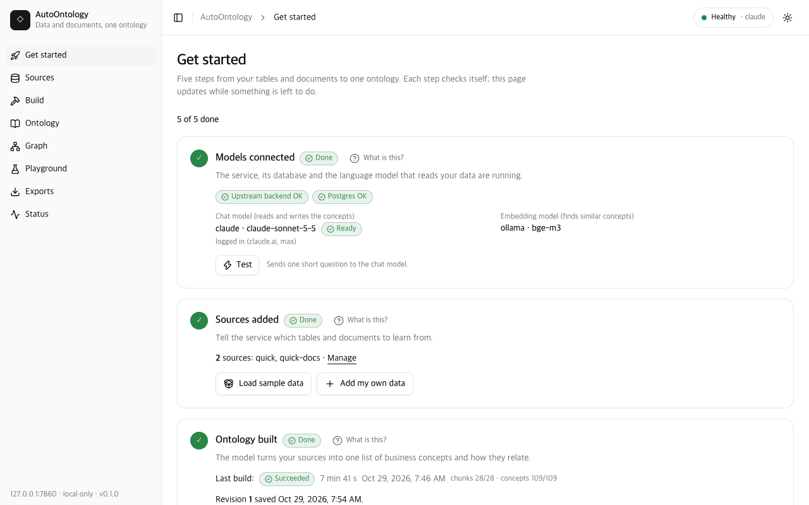

# AutoOntology

**English** | [한국어](README.ko.md)

AutoOntology builds **one ontology** from your tables and your documents together. Point it
at spreadsheets, database exports or a Postgres database, and at the policies, manuals,
minutes, slide decks and scans that explain them (HWP/HWPX, PDF, Word, PowerPoint, Excel,
Markdown, HTML, images through OCR). It finds the business concepts in both, matches the
document concepts to the tables' Terms, and saves one versioned snapshot you can browse,
query and export as RDF/OWL, GraphML, [Apache Ossie](https://github.com/apache/ossie) and
[Open Knowledge Format (OKF)](https://github.com/GoogleCloudPlatform/knowledge-catalog/blob/main/okf/SPEC.md).
It is built on [NVIDIA Auto Ontology](https://github.com/NVIDIA/auto-ontology), which
compiles tables into business Terms, and runs on your machine with Postgres + pgvector and
a model of your choice: local Ollama, your Claude or ChatGPT subscription, or any
OpenAI-compatible API.

**New here? Read the [step-by-step guide](docs/GUIDE.md)** ([한국어](docs/GUIDE.ko.md)). It is
written for domain experts with no data-engineering background: words explained, a
checklist, the 10-minute path, how to prepare your own files, and a troubleshooting table.

For owners sharing an existing sample workspace, see the [password-protected Cloudflare
demo deployment](deploy/cloudflare/README.md). The app stays on its original server;
visitors can explore and query samples without installing it. Administration stays private.



## Quickstart

```
git clone --recurse-submodules https://github.com/kimtoma/AutoOntology.git && cd AutoOntology
docker compose up -d            # or point POSTGRES_* in .env at your own Postgres 17 + pgvector
uv sync
uv run autoontology init        # checks what is installed, picks a model, writes .env, runs setup
uv run autoontology demo        # builds the quickstart sample set, exports it and opens the web UI
```

You need Python 3.12 with [uv](https://docs.astral.sh/uv/), Docker or your own Postgres 17
with [pgvector](https://github.com/pgvector/pgvector), [Ollama](https://ollama.com) (for
embeddings, and for chat unless you use a subscription or an API) and, for HWP/PDF/Office
documents and images, Node.js 20 or newer. The [guide](docs/GUIDE.md#3-before-you-start)
has a checklist with "how to check" commands.

- `init` goes through seven numbered steps (Postgres, chat provider, embeddings,
  documents, `.env`, `setup`, summary). It detects which chat providers you can use and
  suggests the first ready one (claude, codex, ollama). It writes only the keys it needs
  into `.env` and backs up an existing file to `.env.bak-<timestamp>`. It never asks for an
  API key. `--yes` takes the detected defaults; `--provider`, `--chat-model`,
  `--docs/--no-docs` and `--vision-model` preset the answers. Running it again is safe and
  keeps the provider already in `.env`.
- `demo` starts the services, registers the sample set (`quick`, `quick-docs`; with
  `--set hanbit`: `hanbit`, `hanbit-docs`, `hanbit-images`), prints the expected build
  time per provider, builds with the time of every step, exports and opens the web UI.
  `--resume` continues an interrupted build, `--replace` replaces sources of the same name
  that hold other data, and `--no-open` keeps the browser closed. Then look at
  **Ontology → Graph → Playground**.

<details>
<summary>Manual steps (what init/demo do)</summary>

```
cp .env.example .env            # then edit the provider settings
uv run autoontology setup       # add --docs for HWP/PDF/DOCX/PPTX/XLSX and image OCR via kordoc
uv run autoontology up
uv run autoontology source add samples/quickstart/structured --name quick
uv run autoontology source add samples/quickstart/documents --name quick-docs --kind documents
uv run autoontology build
uv run autoontology export
uv run autoontology ui
```

- `up` starts the engine backend on :3101 and the service on :7800, both in the
  background. `down` stops them, and `status` shows them.
- Without kordoc (`setup` without `--docs`), `build` skips the `.pdf`, `.hwp` and `.docx`
  sample documents, prints a warning naming them and the install command, and still
  succeeds (exit 0). kordoc's availability is part of the documents source's fingerprint,
  so after `uv run autoontology tools install-kordoc` the next `build` (or
  `build --resume`) reads them.
- `export` prints the folder it wrote, for example `exports/r0001/`; `ui` opens
  http://127.0.0.1:7800/ui/.

</details>

### Language

The web UI speaks English and Korean: pick one with the globe menu in the header (or open
`/ui/?lang=ko`). The choice is remembered in the browser; without one the UI follows the
browser language. The onboarding commands (`init`, `demo`, `provider`, `setup`, `doctor`)
print Korean when `AUTOONTOLOGY_LANG=ko` is set (shell or `.env`) or the locale (`LANG`,
`LC_ALL`) is Korean; `AUTOONTOLOGY_LANG=en` forces English. Commands and error codes stay
the same in both languages.

## Start with one prompt

With [Claude Code](https://docs.claude.com/en/docs/claude-code/overview) you can skip
the commands above: paste one prompt and Claude clones the repository, checks the
prerequisites, installs everything, configures the Claude provider (your own Claude login,
no API key), builds the quickstart sample set and gives you the UI URL. Behind the prompt
is [`scripts/bootstrap.sh`](scripts/bootstrap.sh); the repository's
[`CLAUDE.md`](CLAUDE.md) / [`AGENTS.md`](AGENTS.md) and the project skill
[`setup-autoontology`](.claude/skills/setup-autoontology/SKILL.md) tell the agent how to
handle each outcome.

**Claude Code in the terminal.** Start `claude` in your home folder and paste:

```text
Clone https://github.com/kimtoma/AutoOntology into ~/AutoOntology and run `scripts/bootstrap.sh --yes --provider claude` there. It takes about 10 minutes: run it in the background and wait for it to finish. Then open the UI URL it prints and tell me what was built.
```

`--yes` makes it non-interactive: it installs uv with the official installer if it is
missing, accepts `init`'s defaults and replaces earlier `quick`/`quick-docs` sample sources
(and their database). Drop `--yes` to be asked first, and run the script in your own
terminal then. A measured run from an empty folder took 9 min 34 s (Apple M4 Mac mini,
2026-10-29, uv cache warm; the quickstart build itself 547 s).

In Korean:

```text
https://github.com/kimtoma/AutoOntology 를 ~/AutoOntology 에 클론하고 그 폴더에서 `scripts/bootstrap.sh --yes --provider claude --lang ko` 를 실행해 줘. 약 10분 걸리니 백그라운드로 실행하고 끝날 때까지 기다려 줘. 끝나면 출력된 UI 주소를 열고 무엇이 만들어졌는지 한국어로 설명해 줘.
```

**Claude desktop app.** Open the **Code** tab (Claude Code in the desktop app), choose
your home folder as the working folder with the local environment (the services must run
on your computer, not in a cloud sandbox), and paste the same prompt. The Claude provider
uses the `claude` command-line tool, so install Claude Code (CLI) and log in with `claude
auth login` on that computer even if you use the desktop app. Cowork has not been tested
for this setup and may not be able to reach Docker, Postgres or Ollama on your computer.

Already cloned? Open Claude Code in the repository and type `/setup-autoontology`, or run
`scripts/bootstrap.sh --yes --provider claude` yourself. `--dry-run` prints the plan
without changing anything; `--provider codex|ollama|openai`, `--set hanbit`, `--no-demo`
and `--lang ko` change the defaults. The script is safe to run again in the same folder (a second checkout on the same
Postgres replaces the first one's sample databases, `autoontology_src_quick*`). Ports
given as `AUTOONTOLOGY_PORT`/`BACKEND_PORT` in the shell are saved into `.env`. Its exit code
says what to do next: 3 means the provider CLI is not logged in, 4 names a missing
prerequisite (Docker or your own Postgres via `POSTGRES_*`, Ollama for the embeddings, uv,
git) with its install hint.

**Claude Enterprise (and Team, Pro, Max).** No API key is needed: AutoOntology calls the
`claude` CLI you are logged in to. Only the claude.ai login is supported; Claude Code set
up through Amazon Bedrock, Google Vertex AI or an API key reports `loggedIn: false` here.

- Log in once with `claude auth login` and pick your **organization account**; check it
  with `claude auth status` (`loggedIn: true`). The script stops with exit 3 and this hint
  when you are not logged in.
- What is sent to Anthropic: the build's prompts, which contain your table and column
  names, sample values and document text, under your organization's terms. Everything
  else stays on your computer: Postgres, the embeddings (Ollama), the files, the
  snapshots and the exports.
- Usage counts against your organization's plan limits like any other Claude Code use;
  the quickstart build made 139 calls in our measured run, the full hanbit sample about 520.
- If your administrator restricts Claude Code, the login or the calls fail; `uv run
  autoontology doctor` shows the `chat provider` row with the remedy.

**Without Claude Code**, run the same script directly. Read it first
([`scripts/bootstrap.sh`](scripts/bootstrap.sh)); piping a script from the internet into
`bash` runs whatever it contains:

```bash
curl -fsSL https://raw.githubusercontent.com/kimtoma/AutoOntology/main/scripts/bootstrap.sh | bash -s -- --yes --provider claude
```

It clones into `./AutoOntology` (change it with `--dir`).

## Choose a provider

The chat provider is the model that compiles the tables, extracts the document concepts
and judges the matches. Embeddings (finding similar concepts) always use Ollama's `bge-m3`
(1.2 GB) or an OpenAI-compatible embedding endpoint.

| Provider | `AUTOONTOLOGY_CHAT_PROVIDER` | Cost | Data leaves the machine | quickstart / hanbit first build | Set up with |
|---|---|---|---|---|---|
| Ollama, local `qwen3:8b` | `ollama` (default) | free | no | 46 min / 4-5 h (estimate) | Ollama installed; `init` pulls the models |
| Claude subscription (Claude Code CLI) | `claude` | your plan's usage limits | yes, to Anthropic | 8-11 min / 37 min | `claude auth login` |
| ChatGPT subscription (Codex CLI) | `codex` | your plan's usage limits | yes, to OpenAI | ~15 min (estimate) / ~75 min (estimate) | `codex login` |
| Any OpenAI-compatible API | `openai` | per use | yes, unless the endpoint runs on your own machine | depends on the endpoint | base URL, model, key in `.env` |

Times were measured on an Apple M4 Mac mini (16 GB) from a fresh clone on 2026-10-29
(see [Sample sets](#sample-sets)); "estimate" marks the ones we did not run.
`uv run autoontology provider status` shows every provider (available, logged in, model,
last test, what to do), `provider test` makes one test call, and `provider use <name>`
switches the provider in `.env` (then restart with `uv run autoontology restart`, or
`uv run autoontology down && uv run autoontology up`).

### Settings page

The web UI's **Settings** page (`/ui/settings`, the gear in the sidebar) does the same
from any browser that can open the UI, including another device over
[Tailscale](#remote-access-over-tailscale): pick the chat provider (Ollama, Claude
subscription, Codex/ChatGPT subscription, OpenAI-compatible API) and its model, the
embedding provider and model, and for an OpenAI-compatible API the base URL and the API
key. **Test** checks the choice without applying it (one test call and one embedding).
**Save and restart** writes `.env` (other lines kept, mode 0600 from the first byte, a
0600 backup `.env.bak-<time>` next to it in which secret values read `***`; set
`AUTOONTOLOGY_ENV_BACKUP_SECRETS=1` to keep them) and restarts the service and the engine backend; the page waits and reconnects,
which took about 5-6 s on an Apple M4 Mac mini.

- **A restart is required**: the engine reads its model endpoints once, at start-up, so a
  provider change only applies after both processes restart. The page does it for a
  service started with `uv run autoontology up`; otherwise run
  `uv run autoontology restart` (or `down` and `up`) yourself. It refuses while a build,
  export, upload, test or playground request is running.
- **The API key** is accepted only in the test and save requests, stored only in `.env`,
  and never shown again, logged or returned (the page shows "Saved ✓"; type a new key to
  replace it, or remove it). A saved key is only ever sent to its own endpoint: after
  changing the base URL to another host, enter that endpoint's key (400 `key_required`).
- **Logins stay on the server**: `claude auth login` / `codex login` must be run once in a
  terminal on the computer that runs AutoOntology; the page shows whether each CLI is
  installed and logged in.
- Values set in the service's shell environment win over `.env`; the page shows them
  read-only.
- Changing the embedding model to one with another dimension needs a confirmation: a
  build cannot re-embed while the old vectors exist, so remove every source
  (`uv run autoontology source rm <name> --drop-db`) and add it again, or keep the previous
  model (see [Troubleshooting](#troubleshooting)).

### Using your Claude or ChatGPT subscription

AutoOntology can send its chat calls through the `claude` (Claude Code) or `codex`
(Codex CLI) command-line tool you are already logged in to, so a Claude or ChatGPT
subscription is used instead of an API key. AutoOntology runs the CLI as a subprocess
for every call and never sends or logs the login tokens; for codex it only links the
login file into a private codex home and, after codex refreshes the token there, copies
that file back to your `auth.json` (mode 0600, atomic replace).

1. Install the CLI and log in once, as the user that runs AutoOntology:
   - Claude: `claude auth login` (or start `claude` and type `/login`). `claude auth
     status` should report `loggedIn: true`.
   - ChatGPT: `codex login` (choose the ChatGPT account). `codex login status` should say
     `Logged in using ChatGPT`.
2. Select it in `.env` and restart (`uv run autoontology down && uv run autoontology up`):

   ```
   AUTOONTOLOGY_CHAT_PROVIDER=claude          # or codex
   # AUTOONTOLOGY_CLAUDE_MODEL=claude-sonnet-5-5
   # AUTOONTOLOGY_CODEX_MODEL=gpt-6-astra
   # If `claude` / `codex` on PATH is a wrapper or shim, name the real binary:
   # AUTOONTOLOGY_CLAUDE_BIN=/path/to/claude
   # AUTOONTOLOGY_CODEX_BIN=/path/to/codex
   ```
3. Check it: `uv run autoontology doctor` shows a `chat provider` row (FAIL with the login
   command when the CLI is missing or logged out) and a `chat endpoint` row (one test
   call). With the service up, `curl -X POST http://127.0.0.1:7800/api/providers/test`
   runs the same test through the service.

What to know:

- **Your data leaves the machine.** Prompts contain your table and column names, sample
  values and document text; they go to Anthropic (claude) or OpenAI (codex) under your
  account's terms. Use Ollama when the data must stay local.
- **Usage limits apply.** Every call counts against your plan's limits. When a limit is
  reached the router answers 429 `usage_limit`; wait for the reset or switch provider.
  The quickstart build made 139 calls (measured on 2026-10-29), the full hanbit sample about 520.
- **Embeddings still need Ollama or an OpenAI-compatible endpoint**
  (`AUTOONTOLOGY_EMBED_PROVIDER=ollama` with `bge-m3`, the default, or `openai`). `setup`
  then pulls only the embedding model.
- **No streaming.** A `stream: true` request gets the whole answer as one chunk.
- Each call runs with tools, MCP servers, settings files, `@file` mentions and the user's
  personal instructions switched off, in an empty temporary directory; codex runs with a
  private `CODEX_HOME` that only links your `auth.json`. At most
  `AUTOONTOLOGY_PROVIDER_MAX_INFLIGHT` (2) calls run at once, each within
  `AUTOONTOLOGY_PROVIDER_TIMEOUT_S` (120 s).

### Using an OpenAI-compatible API

Set these in `.env`. Type the key into the file yourself; never paste it into a chat or
commit it. The example uses NVIDIA's hosted endpoints; the model id is a placeholder.

```
AUTOONTOLOGY_CHAT_PROVIDER=openai
AUTOONTOLOGY_OPENAI_BASE_URL=https://integrate.api.nvidia.com/v1
AUTOONTOLOGY_OPENAI_API_KEY=your-api-key-here
AUTOONTOLOGY_OPENAI_CHAT_MODEL=<chat model id from build.nvidia.com>
# keep local embeddings (bge-m3 via Ollama) ...
AUTOONTOLOGY_EMBED_PROVIDER=ollama
# ... or embed through the same endpoint:
# AUTOONTOLOGY_EMBED_PROVIDER=openai
# AUTOONTOLOGY_OPENAI_EMBED_MODEL=<embedding model id>
```

Then run `uv run autoontology doctor` to check the configuration, and restart with
`down` / `up`. With both providers set to `openai`, `setup` skips Ollama entirely. Write
model ids as the endpoint knows them; AutoOntology adds the `openai/` prefix the engine
needs and strips it again in the router. The embedding dimension is fixed once the first
source has been ingested (see Troubleshooting).

## Sample sets

The sample data is a fictitious Korean trading company, "한빛상사" (Hanbit Trading); the
content is in Korean. `demo --set <set>` (or **Get started → Load sample data** in the web
UI) registers a set; [samples/README.en.md](samples/README.en.md)
([한국어](samples/README.md)) describes every file and the relations between the tables.

| Set | Sources | Tables | Documents | Images | Document chunks | First build: ollama | claude | codex |
|---|---|---|---|---|---|---|---|---|
| `quickstart` | `quick`, `quick-docs` | 3 CSV files, 155 rows | 5 (MD, PDF, DOCX, HWP) | - | 28 (9 without kordoc) | 46 min | 8-11 min | ~15 min (estimate) |
| `hanbit` | `hanbit`, `hanbit-docs`, `hanbit-images` | 9 files in 7 formats, 11 tables, 5,603 rows | 15 in 12 formats | 6 (OCR) | 132 + 9 from images (42 without kordoc) | 4-5 h (estimate) | 37 min | ~75 min (estimate) |

How the times were measured (Apple M4 Mac mini, 16 GB, 2026-10-29, first build, kordoc and
OCR installed, `bge-m3` embeddings through Ollama):

- **quickstart / ollama, 46 min**: a fresh clone, `init --yes --provider ollama --docs`
  (7 s), then `demo --set quickstart`: build 2,732 s, of which compile 126 s, document
  extraction 2,322 s (28 chunks, about 83 s each), consolidation 41 s and alignment 237 s;
  demo total 2,748 s. Rehearsal B ran on the same machine at the same time for most of it.
- **quickstart / claude, 8-11 min**: build 461 s (demo 479 s) and 637 s in two runs in
  working copies (the slower one also re-matched a stale documents source).
- **hanbit / claude, 37 min**: a fresh clone, `init --yes --provider claude --docs` (9 s),
  then `demo --set hanbit`: compile 97 s (11 tables), extraction 734 s (132 chunks) + 39 s
  (images), consolidation 360 s + 36 s, alignment 645 s + 228 s; 2,164 s until the
  subscription's 5-hour usage limit stopped the last 3 of 58 image-concept judgments, then
  `demo --resume` finished them in 34 s. About 520 model calls in total.
- **codex**: `provider test` answered in 6.8 s; compiling the 3 quickstart tables took 53 s
  (claude about 25 s, ollama 126 s) and its judgments about 7 s each (claude about 3.5 s). The
  codex rows are estimates scaled from that.

## Supported formats

The kind of the source decides how a file is read, not its extension: a `.csv` in a
structured source is a table; in a documents source it is a document. `GET /api/status`
returns the same list as `formats`.

| Source kind | Extensions | Read by | Notes |
|---|---|---|---|
| structured | `.csv` `.tsv` `.parquet` `.pq` `.json` `.jsonl` `.ndjson` `.sqlite` `.sqlite3` `.db` | DuckDB / sqlite3 | One table per file (SQLite: per table). |
| structured | `.xlsx` `.xlsm` `.xls` | openpyxl / python-calamine | One table per sheet (`<file>_<sheet>`, or `<file>` for a single sheet); the first row is the header. |
| documents | `.md` `.markdown` `.txt` `.html` `.htm` | native | Heading tree; text as UTF-8 or CP949. |
| documents | `.csv` `.tsv` | native | One table section; the first row is the header; at most `AUTOONTOLOGY_DOC_TABLE_MAX_ROWS` rows, then a "… N more rows (M total)" line. |
| documents | `.doc` | native (olefile) | Word 97-2003 text and tables, no images. Encrypted or unreadable files fail with a remedy: save as `.docx`. |
| documents | `.hwp` `.hwpx` `.hml` `.hwpml` `.pdf` `.docx` `.pptx` `.xls` `.xlsx` | kordoc | Needs Node.js 20+ and `tools install-kordoc`. PDFs run with `--ocr`: scanned pages are recognised. |
| documents | `.png` `.jpg` `.jpeg` `.webp` | kordoc OCR | Needs the OCR models (`tools install-kordoc`). With `AUTOONTOLOGY_VISION_MODEL` set, an Ollama vision model adds an "Image description" section before the OCR text. |

Images and image-only (scanned) PDFs skipped because the OCR models are missing are a
warning, like documents that need kordoc: the build succeeds, and the next build after
`uv run autoontology tools install-kordoc` reads them. Scanned pages inside a PDF that
also has a text layer yield no text until then. Setting `AUTOONTOLOGY_VISION_MODEL` later
re-reads the images already stored so they get a description.

## What the build does

```
 tables: CSV, TSV, XLSX, XLS, JSON,                 documents: HWP/HWPX, PDF, DOCX, PPTX,
 Parquet, SQLite, or a database URL                 XLS/XLSX, DOC, CSV, MD, TXT, HTML; images
            |                                                    |
   load -> register -> ingest -> compile               read -> extract -> consolidate
   (into    (engine     (catalog  (LLM: Terms,          (native,  (LLM: concepts,  (merge
   Postgres) connection) + vectors) semantic FKs)        kordoc,   relations,       duplicates)
            |                                           OCR)      verbatim quotes)  |
            +------------------ align: embeddings + LLM judge + identity policy ----+
                                             |
                                   merge -> snapshot (revision N)
                                             |
                  web UI: Ontology, Graph, Playground      export -> exports/rNNNN/
                                                           (TTL, JSON-LD, GraphML, Ossie, OKF)
```

`uv run autoontology build` (or **Start build** in the web UI) runs every registered source
in one run and saves one snapshot. Each step's time is shown live in the CLI and on the
Build page.

1. **Terms (structured).** Each structured source is loaded into its own Postgres
   database. The engine ingests the catalog and compiles a semantic layer: business Terms
   with descriptions, column attributes and semantic foreign keys between Terms.
2. **Document concepts.** Documents are read (natively, or with kordoc), split into
   section-aware chunks, and sent to the chat model. It extracts concepts (entity,
   attribute, metric, process, rule, other), typed relations and verbatim evidence. Consolidation
   merges duplicates across chunks and documents using embedding similarity plus an LLM
   merge judge.
3. **Alignment.** Each alignable document concept (entity, metric, attribute) retrieves its
   top 5 Terms by embedding cosine (floor `AUTOONTOLOGY_ALIGN_MIN_SIM`). An LLM judge
   returns `same`, `broader`, `narrower`, `related` or `none`, with a confidence and a
   rationale, and the verdict is validated fail-closed.
4. **Identity policy `identity-v2.2`.** A `same` verdict is accepted only with confidence
   ≥ max(`AUTOONTOLOGY_ALIGN_MIN_CONF`, 0.90) **and** an exact match between a whole
   alias of the concept (name, English name, synonyms) and a trusted alias of the Term.
   Aliases are compared after NFKC normalization, case folding and whitespace removal. An
   all-Latin alias longer than 3 characters also matches as its English singular
   (`Contracts` = `Contract`, `categories` = `category`; words ending in `-ss`, `-us` or `-is`
   are kept as they are). A stop-list of pairs that are different words keeps them apart:
   goods/good, customs/custom, news/new, arms/arm, glasses/glass and means/mean. It applies
   to whole aliases and to the last word of a multi-word alias (`Trade Goods` is not
   `Trade Good`). Substrings never count. Instance-like names (record IDs such as `S037`,
   numbers/dates, company names with a legal-form marker such as `주식회사`, `㈜` or `Inc.`)
   are never evidence or synonyms (they are listed as rejected), and a concept named like
   one is never `same`. A `same` that fails any of these checks is downgraded to `related`
   and kept as a review proposal.
5. **Merge.** An accepted `same` **folds** the concept into its Term: the concept's names
   become synonyms (`skos:altLabel`) of the Term, and its document definition and evidence
   attach to the Term. A `broader` verdict makes the concept a subclass of the Term
   (concept extends Term), a `narrower` verdict makes the Term a subclass of the concept
   (Term extends concept), and `related` becomes a `related_to` (`skos:related`) link.
   Other entity, metric and attribute concepts become their own classes; rules and
   processes become individuals of `ao:BusinessRule` and `ao:Process`. Every node gets an
   origin: `document`, `structured` (a Term untouched by documents), or `aligned` (a Term
   with a folded concept or an accepted alignment axiom).
6. **Snapshot.** The merged model is stored as JSON in `ontology_snapshots` with a new
   revision. The UI, the playground and every export read snapshots; nothing is rebuilt on
   read.

With the samples, the judge accepts 계약 → Contracts, 고객 → Customers and
청구서 → Invoices, so all three Terms show as `aligned`.

### Resuming a build

`build --resume` keeps a step only while its inputs are unchanged:

- Files and documents are hashed. A documents source's fingerprint also includes whether
  kordoc is available and, when it holds images or PDFs, whether the OCR models are ready.
- A database-URL source's fingerprint includes its live schema, read from
  `information_schema` for Postgres. If the database cannot be read, or it is MySQL or
  Snowflake (no bundled driver), its steps always run again.
- align, merge and snapshot also run again when the set of registered sources changed.
- align runs again when the upstream Terms changed (a name, description, synonym or table
  edited, or a Term added or removed; its own synonym and description writes do not count),
  and judges again only the concepts whose candidate Terms changed.

### Reviewing and applying decisions

`autoontology review list` (or `GET /api/review`) lists the items to review, and
`autoontology review accept|reject|acknowledge <id>` records a decision. A decision
overrides the align judge on every later pass. `autoontology apply` writes a new revision
with the decisions, and makes no model call. When nothing is pending it writes no
revision (pass `--force` to write one anyway), so a scheduled run adds no empty
revisions:

```bash
# crontab: every night, rebuild what changed, then reflect the review decisions
30 2 * * * cd /path/to/AutoOntology && uv run autoontology build --resume && uv run autoontology apply
```

## Reference

### Architecture

```
                 browser (/ui/)                  autoontology CLI
                       |                                |
                       v                                v
  +--------------------------------------------------------------------------+
  | AutoOntology service  127.0.0.1:7800   (FastAPI, autoontology.web)       |
  |   /api  REST + SSE   /api/playground   /ui  React app   /v1 model router |
  |   in-process: build pipeline, SQLite store (data/autoontology.db),       |
  |               exporters (RDF, GraphML, Ossie, OKF), SPARQL (rdflib)      |
  +--------------------------------------------------------------------------+
        | HTTP /api/...         | imports auto_ontology        | /v1/chat/completions
        v                       v  (ingest, compile, vectors)  v
  +-----------------------+   +-----------------------+   +-------------------------+
  | NVIDIA Auto Ontology  |   | Postgres 17+pgvector  |   | Ollama :11434, an       |
  | backend 127.0.0.1:3101|-->| autoontology (catalog)|   | OpenAI-compatible API,  |
  | (vendor/auto-ontology)|   | autoontology_src_<n>  |   | or the claude / codex   |
  |                       |   |                       |   | CLI (chat only)         |
  +-----------------------+   +-----------------------+   +-------------------------+
```

The engine is an unmodified git submodule. AutoOntology calls it over HTTP for
connections, exports and NL-to-SQL, and imports it in-process for ingest, semantic
compilation and the vector tables. Both the backend and the service send their chat calls
through the service's `/v1` router, which forwards them to Ollama, to the configured
OpenAI-compatible endpoint, or to the logged-in `claude` / `codex` CLI. Details are in [docs/ARCHITECTURE.md](docs/ARCHITECTURE.md).

### CLI reference

| Command | What it does |
|---|---|
| `autoontology init [--provider ollama\|claude\|codex\|openai] [--chat-model M] [--docs/--no-docs] [--vision-model M] [--yes] [--env PATH]` | Step-by-step setup: checks Postgres (retry after `docker compose up -d`), detects and picks the chat provider, embeddings and documents, writes `.env` (other lines kept, previous file backed up) and runs `setup`. A provider and embeddings choice already in `.env` is kept (the recommendation is shown as a hint). `--yes` asks nothing; exits 2 with the fix when Postgres is down or the chosen CLI is not logged in. |
| `autoontology demo [--set quickstart\|hanbit] [--no-open] [--resume] [--replace]` | Starts the services (and prunes upstream connections whose `autoontology_src_*` database is gone; live ones no source here owns are only reported, since another checkout may share the catalog), registers the sample set's sources (already registered ones are kept; a source with the same name but other data is replaced only after you confirm, or with `--replace`, because its database and extracted concepts are deleted), prints the expected build time per provider, builds with per-step times, exports and opens the web UI. |
| `autoontology provider status` / `test [--provider P]` / `use <ollama\|claude\|codex\|openai> [--chat-model M] [--embed ollama\|openai] [--embed-model M] [--base-url URL] [--openai-chat-model M]` | Shows every chat provider (available, logged in, model, last test, remedy), runs one test call, or switches the providers in `.env` (warns when a shell variable overrides the file; the API key is never taken on the command line). |
| `autoontology setup [--docs] [--skip-models] [--force-alias] [--skip-ocr-models]` | Idempotent preparation: creates the catalog database and the `vector` and `pg_trgm` extensions, runs the migrations, pulls the Ollama models (and `AUTOONTOLOGY_VISION_MODEL` when set) and builds the `openai/qwen3:8b` alias, and with `--docs` installs kordoc and its OCR models (`--skip-ocr-models` leaves the models out). |
| `autoontology doctor [--skip-models]` | Checks Postgres, pgvector, migrations, model endpoints, the vector tables, the ports and (with the services up) orphaned upstream connections. |
| `autoontology up` / `down` / `status` | Starts, stops or shows the engine backend and the service. |
| `autoontology restart [--only backend]` | Restarts the service and the backend so both load the current `.env` (what the Settings page does after a save). Like `down` + `up`, it does not wait for a running build (the Settings page refuses then). |
| `autoontology ui [--no-browser]` | Prints the web UI URL and opens it. |
| `autoontology source add <path\|db-url> --name N [--kind structured\|documents] [--recursive]` | Registers a source. Structured sources are loaded into `autoontology_src_<name>`. |
| `autoontology source list` | Lists the sources. |
| `autoontology source rm N [--drop-db] [--force]` | Removes a source; `--drop-db` also drops its database. For a documents source it first removes, from the upstream Terms, the synonyms that source's alignments added (manual aliases, other sources' aliases and aliases still covered by another source's accepted `same` alignment are kept). This needs the engine database; if it fails, the source is kept unless `--force` is given. When `--force` cannot delete the upstream connection (backend down), `--drop-db` keeps the database and tells you to run `tools prune-connections <database> --include-unowned --drop-db` later. |
| `autoontology build [--source N ...] [--resume]` | Builds every source into one snapshot. `--source` rebuilds only the named sources (align, merge and snapshot still cover all of them). `--resume` continues the latest build and keeps steps whose inputs did not change (see [Resuming a build](#resuming-a-build)). |
| `autoontology ontology` | Shows the latest snapshot: revision, sources and counts. |
| `autoontology runs [--limit N]` | Shows recent runs and their steps. |
| `autoontology export [--revision R] [--format all\|rdf\|ossie\|okf] [--out DIR]` | Writes a snapshot to `exports/r<rev>/` (or `DIR/r<rev>/`). |
| `autoontology tools install-kordoc [--version V] [--omit-optional] [--force] [--skip-ocr-models]` | Installs kordoc into `<home>/kordoc` with npm, then downloads its OCR models (PP-OCRv5 korean, about 18 MB, into kordoc's model cache; the only kordoc call allowed to use the network). Running it again fetches missing models. |
| `autoontology tools build-ui` | Rebuilds the web UI into `autoontology/web/static/dist` (needs pnpm). |
| `autoontology tools status` | Shows the kordoc engine and the Node binary in use. |
| `autoontology tools prune-connections [NAME ...] [--dry-run] [--include-unowned [--drop-db]]` | Deletes upstream connections named `autoontology_src_*` whose database is gone. Connections whose database exists but that no source in this checkout owns are listed and deleted only with `--include-unowned` (another checkout sharing the catalog may use them); `--drop-db` then also drops their databases. |
| `autoontology version` | Prints the version. |

`build` exits 1 when a run is partial (for example a document failed to read or a chunk
failed to extract), and prints a `--resume` hint. A partial run still saves its snapshot.
Documents skipped only because kordoc is not installed are a warning, not a failure: the
run succeeds and exits 0.

### HTTP API

The service listens on `http://127.0.0.1:7800`. All JSON routes live under `/api`. Every
error has the shape `{"error": <code>, "detail": <message>}`.

| Method and path | Purpose |
|---|---|
| `GET /api/status` | Version, backend and Postgres health, Ollama models, `kordoc_available`, `ocr_ready`, `vision_model`, `formats` (every supported extension by source kind, with its engine) and a provider summary (never the key): `providers.chat` (`name`, `model`, `available`, `logged_in`, `detail`, `remedy`, `last_test`) and `providers.embed`. |
| `POST /api/providers/test` | One test call (`{"answer": "pong"}`) through the active chat provider; 409 while another test runs. The result is kept as `last_test`. |
| `GET /api/settings` | The provider choice `.env` (and the shell) hold now, with each key's origin (`shell`, `.env`, `default`), `locked_keys` (shell-set), the CLI logins, Ollama's models, the stored vectors, `running` (what this process uses), `restart_required` and `service_pid`. Never the API key: `openai.api_key_set`. |
| `POST /api/settings/test` | Tests a candidate (only the changed fields: `chat_provider`, `chat_model`, `embed_provider`, `embed_model`, `openai_base_url`, `api_key`) without applying it: one test call and one embedding (`dimension`, `mismatch_with_store`); 409 `test_in_progress`. |
| `PUT /api/settings` | Writes the candidate to `.env` (backup, mode 0600): `{written, backup, restart_required}`. 400 `invalid_settings` or `shell_override`; 409 `embedding_dimension_changed` unless `confirm_reingest: true`; `clear_api_key: true` removes the key. |
| `POST /api/settings/restart` | 202 `{restart_id, previous_pid}`: a detached helper restarts the service and the backend. 409 `run_active`, `restart_in_progress` or `not_supervised` (the service was not started by `up`). |
| `GET /api/settings/restart/{id}` | That restart's state (`running`, `done`, `failed`), its error and log tail, answered by the new service. |
| `GET /api/samples` | The sample sets in `samples/` (`quickstart`, `hanbit`): `[{set, path, sources: [{name, kind, path, files, bytes, formats}], registered, durations}]`; `durations` is the expected first-build time per chat provider, `{provider: {text, measured}}`. |
| `POST /api/samples/load` | `{"set": "quickstart"}` registers that set's sources like `autoontology demo` (returns them with `action`: `created`, `kept` or `replaced`); 400 for an unknown set or a body that is not a JSON object, 409 while a run is active, and 409 `sample_conflict` (with `conflicts`: the differing locators) when a source with a sample name holds other data, unless the body has `"replace": true`. |
| `GET /api/sources` | Lists the sources. |
| `POST /api/sources` | Adds a source: JSON `{name, kind: files\|database\|documents, locator, recursive?}`, or a multipart upload. |
| `DELETE /api/sources/{name}` | Removes a source (`?drop_db=true` also drops its database; `&force=true` removes it locally even when the engine's graph deletion or the alias cleanup fails or does not finish, like `source rm --force`). A documents source's alias additions are removed from the upstream Terms first, as with `source rm`. |
| `POST /api/runs` | Starts a run: `{kind: "build", sources?, resume?}` or `{kind: "export", revision?, format?}`. |
| `GET /api/runs`, `GET /api/runs/{id}` | Lists runs; shows one run with its steps. |
| `GET /api/runs/{id}/events` | Server-sent events: the live log and step updates of a run. |
| `POST /api/runs/{id}/cancel` | Cancels a run. |
| `GET /api/ontology[?revision=]` | Snapshot header: revision, workspace, base IRI, sources and counts (404 `no_snapshot` before the first build). |
| `GET /api/ontology/graph?layer=all\|structured\|documents\|aligned&evidence=&revision=` | The unified graph. Every node has an `origin`. |
| `GET /api/ontology/concepts?q=&kind=&origin=&source=&page=&size=&revision=` | Terms and document concepts in one paged list. |
| `GET /api/ontology/concepts/{term-…\|concept-…}[?revision=]` | One concept: definition, synonyms, columns, alignments, relations and evidence. |
| `GET /api/exports` | The export folders and their files. |
| `GET /api/exports/{rev}/{path}` | One exported file (`?inline=true` for a preview). |
| `POST /api/playground/chat` | Chat with the ontology (SSE, with citations). |
| `GET /api/playground/conversations[/{id}]`, `DELETE …/{id}` | Stored chats. |
| `GET` / `POST /api/playground/index` | State of the retrieval index; rebuilds it. |
| `POST /api/playground/sql` | Natural language to SQL through the engine (SSE): `{question, source?}`. |
| `GET /api/playground/sparql/examples` | Example queries. |
| `POST /api/playground/sparql` | `{query, limit?}` runs a read-only SPARQL query against the snapshot. |
| `POST /v1/chat/completions`, `GET /v1/models` | The model router used by the engine; not meant for clients. |
| `POST /ingest`, `POST /ingest/delete?database_name=` | Internal: callbacks from the engine when a connection is registered or deleted. They queue an ingest or a graph deletion; not meant for clients. |
| `GET /health/live`, `GET /health` | Liveness and readiness. |

### Export formats

`autoontology export` writes everything below into `exports/r<rev:04d>/`, together with
`export.json`, a marker that records the workspace, the revision, which export run
wrote each format, and a `files` list of every file the exporter wrote.

| File | Format | What it contains |
|---|---|---|
| `ontology.ttl` | [RDF 1.1 Turtle](https://www.w3.org/TR/turtle/) | OWL classes for Terms and document concepts, object and datatype properties, individuals (rules, processes), `rdfs:subClassOf` and `skos:related` axioms, `skos:altLabel` synonyms, and evidence nodes with quotes, all under the `ao:` namespace (`AUTOONTOLOGY_BASE_IRI`). It is checked by a parse round-trip. |
| `ontology.jsonld` | [JSON-LD 1.1](https://www.w3.org/TR/json-ld11/) | The same graph as JSON-LD. |
| `ontology.graphml` | [GraphML](http://graphml.graphdrawing.org/specification.html) | Nodes and edges with string attributes, for Gephi, yEd or networkx. Edge ids are `e0`, `e1`, ... and unique across the file. |
| `ossie/semantic_model.yaml`, `ossie/ontology.yaml`, `ossie/mapping.yaml` | [Apache Ossie](https://github.com/apache/ossie) spec 0.2.0.dev0 | The structured sources' datasets merged into one semantic model; the unified ontology (Terms and document concepts as `EntityType`s, column and document relationships with verbalizations, `extends` for subclass axioms); object mappings for Terms whose dataset declares a key. `validation.json` holds the JSON Schema results, structural checks and the round-trip through the engine's Ossie converter. |
| `okf/` | [OKF v0.2](https://github.com/GoogleCloudPlatform/knowledge-catalog/blob/main/okf/SPEC.md) | A Markdown bundle with YAML frontmatter: `index.md`, `log.md`, `concepts/*.md` (type `Business Concept`), `tables/<source>.<table>.md` (type `Table`) and `documents/*.md` (type `Document`), with relationships as bundle links and evidence as footnotes. `validation.json` holds the conformance report. |
| `report.md` | Markdown | A human-readable summary: counts, sources, merged concepts and every file with its sha256. |
| `upstream/<source>.model.yaml`, `upstream/<source>.ossie.zip` | Engine native | The engine's own exports per structured source, fetched at export time. |
| `export.json` | JSON | The marker: workspace, revision, the export run that wrote each format, `files`, the list of every file the exporter wrote, and `file_sha256`, each file's hash. |

Options:

- `--format rdf|ossie|okf` rewrites only that format (`rdf` covers ttl, jsonld, graphml and
  `upstream/`) and keeps the other formats' files from the previous export of the same
  revision.
- `--out DIR` writes `DIR/r<rev>/`.

Re-exporting a revision replaces its folder only when every file in it, at any depth
(inside `okf/`, `ossie/` and `upstream/` too), is on the `files` list of its
`export.json` with the content it recorded (`file_sha256`). This holds under `exports/` as well as under `--out`. A folder with any other
file, without `export.json`, or whose `export.json` has no `files` list (an export from
before this list existed) is refused, and nothing in it is removed. During the swap the
previous folder is renamed to `r<NNNN>.prev-<timestamp>-<run>` and deleted once the new
one is in place; the export run is `succeeded` only after that (a backup that cannot be
deleted is left with a warning). An export interrupted between the two renames is restored
from its `.prev-*` backup when the service starts, or by the next export.

### Playground

- **Chat** answers questions about the latest snapshot. It retrieves the most relevant
  elements (Terms, concepts, rules, relations, evidence) and cites them; each citation
  opens the concept on the Ontology page or in the graph. Its system prompt answers in
  Korean, like the sample data. Conversations are stored per workspace.
- **SQL** turns a question into SQL through the engine's NL-to-SQL agent, runs it against
  a structured source and shows the table.
- **SPARQL** runs read-only queries with rdflib over the snapshot's Turtle in up to two
  worker processes (spawn context). The limits are 10 s per query, 500 rows and 2
  concurrent queries. Past the deadline the worker is killed and the query answers 408, so
  a query that never reads the graph also stops. A worker above 1024 MB resident memory
  exits, and the query answers 413 `sparql_memory_limit`. `SERVICE`, `FROM` and
  `LOAD` are refused. Example:

  ```bash
  curl -s http://127.0.0.1:7800/api/playground/sparql -H 'content-type: application/json' \
    -d '{"query": "SELECT ?class ?label WHERE { ?class a owl:Class ; rdfs:label ?label } LIMIT 5"}'
  ```

### Configuration

Copy `.env.example` to `.env`. Every value has a default. Precedence is: shell environment,
then `.env`, then the built-in default.

| Variable | Default | Meaning |
|---|---|---|
| `AUTOONTOLOGY_HOME` | `<repo>/data` | Data directory: SQLite store, logs, PID files, kordoc, uploads. |
| `AUTOONTOLOGY_EXPORTS_DIR` | `<repo>/exports` | Export root (one `r<rev>/` folder per revision). |
| `AUTOONTOLOGY_ENV_FILE` | `<repo>/.env` | Which `.env` to load (set it in the shell). |
| `AUTOONTOLOGY_WORKSPACE` | `default` | Name of the one ontology this home builds. |
| `AUTOONTOLOGY_BASE_IRI` | `http://example.com/autoontology#` | Namespace of every minted IRI (prefix `ao:`). |
| `AUTOONTOLOGY_PORT` | `7800` | Service port (UI, `/api`, `/v1`). |
| `BACKEND_PORT` | `3101` | Engine backend port. |
| `INGESTION_SERVICE_URL` | derived | Always derived from `AUTOONTOLOGY_PORT`; a value you set is overridden. |
| `APP_URL` | unset | Read only by the engine's own web frontend, which AutoOntology does not run. |
| `AUTOONTOLOGY_UPLOAD_MAX_MB` | `200` | Web UI upload limit per request. |
| `AUTOONTOLOGY_ENV_BACKUP_SECRETS` | off | `1` keeps secret values (keys, passwords, tokens) in the `.env.bak-*` backups that `init`, `provider use` and the Settings page write; by default they read `***`. |
| `AUTOONTOLOGY_GRAPH_MAX_NODES` | `1500` | Most nodes the graph view receives (the best-connected nodes are kept). |
| `AUTOONTOLOGY_DEBUG` | `0` | `1` prints full tracebacks for unexpected CLI errors. |
| `AUTOONTOLOGY_LOCK_TIMEOUT_S` | `300` | Maximum wait for the Postgres advisory lock around vector-table setup. |
| `AUTOONTOLOGY_STORE_LOCK_TIMEOUT_S` | `120` | Maximum total wait for a SQLite store lock. |
| `POSTGRES_HOST` / `POSTGRES_PORT` | `localhost` / `5432` | Postgres server. |
| `POSTGRES_USER` / `POSTGRES_PASSWORD` | `autoontology` / `autoontology` | Postgres credentials; this user needs permission to create databases. |
| `POSTGRES_DATABASE` | `autoontology` | Catalog database. Source databases are `autoontology_src_<source>`; AutoOntology refuses any other name. The catalog name may not start with `autoontology_src_` (reserved for source databases); such a value is refused when settings load. |
| `AUTOONTOLOGY_CHAT_PROVIDER` | `ollama` | `ollama`, `openai` (any OpenAI-compatible endpoint), `claude` or `codex` (your logged-in CLI, see above). |
| `AUTOONTOLOGY_EMBED_PROVIDER` | `ollama` | `ollama` or `openai`. |
| `AUTOONTOLOGY_OLLAMA_ENDPOINT` | `http://localhost:11434/v1` | Ollama's OpenAI-compatible endpoint. |
| `AUTOONTOLOGY_OLLAMA_CHAT_MODEL` | `openai/qwen3:8b` | Chat model: an alias of `qwen3:8b` with `num_ctx` 16384 and thinking off, built by `setup`. The `openai/` prefix is part of the alias name. |
| `AUTOONTOLOGY_OLLAMA_EMBED_MODEL` | `bge-m3` | Embedding model (1024 dimensions). |
| `AUTOONTOLOGY_OLLAMA_NO_THINK` | `1` | The router adds `reasoning_effort: none`, so Ollama enforces JSON schemas. |
| `AUTOONTOLOGY_OPENAI_BASE_URL` | unset | Base URL including `/v1`. |
| `AUTOONTOLOGY_OPENAI_API_KEY` | unset | API key (masked everywhere). |
| `AUTOONTOLOGY_OPENAI_CHAT_MODEL` | unset | Chat model id as the endpoint knows it. |
| `AUTOONTOLOGY_OPENAI_EMBED_MODEL` | unset | Embedding model id (with `AUTOONTOLOGY_EMBED_PROVIDER=openai`). |
| `AUTOONTOLOGY_OPENAI_TIMEOUT_S` | `180` | Whole-request timeout of the router's openai passthrough. |
| `AUTOONTOLOGY_CLAUDE_BIN` / `AUTOONTOLOGY_CODEX_BIN` | `claude` / `codex` on PATH | The CLI the claude / codex provider runs. |
| `AUTOONTOLOGY_CLAUDE_MODEL` | `claude-sonnet-5-5` | Also `claude-opus-5-5`, `claude-fable-5-1`, `claude-haiku-5-5`, `sonnet`, `opus`, `fable`, `haiku`. |
| `AUTOONTOLOGY_CODEX_MODEL` | `gpt-6-astra` | Also `gpt-5.5`. |
| `AUTOONTOLOGY_CODEX_REASONING_EFFORT` | unset | Passed to codex as `model_reasoning_effort` when set. |
| `AUTOONTOLOGY_PROVIDER_TIMEOUT_S` | `120` | One claude/codex request's deadline (waiting for a slot, the call and one schema re-ask). |
| `AUTOONTOLOGY_PROVIDER_MAX_INFLIGHT` | `2` | Concurrent claude/codex calls in the service. |
| `AUTOONTOLOGY_SCHEMA_VALIDATION_TIMEOUT_S` | `2` | Budget for validating one answer against its JSON schema (in a separate process). |
| `LLM_INVOKE_TIMEOUT_S` / `LLM_MAX_INFLIGHT` / `SEMANTIC_LLM_MAX_INFLIGHT` | `180` / `2` / `1` | Engine LLM limits, applied with the ollama chat provider unless you set them (claude/codex: `2 x AUTOONTOLOGY_PROVIDER_TIMEOUT_S + 30` / `2` / `2`). |
| `KORDOC_CLI` | unset | Use another kordoc install (path to `dist/cli.js`). |
| `KORDOC_NODE` | `node` on PATH | Node binary for kordoc. |
| `AUTOONTOLOGY_KORDOC_TIMEOUT` | `300` | Seconds per document (kordoc always runs offline). |
| `AUTOONTOLOGY_DOC_TABLE_MAX_ROWS` | `200` | Rows a CSV/TSV document keeps. |
| `AUTOONTOLOGY_DOC_MAX_BYTES` | `52428800` (50 MB) | Largest CSV/TSV, text, Markdown, HTML or `.doc` document the native readers accept; larger files fail with `FILE_TOO_LARGE`. |
| `AUTOONTOLOGY_SAMPLES_DIR` | `<repo>/samples` | Folder holding the sample sets that `demo` and `/api/samples` use. |
| `AUTOONTOLOGY_LANG` | `ko` for a Korean locale, else `en` | Language of the CLI messages (`en` or `ko`). The web UI has its own switch. |
| `AUTOONTOLOGY_VISION_MODEL` | unset | Ollama vision model (for example `gemma4:e4b`) that describes image documents before their OCR text; `setup` pulls it. Unset: OCR text only. |
| `AUTOONTOLOGY_CHUNK_TOKENS` / `_CHUNK_OVERLAP_TOKENS` / `_CHUNK_PACK_TOKENS` | `1200` / `100` / `400` | Chunk size, overlap when a section is split, and how far small neighbouring sections are packed together (tiktoken `cl100k_base` tokens). |
| `AUTOONTOLOGY_LLM_WORKERS` | `1` with ollama, else `3` | Parallel chunk extraction calls. |
| `AUTOONTOLOGY_EXTRACT_MODE` | `auto` | `auto`, `structured` or `json` extraction output. |
| `AUTOONTOLOGY_MERGE_THRESHOLD` | `0.80` | Embedding cosine above which two concepts go to the merge judge. |
| `AUTOONTOLOGY_MERGE_MAX_JUDGE` | `100` | Most merge-judge calls per consolidation. |
| `AUTOONTOLOGY_ALIGN_MIN_SIM` | `0.55` | Candidate Term cosine floor. |
| `AUTOONTOLOGY_ALIGN_MIN_CONF` | `0.7` | Judge confidence needed to apply a verdict (`same` also needs 0.90, see above). |
| `AUTOONTOLOGY_ALIGN_ALLOW_METRIC_SAME` | `0` | `1` lets a metric concept be judged `same` as a Term. |
| `AUTOONTOLOGY_INTEGRATION` | `0` | `1` runs the integration tests (real Postgres and Ollama; set it in the shell). |

The engine's own model variables (`DEFAULT_MODELS_*`, `REASONING_*`, `NON_REASONING_*`,
`EMBED_*`, `RERANK_*`) are derived from the provider settings. Values you set for them
are overridden.

## Limitations

- **Postgres is required.** The engine keeps its catalog and vectors in Postgres with
  pgvector; there is no SQLite-only mode.
- **Small local models merge conservatively.** With `qwen3:8b`, extraction is slow (one to
  two minutes per chunk), and the identity policy deliberately prefers `related` over a wrong
  `same`. Expect review proposals rather than many folded concepts.
- **OCR is tested on generated images only.** kordoc's built-in OCR (PP-OCRv5 korean) is
  covered by integration tests on a rendered HWP page and on the six hanbit images
  (tilted, noisy contract and invoice scans, an org chart, a flow chart, a bar/line chart
  and a whiteboard-style table), and was checked by hand on an image-only PDF. Real camera
  photos and handwriting have not been tested. Small misreadings happen (`ID` read as `D`),
  and charts yield their labels and numbers, not their meaning.
- **Legacy `.doc` support is text-only.** Images, text boxes, headers, footers and
  footnotes are not read, and an empty table cell can split a table row in two.
- **Ossie and OKF are pre-1.0 specifications** (Ossie 0.2.0.dev0, OKF v0.2) and may change;
  the vendored schemas are pinned in `third_party/ossie/`.
- **Mappings need keys.** Ossie object and link mappings are written only for datasets
  whose upstream semantic model declares a key. In the samples only `customers` does.
- **Snapshots are never pruned.** Each successful build adds a revision with the full model
  JSON.
- **`build --resume` cannot always see a database's schema.** It reads a Postgres source's
  live schema, but a MySQL or Snowflake source, or a database it cannot reach, is never
  reused: its steps run again on every resume.
- **Export folders from before the `files` list or `file_sha256` refuse re-export.** An
  `exports/rNNNN/` (or `--out`) folder written before `export.json` listed its files and
  their hashes cannot be replaced. Move or delete it once, then export again.
- **A stray file inside an export folder blocks re-export** (by design). Anything you put
  in `exports/rNNNN/` that the exporter did not write makes the next export of that
  revision refuse, instead of deleting your file. Keep notes outside the revision folder.
- **SPARQL needs a Unix host.** The worker memory cap uses Python's `resource` module; where it is missing (Windows), queries answer 501 `sparql_unsupported`.
- **SPARQL costs memory and a cold start.** The service and the worker each parse the
  graph, so memory is about twice the parsed graph. The first query after a timeout pays one
  process start plus one Turtle parse.
- **Finished runs list only the steps that ran.** Steps that were never reached do not
  appear as pending.
- **Upgrading a pre-release home:** store migration v2 drops older playground
  conversations, and the first `build --resume` after upgrading rebuilds every source once.
  Alias records written before store schema v3 carry no source, so `source rm` does not
  remove the synonyms they added; remove those by hand in the engine if needed.
- Names stay in the source language: Korean concept names are kept in Ossie identifiers
  and OKF file names.

## Security notes

- The service and the engine backend bind to `127.0.0.1`. Requests with a non-local
  `Host` or a cross-site `Origin` are rejected. **There is no authentication:** do not
  expose either port, and do not put them behind a public proxy.
- Document text is treated as untrusted. It is quoted inside delimited prompt blocks,
  model output is validated against schemas (fail-closed), and the OKF bundle escapes
  Markdown and HTML in extracted text. If you render the `.md` files as HTML elsewhere,
  sanitize them.
- The SPARQL console is read-only and refuses `SERVICE`, `FROM` and `LOAD`.
- API keys are masked in logs, status responses and error bodies relayed from upstream.
- Database names are restricted to `autoontology` and `autoontology_src_*`, so
  AutoOntology never touches other databases on a shared Postgres server.
- `docker-compose.yml` publishes Postgres on `127.0.0.1` only, and its default
  credentials (`autoontology` / `autoontology`) are for local use. To change them, set
  `POSTGRES_USER` and `POSTGRES_PASSWORD` in `.env` before the first `docker compose up -d`
  (Compose reads the same `.env`). The password is fixed when the data volume is first
  created: on an existing volume, run `ALTER USER ... PASSWORD ...` in `psql`, or recreate
  the volume with `docker compose down -v` (this deletes the data).

### Remote access over Tailscale

To open the UI from another device on your own [Tailscale](https://tailscale.com) network
(tailnet), let `tailscale serve` forward HTTPS to the local service (default port 7800;
use your `AUTOONTOLOGY_PORT`):

```bash
tailscale serve --bg --https=8444 http://127.0.0.1:7800
tailscale serve status          # shows https://<machine>.<tailnet>.ts.net:8444 -> 127.0.0.1:7800
```

Then add the hostname (and, optionally, the logins allowed) to `.env` and restart:

```bash
AUTOONTOLOGY_TAILSCALE_HOSTS=box.example.ts.net
AUTOONTOLOGY_TAILSCALE_LOGINS=you@example.com   # optional; empty = anyone on the tailnet
```

```bash
uv run autoontology down && uv run autoontology up
```

Open `https://box.example.ts.net:8444/ui/` on the other device. To stop sharing, run
`tailscale serve --https=8444 off`.

Why this is safe: the service still binds to `127.0.0.1`, so only processes on this
machine reach it; from the network, only tailscaled can deliver a request with the tailnet
`Host`. A request
on that hostname is accepted only with the `Tailscale-User-Login` identity header, which
`tailscale serve` adds for tailnet clients and leaves out for public Funnel traffic, so
anything exposed to the internet is refused (`tailscale_identity_required`, also whenever
tailscaled marks a request as Funnel traffic); a login outside
`AUTOONTOLOGY_TAILSCALE_LOGINS` gets `access_denied`. Tagged devices (servers with an ACL
tag instead of a user) get no identity header and are refused the same way; open the UI
from a device logged in as a user. Cross-origin writes stay
refused on that hostname too. `/api/status` lists the hostnames under `remote` (never the
logins). **Never use `tailscale funnel`** for AutoOntology: it has no authentication of
its own.

See [SECURITY.md](SECURITY.md) for how to report a vulnerability.

## Troubleshooting

The [guide's troubleshooting table](docs/GUIDE.md#9-troubleshooting) lists every
`doctor` and `init` remedy with its cause. The most common ones:

| Symptom | Fix |
|---|---|
| `up` says a port is in use | Set `AUTOONTOLOGY_PORT` and/or `BACKEND_PORT` in `.env` (for example 7820 and 3121), then run `up` again. |
| `docker compose up -d` fails on port 5432 | A local Postgres already listens there. Either set `POSTGRES_PORT=5433` in `.env` before `docker compose up -d`, or use that Postgres directly. |
| `setup`: `extension "vector" is not available` | Install pgvector for your Postgres (`brew install pgvector`, or the `postgresql-17-pgvector` package), or use `docker compose`, which ships it. |
| `setup`: permission denied to create database | Give the user `CREATEDB`, or create the `autoontology` database yourself. |
| Chat model `openai/qwen3:8b` not found | Run `uv run autoontology setup` (or `setup --force-alias`). The `openai/` prefix is part of the Ollama alias name; `ollama list` should show it. |
| `doctor` FAIL "vector tables": the embedder emits N dimensions | You switched embedding models after ingesting. Restore the old `*_EMBED_MODEL`, or remove every source (`source rm`) so that the vector tables are empty. An empty table is recreated automatically. |
| `build` warns "N document(s) need kordoc and were skipped" | The run succeeded without those documents. Install kordoc (`uv run autoontology tools install-kordoc`, Node 20 or newer), then `build` or `build --resume` to read them. |
| `build` warns "N image(s) need the OCR models and were skipped" | Run `uv run autoontology tools install-kordoc` (it downloads the models, about 18 MB), then `build` or `build --resume`. `doctor` shows the `ocr models` row. |
| `/ui/` returns 503 `ui_not_built` | The committed UI is missing (for example in a source archive). Run `uv run autoontology tools build-ui` (needs Node and pnpm). |
| `doctor` FAIL "chat provider": claude/codex not logged in | Log in as the user that runs AutoOntology (`claude auth login`, or `codex login`), then `down` / `up`. If the CLI on PATH is a shim, set `AUTOONTOLOGY_CLAUDE_BIN` / `AUTOONTOLOGY_CODEX_BIN`. |
| Build calls fail with 429 `usage_limit` | Your Claude or ChatGPT plan limit is reached. Wait for the reset and run `build --resume`, or switch `AUTOONTOLOGY_CHAT_PROVIDER`. |
| Ingest fails with `PoolTimeout: couldn't get a connection after 30.00 sec` | An upstream connection points at a dropped `autoontology_src_*` database. Run `uv run autoontology tools prune-connections` with the services up (`doctor` lists them under "upstream connections"). |
| A build seems stuck | Run `uv run autoontology runs` and read `data/logs/`. Each chunk takes one to two minutes with `qwen3:8b`. |

## Development

```bash
uv run ruff check . && uv run ruff format --check . && uv run pytest -q   # unit tests
AUTOONTOLOGY_INTEGRATION=1 uv run pytest -m integration                    # real PG + Ollama
cd ui && pnpm install && pnpm lint && pnpm test && pnpm build
```

See [CONTRIBUTING.md](CONTRIBUTING.md).


## Credits and licences

AutoOntology's own code is released under the [MIT License](LICENSE), Copyright (c) 2026
kimtoma.

AutoOntology is built on **NVIDIA Auto Ontology** (Apache-2.0), included unmodified as a
git submodule. It vendors the **Apache Ossie** JSON Schemas (Apache-2.0) and follows the
**Open Knowledge Format** specification (Apache-2.0), which is referenced, not copied. It
uses **kordoc** (MIT; installed at runtime, not redistributed), **shadcn/ui** components
(MIT), and a sample HWP file from **rhwp** (MIT). AutoOntology is an independent project,
not affiliated with or endorsed by NVIDIA, the Apache Software Foundation or Google. See
[NOTICE.md](NOTICE.md) and [THIRD_PARTY_NOTICES.md](THIRD_PARTY_NOTICES.md).
