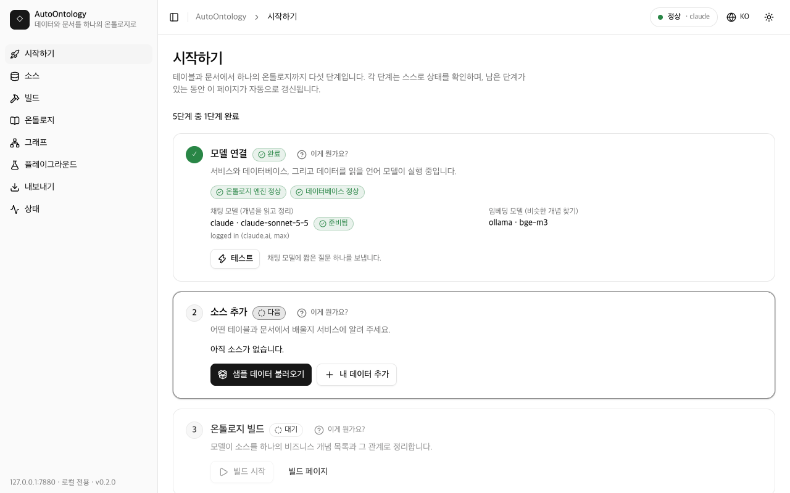
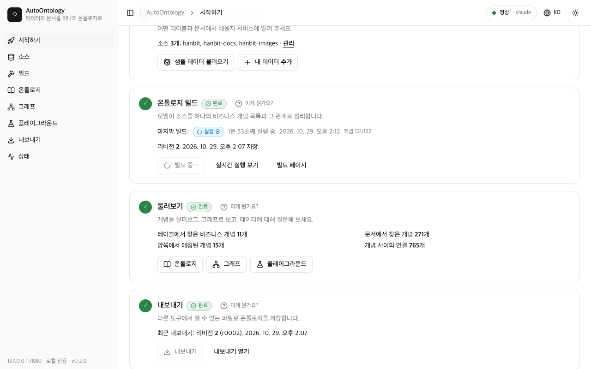
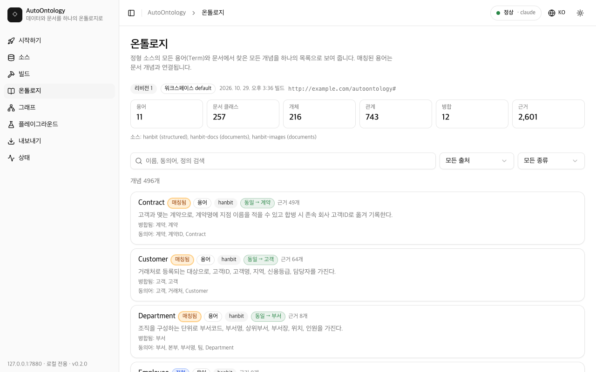

# AutoOntology 현업 전문가 가이드

[English](GUIDE.md) | **한국어**

이 가이드는 업무 데이터(계약, 청구, 고객, 규정, 매뉴얼)는 잘 알지만 데이터 엔지니어는 아닌 분을
위한 것입니다. 빈 컴퓨터에서 시작해 내 데이터로 만든 온톨로지까지, 실제 명령과 화면 그대로 혼자
따라 할 수 있게 썼습니다. 따로 "추정"이라고 적지 않은 시간은 모두 Apple M4 Mac mini(메모리
16 GB)에서 실제로 잰 값입니다.

목차:

1. [10분이면 얻는 것](#1-10분이면-얻는-것)
2. [이 문서에서 쓰는 말](#2-이-문서에서-쓰는-말)
3. [시작하기 전에](#3-시작하기-전에)
4. [모델 제공자 고르기](#4-모델-제공자-고르기)
5. [10분 코스](#5-10분-코스)
6. [내 데이터 넣기](#6-내-데이터-넣기)
7. [결과 읽는 법](#7-결과-읽는-법)
8. [결과가 이상할 때](#8-결과가-이상할-때)
9. [문제 해결](#9-문제-해결)
10. [자주 묻는 질문](#10-자주-묻는-질문)

## 1. 10분이면 얻는 것

짧은 명령 여섯 개를 입력하면 AutoOntology가 컴퓨터 환경을 점검하고, 설정 파일을 쓰고, 작은 샘플
회사(가상의 무역회사 "한빛상사": 고객·계약·청구 표 3개와 규정 문서 5개)를 불러온 뒤, 언어
모델에게 전부 읽혀서 업무 전체를 하나의 지도로 보여 줍니다. 어떤 개념이 있는지(고객, 계약, 청구,
수납상태, 승인권자 …), 서로 어떻게 연결되는지, 어느 표의 어느 컬럼에 담겨 있는지, 그리고 문서의
어느 문장이 그 개념을 정의하는지까지 나옵니다. Claude 구독으로는 샘플 전체가 8~11분(ChatGPT 구독은 약 15분, 추정),
노트북의 로컬 모델로는 46분 걸렸습니다(자세한 숫자는 4장).
웹 UI의 **시작하기** 페이지가 다섯 단계를 보여 주고, 끝난 단계마다 체크 표시를 합니다.


## 2. 이 문서에서 쓰는 말

| 말 | 쉬운 설명 |
|---|---|
| **온톨로지** | 업무에서 쓰는 개념을 모아 서로의 관계까지 그려 넣은 공용 사전입니다. 여기서는 표와 문서를 함께 읽어 만든 결과 파일 묶음 하나를 말합니다. |
| **비즈니스 개념(용어, Term)** | **표**에서 찾은 개념입니다. 예를 들어 고객 표에서 나온 "고객"이고, 표의 컬럼이 속성이 됩니다. NVIDIA Auto Ontology 엔진이 이름과 설명을 붙이며, 이 문서에서는 용어(Term)라고 부릅니다. |
| **문서 개념** | 규정, 매뉴얼, 회의록, 스캔본 같은 **문서**에서 찾은 개념입니다. 예: "연체", "승인권자". 각 개념은 근거가 된 원문 문장을 함께 보관합니다. |
| **매칭** | 문서 개념을 표의 용어와 짝짓는 일입니다. "계약관리규정의 '계약'은 계약(Contracts) 표와 같은 것이다"처럼요. 결과는 *동일(same)*, *상위(broader)*, *하위(narrower)*, *관련(related)* 중 하나입니다. |
| **스냅샷 / 리비전** | 빌드 한 번의 저장된 결과이며 1, 2, 3 … 번호가 붙습니다. 덮어쓰지 않고 빌드할 때마다 새 리비전이 추가되며, 화면은 가장 최근 것을 보여 줍니다. |
| **소스** | 등록한 폴더, 업로드한 파일 묶음, 또는 데이터베이스 하나입니다. `hanbit`, `hanbit-docs`처럼 짧은 이름을 붙입니다. 소스 하나는 표(정형)나 문서 중 한 종류만 담습니다. |
| **빌드** | 모든 소스를 읽고, 모델에게 개념을 찾게 하고, 매칭한 뒤, 새 리비전을 저장하는 실행입니다. 첫 빌드가 가장 오래 걸리고, 다음 빌드부터는 바뀌지 않은 부분을 재사용합니다. |
| **내보내기** | 리비전을 다른 도구가 열 수 있는 파일로 쓰는 일입니다(`exports/r0001/` 등): RDF/OWL, GraphML, Ossie, OKF. |
| **Ossie** | Apache Ossie. 시맨틱 모델(데이터셋, 엔터티, 관계)을 담는 공개 파일 형식입니다. Ossie를 읽는 분석·BI 도구가 이 온톨로지를 그대로 쓸 수 있습니다. |
| **OKF** | Open Knowledge Format. 개념·표·문서마다 마크다운 페이지 하나씩, 서로 링크로 이어진 폴더입니다. 사람이 위키처럼 읽을 수 있고, AI 에이전트나 지식 베이스가 그대로 불러올 수 있습니다. |

그 밖에 나오는 약어: **LLM**(대규모 언어 모델, 글을 읽는 AI), **OCR**(광학 문자 인식, 이미지와
스캔본에서 글자를 읽는 기술), **CLI**(명령줄 인터페이스, 터미널에 입력하는 명령), **RDF/OWL**(지식
그래프를 위한 W3C 표준), **SPARQL**(RDF용 질의 언어), **SQL**(표용 질의 언어), **NL→SQL**(자연어를
SQL로: 말로 질문하면 표로 답을 받음).

## 3. 시작하기 전에

터미널이 필요합니다(macOS는 터미널 앱, Linux는 셸, Windows는 WSL). "확인 방법" 명령을 입력해
버전이 나오면 이미 있는 것입니다.

| 필요한 것 | 용도 | 확인 방법 | 설치 방법 |
|---|---|---|---|
| Python 3.12와 uv | AutoOntology를 실행합니다. 맞는 Python은 uv가 알아서 설치합니다. | `uv --version` | https://docs.astral.sh/uv/ (명령 한 줄) |
| git | 프로젝트를 내려받습니다. | `git --version` | macOS는 Xcode 명령줄 도구, Linux는 패키지 관리자 |
| Docker **또는** pgvector가 있는 Postgres 17 | 표 데이터와 엔진 카탈로그를 담는 데이터베이스입니다. Docker를 쓰면 명령 하나로 알맞은 것이 뜹니다. | `docker --version` 또는 `psql --version` | https://docs.docker.com/get-docker/, 또는 `brew install postgresql@17 pgvector` |
| 모델 제공자 **하나**: Ollama, Claude 구독, ChatGPT 구독, 또는 OpenAI 호환 API 키 | 데이터를 읽는 언어 모델입니다. 4장에서 고르는 법을 설명합니다. | `ollama list` / `claude auth status` / `codex login status` | https://ollama.com, https://claude.com/claude-code, https://developers.openai.com/codex |
| 구독을 쓰더라도 Ollama | 임베딩(비슷한 개념을 찾으려고 글을 숫자로 바꾸는 일)에 씁니다. Ollama를 채팅 모델로도 쓰지 않는다면 작은 `bge-m3` 모델(1.2 GB)만 있으면 됩니다. OpenAI 호환 임베딩 엔드포인트로 대신할 수도 있습니다. | `ollama list` | https://ollama.com |
| Node.js 20 이상(선택) | HWP/HWPX, PDF, DOCX, PPTX, XLS/XLSX 문서와 이미지(OCR)를 읽습니다. 없어도 Markdown, 텍스트, HTML, CSV, `.doc` 문서는 읽습니다. | `node --version` | https://nodejs.org |

디스크 공간(추정): 프로젝트와 도구에 약 2 GB, Ollama를 채팅 모델로 쓰면 `qwen3:8b` 모델에 5 GB가 더
필요합니다.

## 4. 모델 제공자 고르기

제공자는 표와 문서를 읽는 언어 모델입니다. 나중에 명령 하나로 바꿀 수 있으니, 오늘 바로 쓸 수
있는 것으로 시작하세요.

| | Ollama(로컬) | Claude 구독 | ChatGPT 구독(Codex) | OpenAI 호환 API |
|---|---|---|---|---|
| 비용 | 무료 | Claude Pro/Max 요금제에 포함, 사용량 한도에서 차감 | ChatGPT 요금제에 포함, 사용량 한도에서 차감 | API 계정에서 쓴 만큼 과금 |
| quickstart 샘플(첫 빌드) | 46분 | 8~11분 | ~15분(추정) | 엔드포인트에 따라 다름 |
| hanbit 전체 샘플(첫 빌드) | 4~5시간(추정) | 37분 | ~75분(추정) | 엔드포인트에 따라 다름 |
| 데이터가 컴퓨터 밖으로 나가나요? | **아니요** | 예: 프롬프트가 내 계정 약관에 따라 Anthropic으로 갑니다 | 예: 프롬프트가 내 계정 약관에 따라 OpenAI로 갑니다 | 예(엔드포인트가 내 컴퓨터에서 돌면 아니요) |
| 준비 | Ollama 설치, `init`이 `qwen3:8b`(5 GB)를 받음 | `claude auth login` 한 번 | `codex login` 한 번 | 기본 URL, 모델 이름, 그리고 `.env`에 직접 입력하는 키 |
| 품질 | 작은 모델: 느리고, 찾는 개념이 적고, 보수적으로 병합 | 저희 테스트에서 가장 좋은 결과, 빠름 | 좋은 결과, 호출 하나는 Claude보다 느림 | 모델에 따라 다름 |

시간은 README의 "샘플 세트"에 적은 리허설에서 잰 값입니다. 빌드는 문서 청크마다 모델을 한 번
부르고, 짧은 판정 호출을 수백 번 더 하므로, 시간은 표의 행 수가 아니라 문서 분량에 비례해
늘어납니다.

AutoOntology를 실행할 사용자 계정으로 한 번 로그인해 두세요.

```
claude auth login        # Claude: 또는 claude를 실행해 /login 입력, 확인은 claude auth status
codex login              # ChatGPT: ChatGPT 계정 선택, 확인은 codex login status
ollama serve             # Ollama: ollama list가 연결할 수 없다고 하면 실행
```

OpenAI 호환 API를 쓰려면 `init` 뒤에 텍스트 편집기로 `.env`를 열고
`AUTOONTOLOGY_OPENAI_API_KEY=...` 줄을 직접 추가하세요. 키를 채팅 창이나 셸 기록에 남는 명령에
붙여 넣으면 안 됩니다.

## 5. 10분 코스

터미널을 열고 아래 명령을 한 줄씩 입력합니다. 각 명령이 무엇을 출력하는지 아래에 설명합니다.

```
git clone --recurse-submodules https://github.com/kimtoma/AutoOntology.git
cd AutoOntology
docker compose up -d
uv sync
uv run autoontology init
uv run autoontology demo
```

**`git clone ...`과 `cd AutoOntology`**는 프로젝트와 그 바탕인 NVIDIA 엔진을 `AutoOntology`
폴더에 내려받고 그 폴더로 들어갑니다. 이후 명령은 모두 이 폴더에서 실행합니다.

**`docker compose up -d`**는 Postgres 데이터베이스를 백그라운드로 시작하고
`Container autoontology-db-1 Started`를 출력합니다. pgvector가 있는 Postgres 17을 이미 쓰고
있다면 이 명령 대신 이 폴더의 `.env` 파일에 그 서버의 `POSTGRES_HOST`, `POSTGRES_PORT`,
`POSTGRES_USER`, `POSTGRES_PASSWORD`를 적으세요.

**`uv sync`**는 Python과 모든 라이브러리를 `.venv`에 설치합니다. 처음에는 수백 MB를 내려받고
`Installed N packages`로 끝납니다.

**`uv run autoontology init`**은 몇 가지를 묻고 `.env`를 씁니다. 시스템 언어가 한국어이면(또는
`AUTOONTOLOGY_LANG=ko`) 한국어로, 번호가 붙은 일곱 단계를 출력합니다.

```
[1/7] Postgres
  ok    database autoontology (exists) on localhost:5432 as autoontology; extensions: pg_trgm 1.6, vector 0.8.7

[2/7] 채팅 제공자
  제공자  설치됨  로그인  비고
  ollama  예      예      http://localhost:11434 has openai/qwen3:8b, bge-m3
  openai  아니요  아니요  set AUTOONTOLOGY_OPENAI_BASE_URL in .env
  claude  예      예      logged in (claude.ai, max)
  codex   예      예      logged in (ChatGPT)
  채팅 제공자 [claude]:
```

준비된 첫 번째 제공자(claude, codex, ollama 순)를 제안합니다. Enter를 누르면 그대로 쓰고, 다른
이름을 입력하면 바꿉니다. Node.js가 있으면 "kordoc과 OCR 모델(약 18 MB)을 지금 설치할까요?"라고
묻습니다. Markdown, 텍스트, HTML, CSV, `.doc` 파일만 있는 게 아니라면 `y`로 답하세요. 5·6단계는
`.env`를 쓰고(기존 파일은 먼저 `.env.bak-<시각>`으로 복사), 데이터베이스를 준비하고, 테스트 호출
한 번으로 모델을 확인합니다.

```
[7/7] 요약
  항목        값
  postgres    localhost:5432/autoontology
  chat        claude claude-sonnet-5-5
  embeddings  ollama bge-m3
  documents   kordoc + OCR
  vision      꺼짐 (이미지: OCR 텍스트만)

다음: uv run autoontology demo --set hanbit
```

마지막 줄은 다음에 입력할 명령입니다(Ollama가 아닌 제공자는 큰 샘플도 금방 끝나므로
`--set hanbit`이 붙습니다). 리허설에서 도구가 설치된 상태의 `init`은 7초(Ollama), 9초(Claude)
걸렸고, kordoc을 처음 설치할 때는 1분쯤(추정) 더 걸립니다. `init --yes`는 모든 질문에 제안된 값으로
답하고, `--provider claude`(또는 `ollama`, `codex`, `openai`)는 묻지 않고 제공자를 정합니다.

**`uv run autoontology demo`**는 백그라운드 서비스 두 개를 시작하고, 샘플 세트를 소스로
등록하고(표는 `quick`, 문서는 `quick-docs`), 제공자별 첫 빌드 예상 시간을 보여 준 뒤, 빌드하고,
내보내고, 웹 UI를 엽니다. 빌드하는 동안 단계마다 한 줄씩 출력합니다.

```
[1/10] structured:quick:load: ok (0.3s)
[4/10] structured:quick:compile ...
[6/10] documents:quick-docs:extract ...
  [1/28] 한빛상사 계약관리규정 #0: 3 concept(s), 4 relation(s) via structured in 53.7s
```

빌드 단계 줄은 영어로 나옵니다. 끝나면 단계별 시간 표, `빌드 합계`, 내보낸 폴더
(`exports/r0001`), 웹 UI 주소(http://127.0.0.1:7800/ui/)를 출력합니다. 회사 전체 샘플(표 11개,
12가지 형식의 문서 15개, 이미지 6장)을 쓰려면 `--set hanbit`을, 브라우저를 열지 않으려면
`--no-open`을 붙이세요.

웹 UI의 **시작하기** 페이지가 진행 상황을 함께 보여 줍니다. 서비스가 막 뜨면 1단계(모델 연결)가
완료되고 2단계가 데이터를 기다립니다.



빌드하는 동안 3단계에 경과 시간과 진행 상황이 표시됩니다(아래는 hanbit 샘플을 다시 빌드하며
매칭 단계를 진행 중인 화면입니다). 샘플 세트의 첫 빌드라면 내 제공자 기준 예상 시간도 함께 나옵니다.



모두 끝나면 다섯 단계에 전부 체크 표시가 붙습니다(이 가이드 맨 위 화면). 노트북을 덮었거나 사용량
한도에 걸려 데모가 중간에 멈췄다면 `uv run autoontology demo --resume`을 실행하세요. 끝난 단계는
그대로 유지됩니다.

## 6. 내 데이터 넣기

### 파일 준비

**표**(CSV, TSV, XLSX, XLSM, XLS, JSON, JSON Lines, Parquet, SQLite):

- **첫 행은 컬럼 이름이 담긴 머리글**이어야 합니다. 데이터 위아래에 제목 행, 병합된 셀, 합계 행을
  두지 마세요.
- 엑셀은 **시트 하나에 표 하나**: 시트마다 `<파일>_<시트>` 이름의 표가 됩니다(시트가 하나뿐이면
  `<파일>`). 메모나 차트만 있는 시트는 지우세요.
- 파일 사이에서 **ID 컬럼을 일관되게** 유지하세요. 같은 것은 같은 이름, 같은 형식으로
  씁니다(고객 표와 계약 표 모두 `고객ID` = `C001`). 파일에 키를 선언하지 않아도 표 사이의 연결은
  이것으로 찾아냅니다.
- 날짜는 `2026-09-30`처럼, 금액은 숫자만(숫자 컬럼 안에 통화 기호나 천 단위 쉼표 없이) 쓰세요.
  컬럼 이름은 한국어든 영어든 괜찮습니다.
- 표로 쓸 CSV는 **UTF-8**로 저장하세요(엑셀: "CSV UTF-8"). 예전 한국어 엑셀 인코딩인 CP949는 문서
  소스의 CSV에서만 읽습니다.

**문서**: HWP, HWPX(HML/HWPML 포함), PDF, DOCX, PPTX, XLS, XLSX, DOC(Word 97-2003), CSV/TSV,
Markdown, TXT, HTML. 제목이 분명할수록 좋습니다. 리더가 제목을 기준으로 문서를 나누고, 개념도
절마다 찾기 때문입니다. 코드값과 상태를 말로 정의한 문서("수납상태는 완납, 부분수납, 미수납, 연체
중 하나다")가 표와 가장 잘 매칭됩니다.

- HWP(바이너리 형식)와 HWPX 모두 읽습니다. 오래된 HWP가 실패하면 한글에서 HWPX나 PDF로 저장하세요.
- `.doc`는 추가 도구 없이 읽지만 본문과 표만 읽습니다(이미지, 글상자, 각주는 제외). 암호가 걸린
  파일은 ".docx로 저장하세요" 안내와 함께 실패합니다.
- 문서 소스에 넣은 CSV는 최대 200행(`AUTOONTOLOGY_DOC_TABLE_MAX_ROWS`)짜리 표 하나로 읽습니다. 실제
  데이터가 담긴 CSV는 표 소스에 넣으세요.

**이미지와 스캔본**(PNG, JPG/JPEG, WEBP, 스캔한 PDF):

- **300 dpi**로, 똑바로, 컬러나 흑백으로 스캔하세요. 화면이나 화이트보드를 찍은 사진도 선명하고
  정면에서 찍었다면 읽힙니다.
- OCR은 인쇄된 한국어·영어 글자, 숫자, 단순한 표를 읽습니다. 손글씨, 아주 작거나 흐린 글자, 차트의
  의미(축 이름과 숫자는 읽지만 추세는 못 읽음)는 읽지 못합니다. 글자를 잘못 읽기도 합니다(`ID`가
  `D`로 읽히는 경우 등).
- 선택: `.env`에 `AUTOONTOLOGY_VISION_MODEL=gemma4:e4b`를 넣고 `uv run autoontology setup`을
  실행하면, 로컬 비전 모델이 OCR 텍스트 앞에 이미지 설명을 붙입니다. 차트와 도식에 도움이 되며,
  이미지 하나에 45초쯤 더 걸립니다.

### 소스 추가

소스마다 짧은 이름을 붙입니다. 영문 소문자, 숫자, `_`만 쓰고(문서 소스는 `-`도 가능), 예를 들면
`sales`, `sales-docs`입니다. 방법은 세 가지입니다.

- **이 컴퓨터의 폴더**(파일이 많을 때 가장 좋음, 복사하지 않음): 표는
  `uv run autoontology source add ~/data/sales --name sales`, 문서는
  `uv run autoontology source add ~/data/policies --name sales-docs --kind documents`. 하위
  폴더까지 넣으려면 `--recursive`를 붙입니다. 웹 UI에서는 **소스 → 소스 추가 → 폴더**.
- **업로드**(파일이 몇 개뿐일 때): **소스 → 소스 추가 → 업로드**. 대화 상자가 파일마다 어떻게
  읽힐지 보여 주고, 지원하지 않는 파일이 있으면 업로드를 막습니다("지원하지 않는 파일 N개 제거" 버튼으로
  뺄 수 있습니다). 업로드는 요청 한 번에 200 MB까지입니다.
- **데이터베이스 URL**(표만; PostgreSQL, 엔진에 드라이버가 있으면 MySQL과 Snowflake도):
  `uv run autoontology source add postgresql://user@host/dbname --name erp`, 또는 **소스 → 소스
  추가 → DB URL**. 데이터베이스를 그 자리에서 읽으며 AutoOntology로 복사하지 않습니다.

그다음 빌드합니다: `uv run autoontology build`, 또는 **시작하기 → 빌드 시작**. 내보내기는
`uv run autoontology export` 또는 **내보내기** 버튼입니다.

### 소스를 나눌 때

- 표와 문서는 **따로** 등록하세요. 소스 하나에는 표나 문서 중 한 종류만 들어갑니다.
- 같은 단어를 다르게 쓰는 문서(영업의 "계약"과 구매의 "계약")는 **주제나 부서별로** 나누세요. 문서
  소스마다 따로 매칭되고, 다른 소스를 건드리지 않고 하나만 다시 빌드하거나 지울 수 있습니다.
- 파일이 수백 개인 큰 문서 폴더는 나누세요. 파일 하나가 실패해도 나머지가 막히지 않고,
  `build --source <이름>`으로 바뀐 부분만 다시 빌드할 수 있습니다.
- 서로 참조하는 표(고객, 계약, 청구)는 **한** 소스에 두세요. 표 사이의 연결은 소스 안에서 찾습니다.

## 7. 결과 읽는 법

### 온톨로지 페이지

모든 개념을 검색할 수 있는 목록 하나입니다. 행마다 **출처** 배지가 붙습니다.

- **정형**: 어떤 문서와도 매칭되지 않은, 표에서 나온 용어.
- **문서**: 문서에서만 찾은 개념.
- **매칭됨**: 문서 개념이 매칭된 용어. 열어 보면 문서가 무엇을 더했는지 볼 수 있습니다.

개념을 누르면 정의, **동의어**(그 용어로 접힌 문서 속 이름, 예: Customers의 "고객"), 표 컬럼,
**매칭**(어떤 문서 개념이 이 용어를 가리키는지, 판정과 모델의 신뢰도), 관계, 그리고 **근거**(문서와
쪽 번호가 붙은 원문 문장)를 보여 줍니다. 레코드 ID, 숫자·날짜, 회사 이름(주식회사 …, Inc.)은
동의어가 되지 않고 동의어 아래에 "제외됨"으로 표시됩니다. 검색은 이름, 동의어, 정의를 찾고, 필터로 출처와 종류를
좁힐 수 있습니다.



### 그래프

같은 온톨로지를 3D 네트워크로 보여 줍니다(브라우저가 3D를 지원하지 않으면 2D). **보기**의
**레이어**에서 전체, 표의 용어만(정형), 문서 개념만(문서), 매칭된 것만(매칭)을 고를 수 있고,
**근거(원본 문서)**를 켜면 원본 문서도 노드로 나타납니다. **노드 찾기**는 이름이나 동의어로 개념을
찾아가고, 노드를 누르면 상세 정보가 열리며 **이웃만 보기**로 그 노드에 집중할 수 있습니다. 연결선
위를 움직이는 점은 수락된 *동일(same)* 매칭입니다.


### 플레이그라운드

- **채팅**: 평소 말로 묻습니다("연체는 언제 되나요?"). 답변은 근거로 쓴 개념, 규칙, 원문을 인용하며,
  인용을 누르면 해당 개념이 열립니다. 가장 최근 리비전에 대해서만 답합니다.
- **SQL**: 데이터에 대해 물으면("지역별 고객 수") 엔진이 SQL을 작성해 정형 소스에서 실행하고 표와
  SQL을 보여 줍니다.
- **SPARQL**: 온톨로지 자체에 읽기 전용 질의를 실행합니다. 예시 메뉴에 바로 쓸 수 있는 질의가
  있습니다: Classes, Synonyms per Term, Aligned concepts, Relations and their evidence, Business
  rules, Concepts per document, Property domain/range, Unaligned concepts(예시 이름은 영어로
  표시됩니다).

### 내보내기

내보내기마다 `exports/r<리비전>/` 폴더가 하나씩 생깁니다. 파일별 용도와 쓰는 사람:

| 파일 | 내용 | 여는 사람 |
|---|---|---|
| `ontology.ttl`(Turtle), `ontology.jsonld`(JSON-LD) | W3C RDF/OWL 표준으로 쓴 온톨로지 전체 | 온톨로지 편집기(Protégé), 지식 그래프 데이터베이스, 데이터 카탈로그 |
| `ontology.graphml` | 노드와 연결선 | 그래프 도구(Gephi, yEd), 데이터 과학자(networkx) |
| `ossie/` | Apache Ossie 시맨틱 모델, 온톨로지, 매핑과 `validation.json` | Ossie를 읽는 시맨틱 레이어·BI 도구 |
| `okf/` | Open Knowledge Format: 개념·표·문서마다 마크다운 페이지 하나와 `validation.json` | 사람(위키처럼 읽기), AI 에이전트, 지식 베이스 |
| `report.md` | 개수와 파일 해시를 담은 한 쪽짜리 요약 | 나, 그리고 결과를 검토하는 사람 |
| `upstream/` | 표 소스별 엔진 자체 내보내기 | NVIDIA Auto Ontology 사용자 |

번들이 검사를 통과하면 `validation.json`에 `"ok": true`가 적힙니다. **내보내기** 페이지에서 모든
파일을 미리 보고 내려받을 수 있습니다.


## 8. 결과가 이상할 때

**다시 빌드할까, 이어서 할까?** `uv run autoontology build --resume`은 마지막 빌드를 이어 가며
입력(파일, kordoc과 OCR 사용 가능 여부, 모델)이 바뀌지 않은 단계는 모두 유지합니다. 중단됐을 때,
사용량 한도에 걸렸을 때, kordoc을 설치한 뒤에 쓰세요. 그냥 `uv run autoontology build`는 모든
단계를 다시 실행하지만 바뀌지 않은 것(문서, 추출한 청크, 판정)은 저장된 결과를 재사용하므로 새로운
부분에만 모델을 호출하며, 항상 새 리비전을 저장합니다. `build --source sales-docs`는 그 소스만 다시
빌드합니다(매칭과 스냅샷은 여전히 모든 소스를 다룹니다).

**개념이 빠졌어요.** 빌드 페이지에서 건너뛴 파일이 있는지 보세요(kordoc이나 OCR 모델이 필요한 파일은
경고에 이름이 나옵니다). 그 개념을 표나 이미지가 아니라 문장으로 정의한 문서가 있는지 확인하세요.
더 큰 모델은 더 많이 찾습니다. 제공자를 바꿔 보세요(아래).

**합쳐지면 안 되는 게 합쳐졌거나, 그 반대예요.** 매칭은 세 단계로 이뤄집니다.

1. 엔터티·지표·속성인 문서 개념마다(규칙과 절차는 매칭하지 않음) 의미가 가장 비슷한 용어 다섯
   개를 고릅니다(임베딩).
2. 모델이 쌍마다 `same`(동일), `broader`(상위: 용어가 더 넓음, 개념이 용어의 일부나 하위 종류),
   `narrower`(하위: 용어가 더 좁음, 용어가 개념의 일부나 하위 종류), `related`(관련), `none`(무관)
   중 하나와 신뢰도를 판정합니다.
3. 엄격한 규칙이 결정합니다. `same`은 신뢰도가 0.90 이상이고 **동시에** 개념의 이름 하나가 용어의
   이름과 정확히 같을 때만(대소문자와 공백 무시, 영어 복수형은 단수로 봄) 받아들입니다. 그렇지
   않으면 검토할 수 있는 제안인 `related`로 남깁니다. 그래서 "계약"은 이름이 맞을 때만 계약
   (Contracts) 용어로 접히고, 비슷하게 들리는 말이 실수로 합쳐지는 일은 없습니다.

매칭이 너무 적다면 용어에 업무에서 쓰는 이름을 알려 주세요. 문서에 "계약(Contracts)은 …"처럼
적거나, 컬럼 이름을 사람들이 부르는 대로 지으면 됩니다. 관련 없는 문서끼리 개념을 끌어당긴다면
문서 소스를 나누세요.

**제공자 바꾸기.** `uv run autoontology provider use claude`(또는 `codex`, `ollama`, `openai`),
이어서 `uv run autoontology down && uv run autoontology up`으로 다시 시작하고
`uv run autoontology build`를 실행합니다. `uv run autoontology provider test`로 모델부터 확인할 수
있습니다.

**작은 로컬 모델의 한계.** 노트북의 `qwen3:8b`는 문서 청크 하나에 1~2분이 걸리고, 찾는 개념이
적으며, 판정이 `same`보다 `related`로 나오는 경우가 많습니다. 잘못 합치지는 않으니 안전하지만,
검토할 제안이 더 많이 남습니다. 데이터를 밖으로 내보내면 안 될 때 쓰고, 가장 좋은 온톨로지가
필요하면 구독이나 더 큰 엔드포인트를 쓰세요.

## 9. 문제 해결

`uv run autoontology doctor`가 전체를 점검해 조치 열을 출력하고, `init`은 `조치:` 줄을 출력합니다.
아래 명령은 doctor와 init이 제안하는 것에 몇 가지 단계를 더한 것입니다(`AUTOONTOLOGY_LANG=ko`이면
메시지는 한국어, 명령은 그대로입니다).

| 증상 | 원인 | 입력할 것 |
|---|---|---|
| `.env` WARN "missing: using the built-in defaults" | 아직 설정 파일이 없음 | `uv run autoontology init` |
| `init 중단: Postgres에 연결할 수 없습니다`, 또는 doctor `postgres` FAIL | 데이터베이스가 꺼져 있거나 `.env`가 다른 곳을 가리킴 | `docker compose up -d` 후 `uv run autoontology init` 다시 실행. 직접 운영하는 Postgres라면 `.env`에 `POSTGRES_HOST` / `POSTGRES_PORT` / `POSTGRES_USER` / `POSTGRES_PASSWORD` 설정 |
| `docker compose up -d`가 5432 포트에서 실패 | 다른 Postgres가 이미 그 포트를 씀 | 먼저 `.env`에 `POSTGRES_PORT=5433` 설정, 또는 그 Postgres를 사용 |
| doctor `database autoontology` FAIL "missing", 또는 `alembic` WARN | 카탈로그가 준비되지 않음 | `uv run autoontology setup` |
| doctor `extension vector` FAIL | Postgres 서버에 pgvector가 없음 | `brew install pgvector`(또는 `postgresql-17-pgvector` 패키지), 또는 `docker compose` 사용. 그다음 `uv run autoontology setup` |
| `setup`: 데이터베이스 생성 권한 없음 | Postgres 사용자가 데이터베이스를 만들 수 없음 | `psql`에서 `ALTER USER <이름> CREATEDB;`, 또는 `autoontology` 데이터베이스를 직접 생성 |
| `init 중단: claude CLI에 로그인되어 있지 않습니다`, doctor `chat provider` FAIL | 이 사용자 계정으로 로그인하지 않음 | `claude auth login`(또는 `codex login`) 후 `uv run autoontology init` 다시 실행 |
| doctor `chat provider` FAIL, 조치 "claude CLI를 설치하고 로그인하세요" | CLI가 설치되지 않았거나 PATH의 `claude`가 래퍼임 | 설치하거나, `.env`에 `AUTOONTOLOGY_CLAUDE_BIN=/path/to/claude` 설정(codex는 `AUTOONTOLOGY_CODEX_BIN`) |
| `init 중단: openai 제공자에는 … base URL이 필요합니다` | openai를 `--yes`로 골랐는데 URL이 없음 | `.env`에 `AUTOONTOLOGY_OPENAI_BASE_URL` 설정, 또는 `--yes` 없이 `init` 실행 |
| `init 중단: … 채팅 모델 이름이 필요합니다` / `init 중단: openai 임베딩에는 모델 이름이 필요합니다` | openai를 `--yes`로 골랐는데 모델이 없음 | `--chat-model`을 주거나 `.env`에 `AUTOONTOLOGY_OPENAI_CHAT_MODEL` / `AUTOONTOLOGY_OPENAI_EMBED_MODEL` 설정 |
| `warn  셸에 KEY=...이(가) 설정되어 있어 .env보다 우선합니다` | 셸 프로필의 변수가 `.env`보다 우선함 | `unset KEY` 후 셸 프로필에서도 삭제 |
| `setup 단계에서 init 중단` | 바로 위 줄이 실패한 부분을 알려 줌 | 그 부분을 고친 뒤 `uv run autoontology init` 다시 실행(반복해도 안전) |
| doctor `ollama` FAIL, 또는 `warn  Ollama가 응답하지 않습니다` | Ollama가 실행 중이 아님 | `ollama serve`(설치는 https://ollama.com) |
| doctor `ollama` FAIL "models missing", 또는 채팅 모델 `openai/qwen3:8b`를 찾을 수 없음 | 모델이나 별칭을 받지 않음 | `uv run autoontology setup`(또는 `setup --force-alias`) |
| doctor `model profile` FAIL/WARN | `.env`의 제공자 값이 없거나 알려진 모델이 아님 | `AUTOONTOLOGY_OPENAI_*` / `_CLAUDE_*` / `_CODEX_*` 값 설정(`.env.example` 참고). Ollama는 `openai/<이름>` 별칭 사용 |
| doctor `chat endpoint` FAIL "not bare JSON: schema not enforced" | Ollama가 답변 형식을 무시함 | `AUTOONTOLOGY_OLLAMA_NO_THINK`을 켠 상태(기본값)로 두고 Ollama 업그레이드 |
| doctor `chat no-think` FAIL | Ollama 채팅 별칭이 답하기 전에 여전히 "생각"함 | `uv run autoontology setup --force-alias` |
| doctor `chat endpoint` FAIL | 모델이 테스트 호출에 답하지 않음 | `uv run autoontology provider test` 후 출력되는 조치. openai는 `AUTOONTOLOGY_OPENAI_BASE_URL` / `API_KEY` / `CHAT_MODEL` 확인 |
| doctor `embedding endpoint` FAIL | 임베딩 모델에 연결할 수 없음 | `.env`의 `EMBED_*` / `AUTOONTOLOGY_EMBED_PROVIDER`와 Ollama 실행 여부 확인 |
| doctor `vector tables` FAIL "the embedder emits N dimensions" | 빌드한 뒤 임베딩 모델을 바꿈 | 이전 임베딩 모델로 되돌리거나, 모든 소스를 지우고(`uv run autoontology source rm <이름>`) `vdb` 벡터 테이블을 비운 뒤 다시 빌드 |
| doctor `node` WARN | Node.js 20 이상이 없음 | Node.js 20 이상 설치(HWP/PDF/DOCX/PPTX/XLSX 문서에만 필요) |
| doctor `kordoc` WARN, 또는 빌드 경고 "N document(s) need kordoc and were skipped" | 문서 리더가 설치되지 않음 | `uv run autoontology tools install-kordoc` 후 `uv run autoontology build --resume` |
| doctor `kordoc` WARN "installed with --omit-optional" | PDF·OCR 지원 없이 설치됨 | `uv run autoontology tools install-kordoc --force` |
| doctor `ocr models` WARN, 또는 빌드 경고 "N image(s) or scanned PDF(s) need the OCR models" | OCR 모델을 내려받지 않음 | `uv run autoontology tools install-kordoc` 후 `uv run autoontology build --resume` |
| doctor `vision model` FAIL | `AUTOONTOLOGY_VISION_MODEL`을 설정했는데 Ollama가 꺼져 있거나 모델이 없음 | `ollama serve` 후 `uv run autoontology setup` |
| doctor `port ...` FAIL "in use", 또는 `up`이 포트가 사용 중이라고 함 | 다른 프로그램이 7800이나 3101을 씀 | 그 프로그램을 끄거나 `.env`에 `AUTOONTOLOGY_PORT` / `BACKEND_PORT` 설정(예: 7820과 3121) |
| doctor `upstream connections` WARN "database gone", 또는 적재(ingest)가 `PoolTimeout`으로 실패 | 지워진 데이터베이스를 가리키는 연결이 남아 있음 | 서비스를 켠 상태에서 `uv run autoontology tools prune-connections` |
| doctor `upstream connections` WARN "no source in this checkout" | 다른 AutoOntology 사본이 같은 데이터베이스 서버를 씀 | 그 사본을 쓰는 중이면 그대로 둠. 아니면 `uv run autoontology tools prune-connections --include-unowned` |
| `demo 중단: 소스 ...을(를) 유지했습니다` | 샘플 이름의 소스가 다른 데이터를 담고 있음 | `uv run autoontology demo --replace`(그 소스의 데이터베이스 삭제), 또는 `uv run autoontology source rm <이름>`으로 제거 |
| 빌드 호출이 429 `usage_limit`으로 실패 | Claude나 ChatGPT 요금제 한도에 도달 | 한도가 초기화된 뒤 `uv run autoontology demo --resume`(또는 `build --resume`), 또는 제공자 변경 |
| 문서가 `DOC_PARSE_FAILED`나 `DOC_ENCRYPTED`로 실패 | 읽을 수 없거나 암호가 걸린 `.doc` | `.docx`로 저장해 다시 추가 |
| 문서가 `FILE_TOO_LARGE`로 실패 | 텍스트가 50 MB 초과(`AUTOONTOLOGY_DOC_MAX_BYTES`) | 파일을 나누거나 `.env`에서 한도를 올림 |
| `/ui/`가 503 `ui_not_built`로 응답 | 웹 UI 파일이 없음(소스 아카이브) | `uv run autoontology tools build-ui`(Node와 pnpm 필요) |
| 빌드가 멈춘 것 같음 | 로컬 모델이 느림 | `uv run autoontology runs`로 단계와 청크 수 확인. 로그는 `data/logs/` |

## 10. 자주 묻는 질문

**내 데이터는 안전한가요?** 채팅과 임베딩 모두 Ollama를 쓰면 아무것도 컴퓨터 밖으로 나가지
않습니다. 서비스는 127.0.0.1에서만 받고 다른 컴퓨터의 요청은 거부합니다. Claude·ChatGPT 구독이나
API를 쓰면 프롬프트(표와 컬럼 이름, 몇 개의 샘플 값, 문서 본문)가 내 계정 약관에 따라 해당
제공자에게 갑니다. AutoOntology는 로그인 토큰을 보내거나 기록하지 않습니다(codex는
`auth.json`을 전용 폴더에 링크하고, 갱신된 토큰을 다시 복사해 둘 뿐입니다).

**비용은요?** 소프트웨어는 무료(MIT 라이선스)이고 Ollama도 무료입니다. 구독으로 빌드하면 요금제
사용량 한도에서 차감되며, hanbit 전체 샘플은 모델 호출 약 520번이 들었습니다. API는
제공자가 과금합니다.

**얼마나 걸리나요?** 4장의 표를 보세요. 어림셈: 문서 청크 수를 세세요(`demo`와 빌드 페이지에
나옵니다). 로컬 `qwen3:8b`는 청크 하나에 1~2분, 구독은 약 6초입니다(동시에 최대 두 개씩 호출). 표는 시간이 별로 들지
않습니다. hanbit 표 11개 컴파일은 Claude로 97초 걸렸습니다.

**인터넷 없이 쓸 수 있나요?** 네. 채팅과 임베딩에 Ollama를 쓰고, `init`으로 모델과 kordoc을 한 번
내려받은 뒤라면 됩니다. kordoc은 항상 오프라인으로 실행되며, 네트워크를 쓰는 것은
`tools install-kordoc`뿐입니다.

**한국어와 영어가 섞여 있어도 되나요?** 됩니다. 컬럼 이름, 문서, 질문 모두 어느 언어든, 섞여
있어도 됩니다. 개념 이름은 원래 언어를 유지합니다(한국어 이름은 내보내기에서도 한국어). 웹 UI와
온보딩 명령은 영어와 한국어를 지원합니다. 헤더의 지구본 메뉴로 UI 언어를 바꾸고,
`AUTOONTOLOGY_LANG=ko`(또는 한국어 시스템 로캘)로 명령의 언어를 바꿉니다.

**큰 파일은요?** 수십만 행의 표도 괜찮습니다. 행은 Postgres에 적재되고 모델에는 구조와 몇 개의
샘플만 갑니다. 문서는 청크(약 1,200토큰, 대략 한 쪽)마다 시간이 듭니다. 300쪽 매뉴얼은 청크
300개쯤입니다. 아주 큰 폴더는 소스 여러 개로 나누세요. 텍스트 문서는 50 MB까지 읽습니다.

**HWP 바이너리와 HWPX 중 무엇이 좋나요?** 둘 다 kordoc으로 읽습니다. 최근 한글의 기본 형식인
HWPX(새 XML 형식)가 더 안전합니다. 오래된 바이너리 HWP가 실패하면 한글에서 열어 HWPX나 PDF로
저장하세요.

**내 파일은 어디에 보관되나요?** 등록한 폴더는 그 자리에서 읽습니다. AutoOntology는 자체 데이터
(소스, 실행 기록, 추출한 개념, 스냅샷)를 `data/`에, 내보내기를 `exports/`에 두며 둘 다 프로젝트
폴더 안에 있습니다. 표는 `autoontology_src_<소스>` 이름의 Postgres 데이터베이스에 적재됩니다.
`uv run autoontology source rm <이름> --drop-db`는 소스와 그 데이터베이스를 지웁니다.
