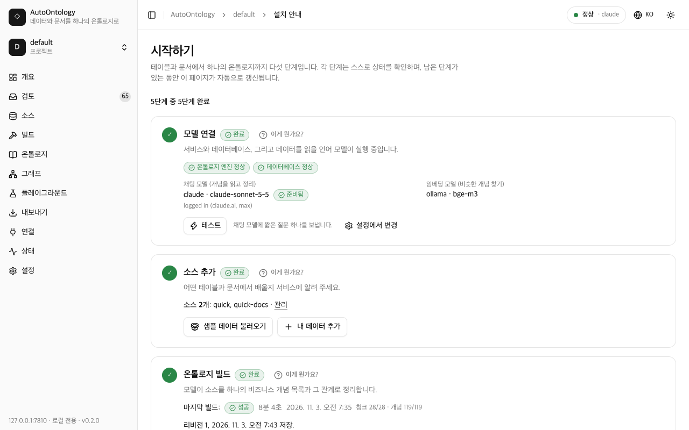
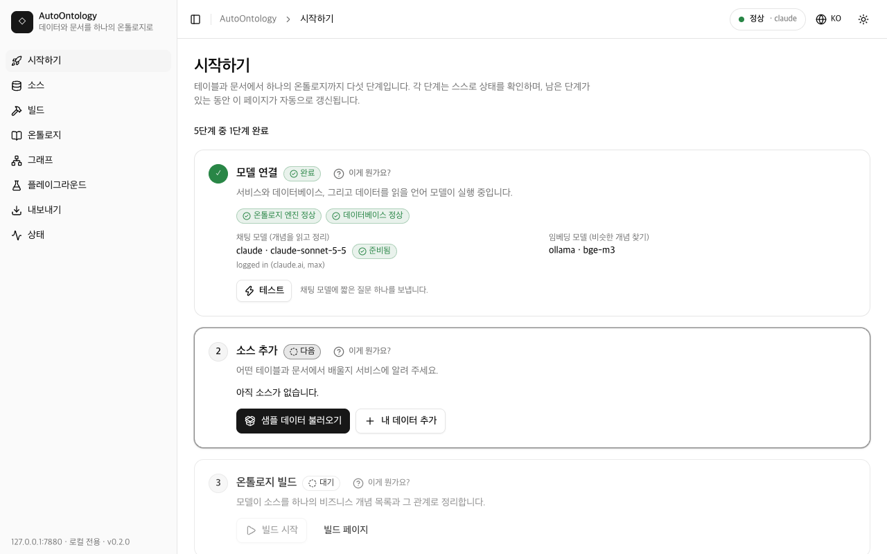
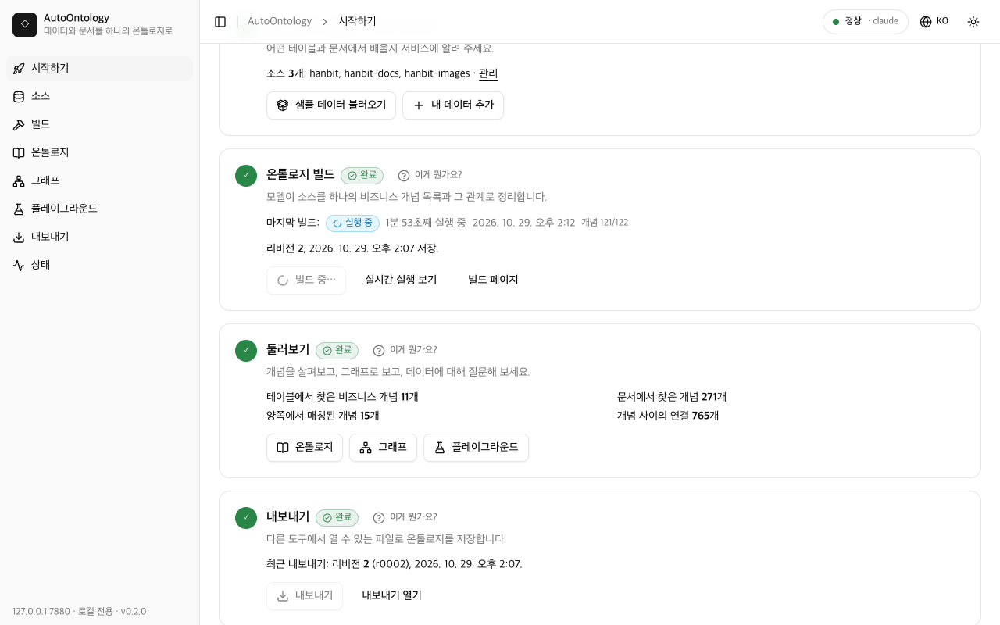
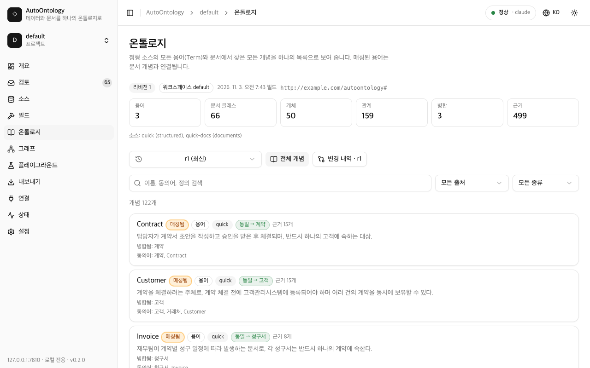
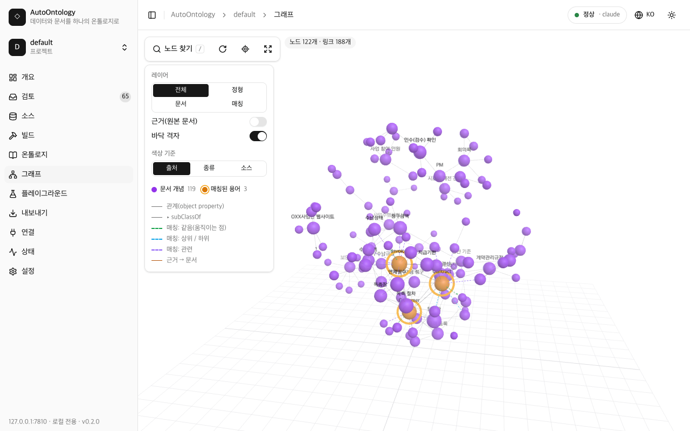
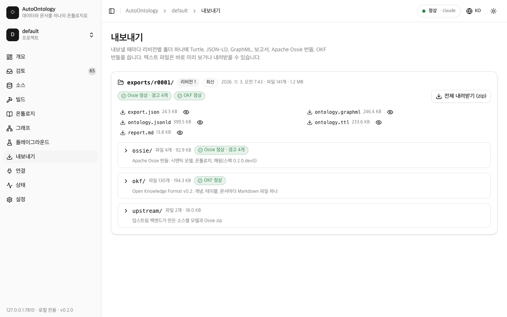
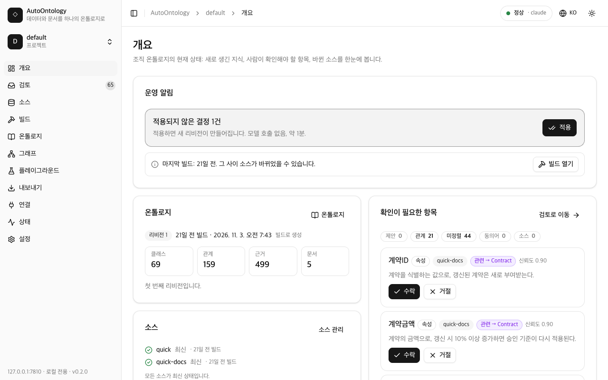
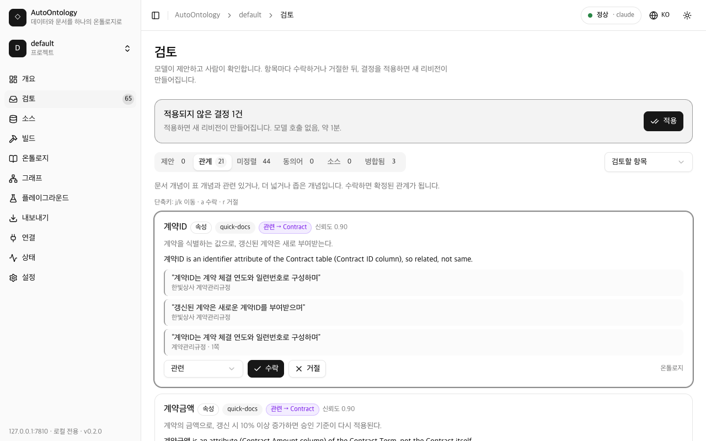

# AutoOntology 현업 전문가 가이드

[English](GUIDE.md) | **한국어**

이 가이드는 업무 데이터(계약, 청구, 고객, 규정, 매뉴얼)는 잘 알지만 데이터 엔지니어는 아닌 분을
위한 것입니다. 빈 컴퓨터에서 시작해 내 데이터로 만든 온톨로지까지, 실제 명령과 화면 그대로 혼자
따라 할 수 있게 썼습니다. 따로 "추정"이라고 적지 않은 시간은 모두 Apple M4 Mac mini(메모리
16 GB)에서 실제로 잰 값입니다.

목차:

- [프롬프트 한 번으로 시작하기](#프롬프트-한-번으로-시작하기) (Claude Code로 바로 시작)

1. [10분이면 얻는 것](#1-10분이면-얻는-것)
2. [이 문서에서 쓰는 말](#2-이-문서에서-쓰는-말)
3. [시작하기 전에](#3-시작하기-전에)
4. [모델 제공자 고르기](#4-모델-제공자-고르기)
5. [10분 코스](#5-10분-코스)
6. [내 데이터 넣기](#6-내-데이터-넣기)
7. [결과 읽는 법](#7-결과-읽는-법)
8. [살아있는 온톨로지 운영하기](#8-살아있는-온톨로지-운영하기)
9. [로그인과 계정](#9-로그인과-계정) (여럿이 함께 쓰는 설치)
10. [일하는 온톨로지](#10-일하는-온톨로지) (개체, 펑션, 액션, 워크플로, 스킬)
11. [결과가 이상할 때](#11-결과가-이상할-때)
12. [문제 해결](#12-문제-해결)
13. [자주 묻는 질문](#13-자주-묻는-질문)

## 프롬프트 한 번으로 시작하기

[Claude Code](https://docs.claude.com/en/docs/claude-code/overview)를 쓰면 5장의 명령을
직접 입력하지 않아도 됩니다. 프롬프트 하나를 붙여 넣으면 Claude가 저장소를 클론하고, 사전 조건을
점검하고, 설치하고, Claude 제공자(내 Claude 로그인, API 키 없음)를 설정하고, quickstart 샘플
세트를 빌드한 뒤 UI 주소를 알려 줍니다. 프롬프트 뒤에서 도는 것은
[`scripts/bootstrap.sh`](../scripts/bootstrap.sh)이고, 저장소의 [`CLAUDE.md`](../CLAUDE.md) /
[`AGENTS.md`](../AGENTS.md)와 프로젝트 스킬
[`setup-autoontology`](../.claude/skills/setup-autoontology/SKILL.md)가 결과별 대처법을
에이전트에게 알려 줍니다.

**터미널의 Claude Code.** 홈 폴더에서 `claude`를 실행하고 다음을 붙여 넣습니다.

```text
https://github.com/kimtoma/AutoOntology 를 ~/AutoOntology 에 클론하고 그 폴더에서 `scripts/bootstrap.sh --yes --provider claude --lang ko` 를 실행해 줘. 약 10분 걸리니 백그라운드로 실행하고 끝날 때까지 기다려 줘. 끝나면 출력된 UI 주소를 열고 무엇이 만들어졌는지 한국어로 설명해 줘.
```

`--yes`는 묻지 않고 진행합니다. uv가 없으면 공식 설치 스크립트로 설치하고, `init`의 기본값을
받아들이고, 예전 `quick`/`quick-docs` 샘플 소스(와 그 데이터베이스)를 교체합니다. 먼저
확인받고 싶으면 `--yes` 없이 직접 터미널에서 실행하세요. 빈 폴더에서 실측한 전체 시간은 9분 34초였습니다(Apple M4 Mac
mini, 2026-10-29, uv 캐시 있음, quickstart 빌드만 547초).

영어로는:

```text
Clone https://github.com/kimtoma/AutoOntology into ~/AutoOntology and run `scripts/bootstrap.sh --yes --provider claude` there. It takes about 10 minutes: run it in the background and wait for it to finish. Then open the UI URL it prints and tell me what was built.
```

**Claude 데스크톱 앱.** **Code** 탭(데스크톱 앱 안의 Claude Code)을 열고, 작업 폴더로 홈
폴더를 고르고 로컬 환경을 선택한 다음(서비스가 클라우드 샌드박스가 아니라 내 컴퓨터에서 돌아야
합니다) 같은 프롬프트를 붙여 넣습니다. Claude 제공자는 `claude` 명령줄 도구를 쓰므로,
데스크톱 앱을 쓰더라도 그 컴퓨터에 Claude Code(CLI)를 설치하고 `claude auth login`으로
로그인해 두어야 합니다. Cowork에서는 시험해 보지 않았고, 내 컴퓨터의 Docker·Postgres·Ollama에
접근하지 못할 수 있습니다.

이미 클론했다면 저장소에서 Claude Code를 열고 `/setup-autoontology`를 입력하거나,
`scripts/bootstrap.sh --yes --provider claude`를 직접 실행합니다. `--dry-run`은 아무것도
바꾸지 않고 계획만 출력하고, `--provider codex|ollama|openai`, `--set hanbit`,
`--no-demo`, `--lang ko`로 기본값을 바꿉니다. 같은 폴더에서는 여러 번 실행해도 안전합니다(같은 Postgres를 쓰는 두 번째 체크아웃은 첫 번째
체크아웃의 샘플 데이터베이스 `autoontology_src_quick*`를 교체합니다). 셸에서
`AUTOONTOLOGY_PORT`/`BACKEND_PORT`로 준 포트는 `.env`에 저장됩니다. 종료 코드가 다음 할
일을 알려 줍니다. 3은 제공자 CLI에 로그인되어 있지 않다는 뜻이고, 4는 빠진 사전 조건(Docker
또는 `POSTGRES_*`로 지정한 내 Postgres, 임베딩용 Ollama, uv, git)과 설치 방법을 출력합니다.

**Claude Enterprise(그리고 Team, Pro, Max).** API 키가 필요 없습니다. AutoOntology는
로그인되어 있는 `claude` CLI를 호출합니다. claude.ai 로그인만 지원하며, Amazon Bedrock,
Google Vertex AI, API 키로 설정한 Claude Code는 여기서 `loggedIn: false`로 나옵니다.

- `claude auth login`으로 한 번 로그인하면서 **조직 계정**을 고르고, `claude auth status`로
  확인합니다(`loggedIn: true`). 로그인되어 있지 않으면 스크립트가 이 안내와 함께 종료 코드 3으로
  멈춥니다.
- Anthropic으로 보내는 것: 빌드 프롬프트입니다. 여기에는 표·컬럼 이름, 샘플 값, 문서 본문이
  들어가며 조직의 약관이 적용됩니다. 나머지(Postgres, Ollama 임베딩, 파일, 스냅샷, 내보내기)는
  모두 내 컴퓨터에 남습니다.
- 사용량은 다른 Claude Code 사용과 똑같이 조직 플랜 한도에 포함됩니다. quickstart 빌드는 실측에서
  호출 139번, hanbit 전체 샘플은 약 520번이었습니다.
- 관리자가 Claude Code 사용을 제한했다면 로그인이나 호출이 실패합니다. `uv run autoontology
  doctor`의 `chat provider` 행에 해결 방법이 나옵니다.

**Claude Code가 없다면** 같은 스크립트를 직접 실행합니다. 먼저
[`scripts/bootstrap.sh`](../scripts/bootstrap.sh)를 읽어 보세요. 인터넷의 스크립트를 `bash`로
파이프하면 그 안의 내용이 그대로 실행됩니다.

```bash
curl -fsSL https://raw.githubusercontent.com/kimtoma/AutoOntology/main/scripts/bootstrap.sh | bash -s -- --yes --provider claude
```

`./AutoOntology`에 클론합니다(`--dir`로 바꿀 수 있습니다).

## 1. 10분이면 얻는 것

짧은 명령 여섯 개를 입력하면 AutoOntology가 컴퓨터 환경을 점검하고, 설정 파일을 쓰고, 작은 샘플
회사(가상의 무역회사 "한빛상사": 고객·계약·청구 표 3개와 규정 문서 5개)를 불러온 뒤, 언어
모델에게 전부 읽혀서 업무 전체를 하나의 지도로 보여 줍니다. 어떤 개념이 있는지(고객, 계약, 청구,
수납상태, 승인권자 …), 서로 어떻게 연결되는지, 어느 표의 어느 컬럼에 담겨 있는지, 그리고 문서의
어느 문장이 그 개념을 정의하는지까지 나옵니다. Claude 구독으로는 샘플 전체가 8~11분(ChatGPT 구독은 약 15분, 추정),
노트북의 로컬 모델로는 46분 걸렸습니다(자세한 숫자는 4장).
웹 UI의 **시작하기** 페이지가 다섯 단계를 보여 주고, 끝난 단계마다 체크 표시를 합니다(첫 빌드가
끝나면 첫 화면은 **개요**로 바뀝니다. [8장](#8-살아있는-온톨로지-운영하기) 참고).



## 2. 이 문서에서 쓰는 말

| 말 | 쉬운 설명 |
|---|---|
| **온톨로지** | 업무에서 쓰는 개념을 모아 서로의 관계까지 그려 넣은 공용 사전입니다. 여기서는 표와 문서를 함께 읽어 만든 결과 파일 묶음 하나를 말합니다. |
| **비즈니스 개념(용어, Term)** | **표**에서 찾은 개념입니다. 예를 들어 고객 표에서 나온 "고객"이고, 표의 컬럼이 속성이 됩니다. NVIDIA Auto Ontology 엔진이 이름과 설명을 붙이며, 이 문서에서는 용어(Term)라고 부릅니다. |
| **문서 개념** | 규정, 매뉴얼, 회의록, 스캔본 같은 **문서**에서 찾은 개념입니다. 예: "연체", "승인권자". 각 개념은 근거가 된 원문 문장을 함께 보관합니다. |
| **매칭** | 문서 개념을 표의 용어와 짝짓는 일입니다. "계약관리규정의 '계약'은 계약(Contracts) 표와 같은 것이다"처럼요. 결과는 *동일(same)*, *상위(broader)*, *하위(narrower)*, *관련(related)* 중 하나입니다. |
| **스냅샷 / 리비전** | 빌드 한 번의 저장된 결과이며 1, 2, 3 … 번호가 붙습니다. 덮어쓰지 않고 빌드할 때마다 새 리비전이 추가되며, 화면은 가장 최근 것을 보여 줍니다. |
| **소스** | 등록한 폴더, 업로드한 파일 묶음, 또는 데이터베이스 하나입니다. `hanbit`, `hanbit-docs`처럼 짧은 이름을 붙입니다. 소스 하나는 표(정형)나 문서 중 한 종류만 담습니다. |
| **빌드** | 모든 소스를 읽고, 모델에게 개념을 찾게 하고, 매칭한 뒤, 새 리비전을 저장하는 실행입니다. 첫 빌드가 가장 오래 걸리고, 다음 빌드부터는 바뀌지 않은 부분을 재사용합니다. |
| **내보내기** | 리비전을 다른 도구가 열 수 있는 파일로 쓰는 일입니다(`exports/<프로젝트>/r0001/` 등): RDF/OWL, GraphML, Ossie, OKF. |
| **프로젝트** | 소스, 빌드, 리비전, 검토 결정, 내보내기, 플레이그라운드 대화, 에이전트 토큰을 따로 가진 온톨로지 하나입니다. 한 설치에 여러 개를 둘 수 있고(예: 부서마다 하나), 한 프로젝트의 빌드에는 다른 프로젝트의 소스가 섞이지 않습니다. 프로젝트 기능 이전에 만든 것은 **기본 프로젝트**입니다. |
| **Ossie** | Apache Ossie. 시맨틱 모델(데이터셋, 엔터티, 관계)을 담는 공개 파일 형식입니다. Ossie를 읽는 분석·BI 도구가 이 온톨로지를 그대로 쓸 수 있습니다. |
| **OKF** | Open Knowledge Format. 개념·표·문서마다 마크다운 페이지 하나씩, 서로 링크로 이어진 폴더입니다. 사람이 위키처럼 읽을 수 있고, AI 에이전트나 지식 베이스가 그대로 불러올 수 있습니다. |

그 밖에 나오는 약어: **LLM**(대규모 언어 모델, 글을 읽는 AI), **OCR**(광학 문자 인식, 이미지와
스캔본에서 글자를 읽는 기술), **CLI**(명령줄 인터페이스, 터미널에 입력하는 명령), **RDF/OWL**(지식
그래프를 위한 W3C 표준), **SPARQL**(RDF용 질의 언어), **SQL**(표용 질의 언어), **NL→SQL**(자연어를
SQL로: 말로 질문하면 표로 답을 받음).

## 3. 시작하기 전에

터미널이 필요합니다(macOS는 터미널 앱, Linux는 셸, Windows는 WSL). "확인 방법" 명령을 입력해
버전이 나오면 이미 있는 것입니다.

| 필요한 것 | 용도 | 확인 방법 | 설치 방법 |
|---|---|---|---|
| Python 3.12와 uv | AutoOntology를 실행합니다. 맞는 Python은 uv가 알아서 설치합니다. | `uv --version` | https://docs.astral.sh/uv/ (명령 한 줄) |
| git | 프로젝트를 내려받습니다. | `git --version` | macOS는 Xcode 명령줄 도구, Linux는 패키지 관리자 |
| Docker **또는** pgvector가 있는 Postgres 17 | 표 데이터와 엔진 카탈로그를 담는 데이터베이스입니다. Docker를 쓰면 명령 하나로 알맞은 것이 뜹니다. | `docker --version` 또는 `psql --version` | https://docs.docker.com/get-docker/, 또는 `brew install postgresql@17 pgvector` |
| 모델 제공자 **하나**: Ollama, Claude 구독, ChatGPT 구독, 또는 OpenAI 호환 API 키 | 데이터를 읽는 언어 모델입니다. 4장에서 고르는 법을 설명합니다. | `ollama list` / `claude auth status` / `codex login status` | https://ollama.com, https://claude.com/claude-code, https://developers.openai.com/codex |
| 구독을 쓰더라도 Ollama | 임베딩(비슷한 개념을 찾으려고 글을 숫자로 바꾸는 일)에 씁니다. Ollama를 채팅 모델로도 쓰지 않는다면 작은 `bge-m3` 모델(1.2 GB)만 있으면 됩니다. OpenAI 호환 임베딩 엔드포인트로 대신할 수도 있습니다. | `ollama list` | https://ollama.com |
| Node.js 20 이상(선택) | HWP/HWPX, PDF, DOCX, PPTX, XLS/XLSX 문서와 이미지(OCR)를 읽습니다. 없어도 Markdown, 텍스트, HTML, CSV, `.doc` 문서는 읽습니다. | `node --version` | https://nodejs.org |

디스크 공간(추정): 프로젝트와 도구에 약 2 GB, Ollama를 채팅 모델로 쓰면 `qwen3:8b` 모델에 5 GB가 더
필요합니다.

## 4. 모델 제공자 고르기

제공자는 표와 문서를 읽는 언어 모델입니다. 나중에 명령 하나로 바꿀 수 있으니, 오늘 바로 쓸 수
있는 것으로 시작하세요.

| | Ollama(로컬) | Claude 구독 | ChatGPT 구독(Codex) | OpenAI 호환 API |
|---|---|---|---|---|
| 비용 | 무료 | Claude Pro/Max 요금제에 포함, 사용량 한도에서 차감 | ChatGPT 요금제에 포함, 사용량 한도에서 차감 | API 계정에서 쓴 만큼 과금 |
| quickstart 샘플(첫 빌드) | 46분 | 8~11분 | ~15분(추정) | 엔드포인트에 따라 다름 |
| hanbit 전체 샘플(첫 빌드) | 4~5시간(추정) | 37분 | ~75분(추정) | 엔드포인트에 따라 다름 |
| 데이터가 컴퓨터 밖으로 나가나요? | **아니요** | 예: 프롬프트가 내 계정 약관에 따라 Anthropic으로 갑니다 | 예: 프롬프트가 내 계정 약관에 따라 OpenAI로 갑니다 | 예(엔드포인트가 내 컴퓨터에서 돌면 아니요) |
| 준비 | Ollama 설치, `init`이 `qwen3:8b`(5 GB)를 받음 | `claude auth login` 한 번 | `codex login` 한 번 | 기본 URL, 모델 이름, 그리고 `.env`에 직접 입력하는 키 |
| 품질 | 작은 모델: 느리고, 찾는 개념이 적고, 보수적으로 병합 | 저희 테스트에서 가장 좋은 결과, 빠름 | 좋은 결과, 호출 하나는 Claude보다 느림 | 모델에 따라 다름 |

시간은 README의 "샘플 세트"에 적은 리허설에서 잰 값입니다. 빌드는 문서 청크마다 모델을 한 번
부르고, 짧은 판정 호출을 수백 번 더 하므로, 시간은 표의 행 수가 아니라 문서 분량에 비례해
늘어납니다.

AutoOntology를 실행할 사용자 계정으로 한 번 로그인해 두세요.

```
claude auth login        # Claude: 또는 claude를 실행해 /login 입력, 확인은 claude auth status
codex login              # ChatGPT: ChatGPT 계정 선택, 확인은 codex login status
ollama serve             # Ollama: ollama list가 연결할 수 없다고 하면 실행
```

OpenAI 호환 API를 쓰려면 `init` 뒤에 텍스트 편집기로 `.env`를 열고
`AUTOONTOLOGY_OPENAI_API_KEY=...` 줄을 직접 추가하세요. 키를 채팅 창이나 셸 기록에 남는 명령에
붙여 넣으면 안 됩니다.

이 모든 것은 나중에 웹 UI에서도 할 수 있습니다: **설정** 페이지(사이드바의 톱니바퀴)에서 제공자와
모델을 고르고, API 키를 비밀번호 칸에 입력하고(`.env`에만 저장되며 다시 표시되지 않음, 백업에는 `***`로 남음), **테스트**로
확인한 뒤 **저장 후 재시작**을 누르면 됩니다. 다만 로그인(`claude auth login`, `codex login`)은
AutoOntology를 실행하는 컴퓨터의 터미널에서 한 번 직접 해야 합니다.

## 5. 10분 코스

터미널을 열고 아래 명령을 한 줄씩 입력합니다. 각 명령이 무엇을 출력하는지 아래에 설명합니다.

```
git clone --recurse-submodules https://github.com/kimtoma/AutoOntology.git
cd AutoOntology
docker compose up -d
uv sync
uv run autoontology init
uv run autoontology demo
```

**`git clone ...`과 `cd AutoOntology`**는 프로젝트와 그 바탕인 NVIDIA 엔진을 `AutoOntology`
폴더에 내려받고 그 폴더로 들어갑니다. 이후 명령은 모두 이 폴더에서 실행합니다.

**`docker compose up -d`**는 Postgres 데이터베이스를 백그라운드로 시작하고
`Container autoontology-db-1 Started`를 출력합니다. pgvector가 있는 Postgres 17을 이미 쓰고
있다면 이 명령 대신 이 폴더의 `.env` 파일에 그 서버의 `POSTGRES_HOST`, `POSTGRES_PORT`,
`POSTGRES_USER`, `POSTGRES_PASSWORD`를 적으세요.

**`uv sync`**는 Python과 모든 라이브러리를 `.venv`에 설치합니다. 처음에는 수백 MB를 내려받고
`Installed N packages`로 끝납니다.

**`uv run autoontology init`**은 몇 가지를 묻고 `.env`를 씁니다. 시스템 언어가 한국어이면(또는
`AUTOONTOLOGY_LANG=ko`) 한국어로, 번호가 붙은 일곱 단계를 출력합니다.

```
[1/7] Postgres
  ok    database autoontology (exists) on localhost:5432 as autoontology; extensions: pg_trgm 1.6, vector 0.8.7

[2/7] 채팅 제공자
  제공자  설치됨  로그인  비고
  ollama  예      예      http://localhost:11434 has openai/qwen3:8b, bge-m3
  openai  아니요  아니요  set AUTOONTOLOGY_OPENAI_BASE_URL in .env
  claude  예      예      logged in (claude.ai, max)
  codex   예      예      logged in (ChatGPT)
  채팅 제공자 [claude]:
```

준비된 첫 번째 제공자(claude, codex, ollama 순)를 제안합니다. Enter를 누르면 그대로 쓰고, 다른
이름을 입력하면 바꿉니다. Node.js가 있으면 "kordoc과 OCR 모델(약 18 MB)을 지금 설치할까요?"라고
묻습니다. Markdown, 텍스트, HTML, CSV, `.doc` 파일만 있는 게 아니라면 `y`로 답하세요. 5·6단계는
`.env`를 쓰고(기존 파일은 먼저 `.env.bak-<시각>`으로 복사), 데이터베이스를 준비하고, 테스트 호출
한 번으로 모델을 확인합니다.

```
[7/7] 요약
  항목        값
  postgres    localhost:5432/autoontology
  chat        claude claude-sonnet-5-5
  embeddings  ollama bge-m3
  documents   kordoc + OCR
  vision      꺼짐 (이미지: OCR 텍스트만)

다음: uv run autoontology demo --set hanbit
```

마지막 줄은 다음에 입력할 명령입니다(Ollama가 아닌 제공자는 큰 샘플도 금방 끝나므로
`--set hanbit`이 붙습니다). 리허설에서 도구가 설치된 상태의 `init`은 7초(Ollama), 9초(Claude)
걸렸고, kordoc을 처음 설치할 때는 1분쯤(추정) 더 걸립니다. `init --yes`는 모든 질문에 제안된 값으로
답하고, `--provider claude`(또는 `ollama`, `codex`, `openai`)는 묻지 않고 제공자를 정합니다.

**`uv run autoontology demo`**는 백그라운드 서비스 두 개를 시작하고, 샘플 세트를 소스로
등록하고(표는 `quick`, 문서는 `quick-docs`), 제공자별 첫 빌드 예상 시간을 보여 준 뒤, 빌드하고,
내보내고, 웹 UI를 엽니다. 빌드하는 동안 단계마다 한 줄씩 출력합니다.

```
[1/10] structured:quick:load: ok (0.3s)
[4/10] structured:quick:compile ...
[6/10] documents:quick-docs:extract ...
  [1/28] 한빛상사 계약관리규정 #0: 3 concept(s), 4 relation(s) via structured in 53.7s
```

빌드 단계 줄은 영어로 나옵니다. 끝나면 단계별 시간 표, `빌드 합계`, 내보낸 폴더
(`exports/r0001`), 웹 UI 주소(http://127.0.0.1:7800/ui/)를 출력합니다. 회사 전체 샘플(표 11개,
12가지 형식의 문서 15개, 이미지 6장)을 쓰려면 `--set hanbit`을, 브라우저를 열지 않으려면
`--no-open`을 붙이세요.

웹 UI의 **시작하기** 페이지가 진행 상황을 함께 보여 줍니다. 서비스가 막 뜨면 1단계(모델 연결)가
완료되고 2단계가 데이터를 기다립니다.



빌드하는 동안 3단계에 경과 시간과 진행 상황이 표시됩니다(아래는 hanbit 샘플을 다시 빌드하며
매칭 단계를 진행 중인 화면입니다). 샘플 세트의 첫 빌드라면 내 제공자 기준 예상 시간도 함께 나옵니다.



모두 끝나면 다섯 단계에 전부 체크 표시가 붙고(이 가이드 맨 위 화면), 그 뒤로 첫 화면은
**개요**입니다(8장). 체크리스트는 **설정 → 설치 안내**에서 다시 볼 수 있습니다. 노트북을 덮었거나 사용량
한도에 걸려 데모가 중간에 멈췄다면 `uv run autoontology demo --resume`을 실행하세요. 끝난 단계는
그대로 유지됩니다.

**나중에 모델 바꾸기.** 사이드바에서 **설정**을 열고 다른 제공자(예: Ollama 대신 Claude)를 고른
뒤 **테스트**로 응답을 확인하고 **저장 후 재시작**을 누르세요. 페이지가 AutoOntology를 재시작하고
(약 5초) 스스로 다시 연결하며, 상태 페이지에 새 제공자가 표시됩니다. 터미널에서는
`uv run autoontology provider use claude` 다음에 `uv run autoontology restart`를 실행해도 같습니다.

## 6. 내 데이터 넣기

### 파일 준비

**표**(CSV, TSV, XLSX, XLSM, XLS, JSON, JSON Lines, Parquet, SQLite):

- **첫 행은 컬럼 이름이 담긴 머리글**이어야 합니다. 데이터 위아래에 제목 행, 병합된 셀, 합계 행을
  두지 마세요.
- 엑셀은 **시트 하나에 표 하나**: 시트마다 `<파일>_<시트>` 이름의 표가 됩니다(시트가 하나뿐이면
  `<파일>`). 메모나 차트만 있는 시트는 지우세요.
- 파일 사이에서 **ID 컬럼을 일관되게** 유지하세요. 같은 것은 같은 이름, 같은 형식으로
  씁니다(고객 표와 계약 표 모두 `고객ID` = `C001`). 파일에 키를 선언하지 않아도 표 사이의 연결은
  이것으로 찾아냅니다.
- 날짜는 `2026-09-30`처럼, 금액은 숫자만(숫자 컬럼 안에 통화 기호나 천 단위 쉼표 없이) 쓰세요.
  컬럼 이름은 한국어든 영어든 괜찮습니다.
- 표로 쓸 CSV는 **UTF-8**로 저장하세요(엑셀: "CSV UTF-8"). 예전 한국어 엑셀 인코딩인 CP949는 문서
  소스의 CSV에서만 읽습니다.

**문서**: HWP, HWPX(HML/HWPML 포함), PDF, DOCX, PPTX, XLS, XLSX, DOC(Word 97-2003), CSV/TSV,
Markdown, TXT, HTML. 제목이 분명할수록 좋습니다. 리더가 제목을 기준으로 문서를 나누고, 개념도
절마다 찾기 때문입니다. 코드값과 상태를 말로 정의한 문서("수납상태는 완납, 부분수납, 미수납, 연체
중 하나다")가 표와 가장 잘 매칭됩니다.

- HWP(바이너리 형식)와 HWPX 모두 읽습니다. 오래된 HWP가 실패하면 한글에서 HWPX나 PDF로 저장하세요.
- `.doc`는 추가 도구 없이 읽지만 본문과 표만 읽습니다(이미지, 글상자, 각주는 제외). 암호가 걸린
  파일은 ".docx로 저장하세요" 안내와 함께 실패합니다.
- 문서 소스에 넣은 CSV는 최대 200행(`AUTOONTOLOGY_DOC_TABLE_MAX_ROWS`)짜리 표 하나로 읽습니다. 실제
  데이터가 담긴 CSV는 표 소스에 넣으세요.

**이미지와 스캔본**(PNG, JPG/JPEG, WEBP, 스캔한 PDF):

- **300 dpi**로, 똑바로, 컬러나 흑백으로 스캔하세요. 화면이나 화이트보드를 찍은 사진도 선명하고
  정면에서 찍었다면 읽힙니다.
- OCR은 인쇄된 한국어·영어 글자, 숫자, 단순한 표를 읽습니다. 손글씨, 아주 작거나 흐린 글자, 차트의
  의미(축 이름과 숫자는 읽지만 추세는 못 읽음)는 읽지 못합니다. 글자를 잘못 읽기도 합니다(`ID`가
  `D`로 읽히는 경우 등).
- 선택: `.env`에 `AUTOONTOLOGY_VISION_MODEL=gemma4:e4b`를 넣고 `uv run autoontology setup`을
  실행하면, 로컬 비전 모델이 OCR 텍스트 앞에 이미지 설명을 붙입니다. 차트와 도식에 도움이 되며,
  이미지 하나에 45초쯤 더 걸립니다.

### 소스 추가

소스마다 짧은 이름을 붙입니다. 영문 소문자, 숫자, `_`만 쓰고(문서 소스는 `-`도 가능), 예를 들면
`sales`, `sales-docs`입니다. 방법은 세 가지입니다.

- **이 컴퓨터의 폴더**(파일이 많을 때 가장 좋음, 복사하지 않음): 표는
  `uv run autoontology source add ~/data/sales --name sales`, 문서는
  `uv run autoontology source add ~/data/policies --name sales-docs --kind documents`. 하위
  폴더까지 넣으려면 `--recursive`를 붙입니다. 웹 UI에서는 **소스 → 소스 추가 → 폴더**.
- **업로드**(파일이 몇 개뿐일 때): **소스 → 소스 추가 → 업로드**. 대화 상자가 파일마다 어떻게
  읽힐지 보여 주고, 지원하지 않는 파일이 있으면 업로드를 막습니다("지원하지 않는 파일 N개 제거" 버튼으로
  뺄 수 있습니다). 업로드는 요청 한 번에 200 MB까지입니다.
- **데이터베이스 URL**(표만; PostgreSQL, 엔진에 드라이버가 있으면 MySQL과 Snowflake도):
  `uv run autoontology source add postgresql://user@host/dbname --name erp`, 또는 **소스 → 소스
  추가 → DB URL**. 데이터베이스를 그 자리에서 읽으며 AutoOntology로 복사하지 않습니다.

그다음 빌드합니다: `uv run autoontology build`, 또는 **빌드 → 시작**. 내보내기는
`uv run autoontology export` 또는 **내보내기** 버튼입니다.

### 소스를 나눌 때

- 표와 문서는 **따로** 등록하세요. 소스 하나에는 표나 문서 중 한 종류만 들어갑니다.
- 같은 단어를 다르게 쓰는 문서(영업의 "계약"과 구매의 "계약")는 **주제나 부서별로** 나누세요. 문서
  소스마다 따로 매칭되고, 다른 소스를 건드리지 않고 하나만 다시 빌드하거나 지울 수 있습니다.
- 파일이 수백 개인 큰 문서 폴더는 나누세요. 파일 하나가 실패해도 나머지가 막히지 않고,
  `build --source <이름>`으로 바뀐 부분만 다시 빌드할 수 있습니다.
- 서로 참조하는 표(고객, 계약, 청구)는 **한** 소스에 두세요. 표 사이의 연결은 소스 안에서 찾습니다.

## 7. 결과 읽는 법

### 화면 둘러보기

사이드바 맨 위는 **프로젝트 전환**입니다. 지금 보고 있는 프로젝트이며, 누르면 다른 프로젝트로
바꾸거나 **새 프로젝트**를 만들거나 **모든 프로젝트**를 엽니다(계정을 켜면 프로젝트는 관리자만
만들고, 소유자는 여기서 그 프로젝트의 **멤버**와 **감사 로그**도 엽니다). 그 아래는 현재 프로젝트의
페이지들입니다: **개요**, **검토**(기다리는 항목 수), **소스**, **빌드**, **온톨로지**, **그래프**,
**플레이그라운드**, **내보내기**, **연결**(외부 에이전트), **상태**, **설정**. 계정을 켜면(9장)
설정과 **사용자**는 관리자에게만 보입니다. 헤더의 지구본 메뉴로 한국어와 영어를 바꿉니다.

### 온톨로지 페이지

모든 개념을 검색할 수 있는 목록 하나입니다. 행마다 **출처** 배지가 붙습니다.

- **정형**: 어떤 문서와도 매칭되지 않은, 표에서 나온 용어.
- **문서**: 문서에서만 찾은 개념.
- **매칭됨**: 문서 개념이 매칭된 용어. 열어 보면 문서가 무엇을 더했는지 볼 수 있습니다.

개념을 누르면 정의, **동의어**(그 용어로 접힌 문서 속 이름, 예: Customers의 "고객"), 표 컬럼,
**매칭**(어떤 문서 개념이 이 용어를 가리키는지, 판정과 모델의 신뢰도), 관계, 그리고 **근거**(문서와
쪽 번호가 붙은 원문 문장)를 보여 줍니다. 레코드 ID, 숫자·날짜, 법인 표기가 붙은 회사
이름(법인 표기만 봅니다: 주식회사, ㈜, Inc., Ltd 등. 한빛상사는 그대로 둡니다)은 동의어가 되지
않고 동의어 아래에 "제외됨"으로 표시됩니다. 검색은 이름, 동의어, 정의를 찾고, 필터로 출처와 종류를
좁힐 수 있습니다.



### 그래프

같은 온톨로지를 3D 네트워크로 보여 줍니다(브라우저가 3D를 지원하지 않으면 2D). **보기**의
**레이어**에서 전체, 표의 용어만(정형), 문서 개념만(문서), 매칭된 것만(매칭)을 고를 수 있고,
**근거(원본 문서)**를 켜면 원본 문서도 노드로 나타납니다. **노드 찾기**는 이름이나 동의어로 개념을
찾아가고, 노드를 누르면 상세 정보가 열리며 **이웃만 보기**로 그 노드에 집중할 수 있습니다. 연결선
위를 움직이는 점은 수락된 *동일(same)* 매칭입니다.



### 플레이그라운드

- **채팅**: 평소 말로 묻습니다("연체는 언제 되나요?"). 답변은 근거로 쓴 개념, 규칙, 원문을 인용하며,
  인용을 누르면 해당 개념이 열립니다. 가장 최근 리비전에 대해서만 답합니다.
- **SQL**: 데이터에 대해 물으면("지역별 고객 수") 엔진이 SQL을 작성해 정형 소스에서 실행하고 표와
  SQL을 보여 줍니다. 규칙이나 정의를 묻는 질문("연체는 언제부터인가요?")은 SQL 없이 카탈로그로
  답할 수 있으며, 이때 답변에 그렇게 표시됩니다. 맞는 질의를 만들 수 없으면 이유를 설명합니다.
  에이전트는 검색, 질의 시험, 제출을 한 번의 긴 단계로 진행하므로 페이지에 경과 시간이 표시됩니다.
  엔진은 영어로 답하므로, 한국어 질문에는 채팅 모델이 옮긴 한국어 답변을 보여 주고 영어 원문은
  펼쳐 볼 수 있습니다(`AUTOONTOLOGY_SQL_TRANSLATE=0`이면 끔).
- **SPARQL**: 온톨로지 자체에 읽기 전용 질의를 실행합니다. 예시 메뉴에 바로 쓸 수 있는 질의가
  있습니다: Classes, Synonyms per Term, Aligned concepts, Relations and their evidence, Business
  rules, Concepts per document, Property domain/range, Unaligned concepts(예시 이름은 영어로
  표시됩니다).

### 내보내기

내보내기마다 `exports/r<리비전>/` 폴더가 하나씩 생깁니다. 파일별 용도와 쓰는 사람:

| 파일 | 내용 | 여는 사람 |
|---|---|---|
| `ontology.ttl`(Turtle), `ontology.jsonld`(JSON-LD) | W3C RDF/OWL 표준으로 쓴 온톨로지 전체 | 온톨로지 편집기(Protégé), 지식 그래프 데이터베이스, 데이터 카탈로그 |
| `ontology.graphml` | 노드와 연결선 | 그래프 도구(Gephi, yEd), 데이터 과학자(networkx) |
| `ossie/` | Apache Ossie 시맨틱 모델, 온톨로지, 매핑과 `validation.json` | Ossie를 읽는 시맨틱 레이어·BI 도구 |
| `okf/` | Open Knowledge Format: 개념·표·문서마다 마크다운 페이지 하나와 `validation.json` | 사람(위키처럼 읽기), AI 에이전트, 지식 베이스 |
| `report.md` | 개수와 파일 해시를 담은 한 쪽짜리 요약 | 나, 그리고 결과를 검토하는 사람 |
| `upstream/` | 표 소스별 엔진 자체 내보내기 | NVIDIA Auto Ontology 사용자 |

번들이 검사를 통과하면 `validation.json`에 `"ok": true`가 적힙니다. **내보내기** 페이지에서 모든
파일을 미리 보고 내려받을 수 있고, 리비전마다 있는 **전체 내려받기 (zip)** 버튼은 폴더 전체를
`autoontology-r<리비전>.zip` 하나로 내려받습니다.



### 다른 에이전트 연결하기

내 AI 비서도 온톨로지를 읽을 수 있습니다. Claude Code, Claude Desktop, Cursor나 스크립트가
MCP 또는 작은 REST API로 질문합니다("계약은 무슨 뜻이고 어디에 적혀 있나?"). 기본은
읽기만 할 수 있고, *제안* 또는 *실행* 범위의 토큰은 10장의 규칙에 따라 액션도 제출할 수 있습니다.
에이전트마다 토큰을 하나씩 줍니다.

```bash
uv run autoontology agent tokens create claude-code      # 출력된 aok_... 토큰을 복사
claude mcp add --transport http autoontology http://127.0.0.1:7800/mcp \
  --header "Authorization: Bearer <token>"
```

토큰은 한 번만 보입니다. `agent tokens rotate <id>`는 새 토큰을 주고(이전 토큰은 즉시 멈춤),
`agent tokens revoke <id>`는 토큰을 끄며, `agent usage`는 에이전트별로 무엇을 물었는지 보여
줍니다. `--revision R`을 주면 계속 빌드하는 동안에도 에이전트는 검토를 마친 리비전 하나만 봅니다.

웹 UI의 **연결** 페이지는 이 모든 일을 터미널 없이 합니다. MCP·REST 주소를 복사 버튼과 함께
보여 주고, 토큰마다 리비전·만료·마지막 사용·호출 수를 나열하며, 확인을 거쳐 토큰을 만들고
재발급하고 폐기합니다. 토큰을 만들거나 재발급한 직후에는 토큰을 한 번만 보여 주고, Claude Code,
Claude Desktop·Cursor, curl용 설정에 그 토큰을 채워 바로 복사할 수 있게 합니다. 그 아래에는
에이전트가 호출할 수 있는 도구와 최근 30일 사용량이 있습니다. 계정을 켜면(9장) 토큰 관리는 편집자
이상만 할 수 있고, 토큰을 만든 사람이 비활성화되거나 프로젝트에서 빠지면 그 토큰은 멈춥니다. 자세한 내용은 README의 [외부 에이전트 연결](../README.ko.md#외부-에이전트-연결)에 있습니다.

## 8. 살아있는 온톨로지 운영하기

첫 빌드는 시작일 뿐입니다. 조직은 계속 문서를 쓰고 표를 바꾸며, 모델은 계속 제안합니다. 무엇을
공유 온톨로지에 넣을지는 사람이 정합니다. AutoOntology는 이 주기를 위해 만들어졌습니다.

```
소스 추가·변경 -> 변경분 반영 빌드 -> 검토 -> 적용 -> 내보내기
```

### 개요

무언가를 빌드한 뒤의 첫 화면(**개요**, 사이드바 맨 위)은 "무엇이 새로 생겼고, 내가 무엇을 확인해야
하는가"에 답합니다.

- **운영 알림**(맨 위): 아직 적용하지 않은 결정(**적용** 버튼), 바뀐 소스, 7일 넘은 빌드, 최신
  리비전보다 오래된 내보내기, 실패한 실행. 할 일이 없으면 "모두 정상" 한 줄만 나옵니다.
- **온톨로지**: 리비전, 빌드 시각, 클래스·관계·근거 문장·문서 수, 그리고 직전 리비전 기준 변경
  ("클래스 추가 2건 · 클래스 삭제 1건 · 클래스 변경 3건"). **변경 내역 보기**가 목록을 보여 줍니다.
- **확인이 필요한 항목**: 검토 분류별 대기 수와 처음 다섯 건. 그 자리에서 바로 수락하거나 거절할
  수 있습니다.
- **소스**: 소스마다 마지막 빌드 이후 바뀌었는지를 쉬운 말로 보여 줍니다("파일 3개 추가, 1개 변경",
  "데이터베이스 스키마 변경"). **변경분 반영 빌드**는 그 소스만 다시 빌드하고 나머지 단계는 그대로
  둡니다(이어서 실행하는 빌드).
- **최근 활동**: 최근 빌드, 내보내기, 적용.



### 누가 무엇을 확인하나

읽는 일은 모델이 합니다. 잘하지만 늘 맞지는 않습니다. 모델이 확신하지 못하는 것은 모두 **검토**
페이지에서 기다립니다(사이드바의 **검토** 옆 숫자). 분류를 쉬운 말로 풀면 다음과 같습니다.

| 탭 | 기다리는 것 | 내 답이 하는 일 |
|---|---|---|
| **제안** | 모델은 문서 개념이 표의 개념과 같은 뜻이라고 보지만(예: 계약 = Contract) 동일성 정책이 스스로 합치지 않은 것. | **수락**하면 합쳐집니다(대신 *관련*, *더 좁음*, *더 넓음*을 고를 수도 있음). **거절**하면 따로 둡니다. |
| **관계** | 문서 개념이 표의 개념과 관련 있거나, 더 넓거나 좁은 것(예: 계약ID는 Contract와 관련). | **수락**하면 확정된 관계가 됩니다(그 표 개념은 정렬된 것으로 셉니다). **거절**하면 없앱니다. |
| **미정렬** | 표의 어떤 개념과도 맞지 않는 문서 개념(새것 먼저). | **독립 유지**를 누르면 독립 개념으로 두고 목록에서 뺍니다. |
| **동의어** | 컬럼명, ID, 숫자처럼 보여서 표 개념의 동의어에서 빠진 이름. | **수락**하면 동의어가 되고, **거절**하면 계속 뺍니다. |
| **소스** | 마지막 빌드 이후 파일이나 스키마가 바뀐 소스. | **변경분 반영 빌드**. |
| **병합됨** | 모델이 스스로 표 개념에 합친 문서 개념. 기다리는 항목이 아니며 사이드바 숫자에 들어가지 않습니다. | 잘못 합쳐졌다면 **거절**: 다음 적용 때 분리되고, 그때 추가된 동의어도 빠집니다. |

카드마다 개념과 정의, 후보, 모델의 신뢰도와 판단 이유, 그리고 문서의 문장(문서 이름과 쪽 포함)을
최대 세 개 보여 줍니다. 목록이 길면 키보드를 쓰세요: `j`/`k` 이동, `a` 수락, `r` 거절. **되돌리기**는
결정을 지웁니다. 결정은 내 이름(계정으로 로그인했으면 이메일, Tailscale로 들어오면 tailnet 로그인, 아니면
`local`)과 시각과 함께
기록되며, 이후 빌드가 덮어쓰지 않습니다. 사람이 결정한 개념은 모델에게 다시 묻지 않습니다.



### 적용

결정은 **적용**하기 전까지 온톨로지를 바꾸지 않습니다. 검토 페이지의 배너(그리고 개요의 알림)가 대기
중인 결정 수를 알려 주고, **적용**을 누르면 그 결정으로 새 리비전을 만듭니다. 모델 호출이 없으며
quickstart 샘플에서 1초 미만입니다(큰 온톨로지에서는 약 1분, 추정). 대기 중인 결정이 없으면(그 사이
결정을 되돌린 경우) 리비전을 만들지 않고 "적용할 결정이 없습니다"라고 알려 줍니다. 그다음 개요에 새 리비전과 바뀐
내용이 나옵니다. 터미널에서는 `uv run autoontology apply`가 같은 일을 합니다.

**온톨로지** 페이지의 리비전 메뉴로 예전 리비전을 열 수 있고, **변경 내역 · r{n}**은 그 리비전에서
추가·변경·삭제·병합된 것을 보여 줍니다. 개념 시트에는 사람이 수락했는지 거절했는지, 누가 언제
했는지, 또는 아직 제안 상태인지가 나옵니다.

### 정해진 시간에 자동으로 돌리기

버튼을 누를 사람이 없어도 됩니다. 매일 밤 바뀐 것을 빌드하고 낮에 내린 결정을 적용하는 cron
항목(`crontab -e`):

```bash
0 2 * * * cd /path/to/AutoOntology && uv run autoontology build --resume && uv run autoontology apply
```

`build --resume`은 입력이 바뀌지 않은 단계를 모두 유지하고, `apply`는 기다리는 결정이 없으면
리비전을 만들지 않으므로 조용한 밤에는 거의 비용이 들지 않습니다. 부분 실패한 빌드는 종료 코드 1을 내므로 그때는 `apply`가 실행되지 않습니다. 검토는 낮 동안
브라우저에서, 또는 `uv run autoontology review list`와 `review accept <id>`로 계속합니다.

### 터미널에서 똑같이 하기

웹 UI에서 하는 모든 일에는 대응하는 명령이 있습니다(스크립트용, 또는 터미널이 편한 분용).
어느 명령이든 `--json`을 붙이면 페이지가 보여 주는 것과 같은 데이터를 받습니다. *서비스*로
표시한 명령은 `uv run autoontology up`이 필요하고, 나머지는 로컬 데이터를 읽으므로 서비스가
꺼져 있어도 됩니다.

| 페이지 | 명령 |
|---|---|
| 개요 | `uv run autoontology ontology`, `ontology diff`, `review list`, `source freshness`, `runs` |
| 검토 | `uv run autoontology review list [--category C] [--page P]`, `review accept <id>` / `reject` / `acknowledge` / `undo`, `apply` |
| 소스 | `uv run autoontology source add` / `list` / `rm`, `source freshness`, `samples list`, `samples load <set>` |
| 빌드 | `uv run autoontology build [--source S] [--resume]`, `runs`, `runs show <id>` *(서비스)*, `runs logs <id>`, `runs logs <id> --follow` *(서비스)*, `runs cancel <id>` *(서비스)* |
| 온톨로지 | `uv run autoontology ontology revisions`, `ontology concepts [-q TEXT]`, `ontology concept <id>`, `ontology diff --from R --to R` |
| 그래프 | `uv run autoontology ontology graph [--layer L] [--out graph.json]` |
| 플레이그라운드 *(서비스)* | `uv run autoontology playground chat "질문"`, `playground sql "질문" --source S`, `playground sparql --file q.rq`(`--examples`는 페이지의 예제 목록), `playground index --rebuild` |
| 내보내기 | `uv run autoontology export`, `exports list`, `exports show <rev> [file]`, `exports get <rev> <file> --out F`, `exports zip <rev> --out F` |
| 상태 | `uv run autoontology status`, `doctor`, `provider status` |
| 설정 | `uv run autoontology settings show`, `settings test --chat-provider claude`, `settings set ... [--api-key-stdin]`, `settings restart --wait` *(서비스)* |
| 계정 | `uv run ao user create <email> [--admin]`, `user list`, `user disable\|enable <email>`, `user link <email> --purpose magic\|reset\|invite`, `member list`, `member add <email> --role R`, `member role <email> R`, `member remove <email>`, `audit` (9장) |
| 연결 | `uv run autoontology agent tokens create <name> [--revision R] [--expires-days 30\|90] [--scope propose\|execute] [--action NAME]`, `agent tokens list`, `agent tokens rotate <id>`, `agent tokens revoke <id>`, `agent usage`, `skill export [-o F]` |
| 개체 | `uv run autoontology object types [--status S]`, `object bind <type> [--key K] [--title T]`, `object list <type> [-q TEXT] [--filter col=value]`, `object get <type> <key>` (유형은 표 이름, 라벨, `term-…`, `ot_…`) |
| 로직 | `uv run autoontology logic list [--kind K] [--status S]`, `logic show <kind> <name>`, `logic validate -f F`, `logic apply -f F`, `logic test <name> --key K [--param p=v]`(또는 `-f F`), `logic activate <kind> <name>`, `logic retire <kind> <name>`, `logic extract [--wait]`, `logic candidates [--ready] [--status S]`, `logic accept <id> [-f F] [--note N]`, `logic reject <id> [--note N]` |
| 액션과 승인 | `uv run autoontology action list [--type T]`, `action preview <name> <key> [--param p=v]`, `action run <name> <key> [--param p=v] [--yes] [--idempotency-key K]`, `action runs [--status S] [--action A] [--key K]`, `action approve <run>`, `action reject <run> [--note N]`, `action revert <run> [--force]` |
| 워크플로 | `uv run autoontology workflow list`, `workflow run <name> [--wait]`, `workflow runs [--status S] [--workflow W]`, `workflow show <run>`, `workflow cancel <run>` |
| 프로젝트 | `uv run autoontology project list`, `project show [slug]`, `project create <slug> --name N`, `project rename <slug> [--name N] [--slug S]`, `project archive <slug>`, `project unarchive <slug>` |

모든 명령은 기본 프로젝트를 다룹니다. 다른 프로젝트는 명령 앞에 이름을 줍니다:
`uv run autoontology -p contracts build`(또는 `AUTOONTOLOGY_PROJECT=contracts`를 한 번 설정).

API 키는 명령줄 인수로 받지 않습니다. `settings set --api-key-stdin`은 터미널에서 화면에 표시하지
않고 읽거나, 파이프(예: 비밀번호 관리자 출력)로 받습니다.

## 9. 로그인과 계정

로컬 설치에는 로그인이 없습니다. 기본값 `AUTOONTOLOGY_AUTH=off`에서는 서비스에 닿을 수 있는 사람
(이 컴퓨터, 그리고 설정했다면 내 tailnet)이 모든 일을 할 수 있고, 결정은 `local`이나 tailnet
로그인으로 기록됩니다. 팀이 설치 하나를 함께 쓸 때는 관리자가 `AUTOONTOLOGY_AUTH=accounts`로
바꿉니다(설정 방법은 README의 [계정](../README.ko.md#계정) 절). 그때부터 모두 자기 계정으로
로그인하고, 프로젝트마다 역할을 받습니다. 이 장은 그때 각자가 보는 화면입니다. 계정이 꺼져 있으면
여기 나오는 화면은 하나도 나타나지 않습니다.

### 로그인

- **처음이라면**: 관리자에게 받은 초대 링크(메일, 또는 직접 전달받은 링크)를 엽니다. 쓸
  비밀번호(12자 이상)를 두 번 입력하고 **비밀번호 정하고 로그인**을 누릅니다. 초대 링크는 7일 동안
  한 번만 쓸 수 있습니다.
- **그다음부터**: 설치 주소를 엽니다. 로그아웃 상태면 **AutoOntology 로그인** 화면이 나옵니다.
  이메일과 비밀번호를 넣고 **로그인**을 누르면 원래 열려던 페이지로 갑니다.
- 로그인은 12시간 유지됩니다(관리자가 `AUTOONTOLOGY_SESSION_HOURS`로 바꿀 수 있음). 그 뒤에는
  다시 로그인합니다.
- **이메일로 로그인 링크 받기**는 설치가 메일을 보낼 수 있을 때(SMTP 설정)만 로그인 화면에
  나옵니다. 이메일을 넣고 누르면, 그 주소에 계정이 있을 때 15분 동안 한 번 쓸 수 있는 링크가
  옵니다. 링크를 열면 **로그인 계속** 버튼이 나오고, 그 버튼을 눌러야 로그인됩니다. 화면은 그
  주소에 계정이 있는지 알려 주지 않습니다.
- 관리자가 설정한 tailnet 호스트 이름으로 Tailscale을 통해 들어오면, tailnet 로그인과 같은
  이메일의 사용자로 로그인됩니다.

**비밀번호.** 오른쪽 위 계정 메뉴(이름 머리글자)의 **비밀번호 변경**에서 현재 비밀번호와 새
비밀번호(두 번)를 넣습니다. 다른 브라우저와 기기의 로그인은 끊깁니다. 비밀번호를 잊었다면
관리자에게 **비밀번호 재설정 링크**를 요청하세요. 15분 동안 한 번 쓸 수 있고, 거기서 새 비밀번호를
정하면 바로 로그인되며 다른 곳의 로그인은 모두 끊깁니다. (메일로 받은 로그인 링크로도 들어올 수는
있지만, 그 뒤 비밀번호를 바꿀 때는 여전히 현재 비밀번호를 묻습니다.)

짧은 시간에 비밀번호를 여러 번 틀리면(한 주소에서 1분에 20번, 또는 한 주소에서 같은 이메일로
5번) "시도가 너무 많습니다. N초 뒤 다시 시도하세요."가 나옵니다. 1분쯤 기다렸다가 다시 하세요.

### 역할

사람마다 프로젝트별로 역할이 있습니다. 멤버가 아닌 프로젝트는 아예 보이지 않습니다(프로젝트 전환
메뉴에도, 프로젝트 페이지에도).

| 역할 | 할 수 있는 일 |
|---|---|
| **뷰어** | 프로젝트의 모든 것 보기(개요, 검토 목록, 소스, 빌드, 온톨로지, 그래프, 개체, 로직), 내보내기와 에이전트 스킬 내려받기, 플레이그라운드(채팅·SQL·SPARQL) 질문과 대화 보기, 계산값 보기 |
| **검토자** | 뷰어 + 검토 항목 수락·거절(되돌리기 포함)과 **적용**, 검토자 승인이 필요한 액션 실행 승인 |
| **편집자** | 검토자 + 소스 추가·삭제, 샘플 불러오기, 빌드·내보내기 시작과 취소, **연결**에서 에이전트 토큰 관리, 플레이그라운드 대화 삭제, 액션 실행(액션이 더 높은 역할을 요구하지 않으면), 초안 작성과 펑션 활성화, 워크플로 실행, 문서에서 로직 추출 |
| **소유자** | 편집자 + 프로젝트 이름 바꾸기·보관, 멤버 관리, 프로젝트 감사 로그, 개체 유형 수락, 액션·워크플로 활성화, 소유자 승인이 필요한 실행 승인, *실행* 범위 에이전트 토큰 만들기 |
| **관리자** | 모든 프로젝트의 소유자 + 새 프로젝트 만들기, **설정** 변경과 재시작, 사용자 초대·관리, 전체 감사 로그 |

역할로 할 수 없는 버튼은 흐리게 꺼지거나(마우스를 올리면 이유가 보임) 숨겨지고, 페이지에도
"현재 역할(뷰어)로는 검토 항목을 볼 수만 있고 결정하거나 적용할 수 없습니다." 같은 안내가 나옵니다.
**설정**과 **사용자**는 관리자에게만 사이드바에 보입니다. 서버가 모든 동작을 다시 확인하므로, 버튼을
숨기는 것은 편의일 뿐 보호 장치가 아닙니다.

**계정 메뉴**에는 이름과 이메일, 현재 프로젝트에서의 역할, **비밀번호 변경**, **로그아웃**이 있고,
관리자에게는 **관리자** 표시와 **사용자** 바로가기도 보입니다.

### 멤버 관리 (소유자)

소유자는 프로젝트 전환 메뉴나 프로젝트 페이지에서 **멤버**를 엽니다(`/ui/p/<프로젝트>/members`).
그 프로젝트를 열 수 있는 사람과 역할이 나옵니다.

- **멤버 추가**: 이메일을 넣고 역할을 골라 **추가**를 누릅니다. 소유자는 이미 계정이 있는 사람만
  추가할 수 있습니다. 새로운 사람은 관리자에게 초대를 부탁하세요. 관리자가 계정 없는 이메일을
  추가하면 그 자리에서 계정과 초대 링크가 만들어집니다(메일이 설정되어 있으면 발송, 아니면 화면에
  나온 링크를 직접 전달).
- **역할 바꾸기**: 멤버의 역할 상자에서 고르면 바로 바뀝니다.
- **제거**: 확인을 거치면 그 사람은 더 이상 이 프로젝트를 열 수 없고, 그 사람이 이 프로젝트에서
  만든 에이전트 토큰도 멈춥니다.
- 프로젝트에는 소유자가 적어도 한 명 남아야 합니다. 마지막 소유자는 제거하거나 낮출 수 없습니다.

### 사용자 초대와 관리 (관리자)

사이드바의 **사용자**(`/ui/users`)에서 이 설치의 모든 계정을 봅니다. 이메일, 이름, 상태(활성,
초대됨, 비활성), 마지막 로그인, 참여 프로젝트가 나옵니다.

1. **사용자 초대**를 누르고 이메일(이름은 선택)을 넣습니다. 설정·사용자·모든 프로젝트를 관리할
   사람이면 **관리자**에 체크합니다.
2. **초대 만들기**를 누릅니다. 메일이 설정되어 있으면 초대 메일이 발송되고, 링크는 화면에도
   나오므로 메일이 오지 않으면 직접 전달하면 됩니다. 7일 동안 한 번 쓸 수 있습니다.
3. 그 사람을 프로젝트 멤버로 추가합니다(위). 멤버가 아니면 아무 프로젝트도 보이지 않습니다.

사용자마다 **관리자로 지정**/해제, **비활성화**/활성화, **로그인 링크 만들기**를 할 수 있습니다.
링크 종류는 로그인 링크(15분), 비밀번호 재설정 링크(15분), 초대 링크(7일)이고, 같은 종류의 새
링크를 만들면 아직 쓰지 않은 예전 링크는 더 이상 동작하지 않습니다. 계정을 비활성화하면 그 사람의
로그인과 쓰지 않은 링크가 즉시 끊기고, 그 사람이 만든 에이전트 토큰도 멈춥니다. 설치에는 활성
관리자가 항상 한 명 이상 남습니다.

이 링크들은 비밀번호처럼 다루세요. 링크를 가진 사람은 그 계정으로 들어올 수 있습니다. 본인에게만
보내고, 공용 채팅방이나 문서에 붙여 두지 마세요.

서버의 터미널에서도 똑같이 할 수 있습니다(CLI는 관리자로 동작하며 감사 로그에 `cli`로 남고,
`ao --as <이메일> ...`을 쓰면 그 이메일로 남습니다):

```bash
uv run ao user create colleague@example.com --name "동료"         # 초대 링크를 출력
uv run ao user list
uv run ao user link colleague@example.com --purpose reset         # magic, invite도 가능
uv run ao user disable colleague@example.com                      # enable로 되돌림
uv run ao -p contracts member add colleague@example.com --role reviewer
uv run ao -p contracts member list                                # role <email> R, remove <email>
```

### 감사 로그

누가 언제 무엇을 했는지 남습니다: 로그인(실패한 시도 포함), 사용자·멤버 변경, 에이전트 토큰,
빌드·내보내기·적용의 시작과 취소, 검토 결정과 되돌리기, 소스와 샘플, 설정 변경과 재시작, 프로젝트
변경. 항목마다 사람, 프로젝트, 접속 주소가 기록됩니다. 소유자는 멤버 페이지의 **감사 로그**
(`/ui/p/<프로젝트>/audit`)에서 그 프로젝트의 기록을, 관리자는 **사용자 → 감사 로그**
(`/ui/users/audit`)에서 전체 기록을 봅니다. 작업 종류와 이메일로 거르고, **더 보기**로 이전 기록을
불러옵니다. 터미널에서는 `uv run ao audit [--project P] [--user 이메일] [--action A]`.

## 10. 일하는 온톨로지

지금까지의 온톨로지는 업무를 설명합니다. 이 장은 온톨로지가 일을 하게 만듭니다. 표의 행은 열어 볼
수 있는 **개체**가 되고, 규정은 값과 예/아니요 판정을 계산하는 **펑션**이 되며, 사람이 하는 변경은
실행 조건과 승인을 갖춘 **액션**이 되고, 반복 업무는 **워크플로**가 됩니다. 원칙은 온톨로지 자체와
같습니다. 시스템이 제안하고, 사람이 확정하고, 확정된 것만 실행됩니다.

두 가지 약속은 언제나 지켜집니다.

- **원천 데이터는 절대 바뀌지 않습니다.** 액션은 값을 원천 행 옆, AutoOntology 자체의 수정 기록
  계층에 씁니다. 화면은 수정된 값을 위에, 원래 값을 옆에 보여 주며, 적용된 액션은 모두 되돌릴 수
  있습니다.
- **코드는 실행되지 않습니다.** 펑션과 조건은 작은 식 언어로 쓰고, AutoOntology가 저장 전에
  온톨로지에 맞는지 검사합니다. 데이터에 없는 컬럼을 쓰는 정의는 거부되거나(나중에 바뀌면 깨짐
  표시) 짐작으로 실행되지 않습니다.

예제는 quickstart의 청구수납규정입니다. 제6조는 언제 연체인지, 제7조는 30·60·90일이 지나면 무엇을
할지 정합니다. 샘플 정의는 `samples/quickstart/logic/`에 있습니다. 펑션 `미수금`, `연체일수`,
`연체여부`(계약에 두 개 더), 액션 `독촉단계기록`(독촉 단계 기록. 4단계 해지 검토는 소유자 승인
필요), 워크플로 `연체독촉`(매일 02:00 연체 청구서를 돌며 연체일수에 맞는 단계를 기록)입니다.

| 말 | 쉬운 설명 |
|---|---|
| **개체 유형** | 표 하나를 한 종류의 대상으로 읽은 것입니다. 예: `invoices` 표를 청구로. 행을 구별하는 컬럼(**키**)과 이름으로 보여 줄 컬럼(**제목**)을 정합니다. |
| **개체** | 그 표의 행 하나입니다. 원천에서 그때그때 읽고, 액션이 수정한 값을 위에 덮어 보여 줍니다. |
| **펑션** | 개체 하나에 대한 계산식입니다. 값(`미수금` = 청구금액 − 수납금액) 또는 예/아니요 판정(`연체여부`). |
| **액션** | 개체 하나를 바꾸는 작업입니다. 입력값, **실행 조건**(맞지 않으면 거부), **효과**(바꾸는 값), 필요하면 **승인**을 가집니다. |
| **워크플로** | 정해진 시간에, 액션 뒤에, 또는 누군가 **지금 실행**을 누르면 개체를 돌며 실행하는 단계입니다. |
| **초안 / 활성 / 중지 / 깨짐** | 정의는 활성화하기 전에는 아무 일도 하지 않습니다. 깨짐은 온톨로지가 바뀌어(컬럼이 사라짐) 더 맞지 않는다는 뜻이며, 다시 맞을 때까지 실행되지 않습니다. |

### 개체 유형 확정하기

정형 소스를 빌드하면 표마다 **개체 유형 제안**이 생깁니다. **검토** 페이지의 **개체 유형** 탭에서
기다립니다. 카드에는 표, 제안된 키(기본 키, 또는 `…ID`처럼 생긴 이름에 값이 겹치지 않고 비어 있지
않은 컬럼. 원천에서 확인하면 "원천에서 고유함 확인"), 제목 컬럼, 컬럼 목록이 나옵니다. 제목은 이름처럼
생긴 컬럼(`계약명`, `name`, `title` …)에서만 제안합니다. 그런 컬럼이 없으면 키가 제목이 되어
청구서는 `INV-20200003`처럼 보입니다.

**수락**하면 유형이 연결되어 활성이 됩니다. AutoOntology가 원천에서 키가 정말 고유하고 비어 있지
않은지 확인하고, 아니면 거부합니다. 다른 키나 제목을 쓰려면 **개체** 페이지에서 **키·제목 설정**을
누릅니다. 수락과 연결은 소유자 역할이 필요합니다(계정을 켠 경우, 9장).

정의, 명령, 에이전트 호출에서 개체 유형은 **표 이름**(`invoices` 또는 `public.invoices`),
**라벨**(청구, 대소문자 무관), 이름(`term-…`), id(`ot_…`)로 부를 수 있습니다. 표 이름은 빌드가
클래스 라벨을 어떤 언어로 붙였는지와 상관없어서 샘플은 표 이름을 씁니다. 두 유형에 해당하는
이름(같은 라벨의 표 두 개)은 후보 목록과 함께 거부되니, 그때는 표 이름을 쓰세요.

활성 유형은 표나 필요한 컬럼이 (최신 빌드나 원천에서) 사라지면 **깨짐**이 됩니다. 깨진 동안에는
읽을 수 없고, 표와 컬럼이 돌아오면 저절로 회복됩니다.

### 개체 읽기

**개체** 페이지는 활성 유형을 보여 줍니다. 하나를 고르면 그 개체들이 표로 나오고, 키·제목 검색과
컬럼 필터 하나를 쓸 수 있습니다. **계산값**을 켜면 활성 펑션이 열로 붙습니다. 개체를 열면:

- **값**: 원천 행입니다. 액션이 바꾼 값에는 **수정됨**(누가, 언제)이 붙고 옆에 원래 값이 나옵니다.
  **충돌**은 수정한 뒤 원천 값이 바뀌었다는 뜻입니다. 둘 다 보여 주며, 누군가 되돌리기 전까지는
  수정한 값이 우선합니다.
- **운영 속성**: 액션이 선언해서 수정 기록 계층에만 있는 값입니다. 예: `독촉단계`. 원천의 컬럼이
  아닙니다.
- **계산값**: 이 유형의 활성 펑션을 지금 계산한 값입니다(오류는 엉뚱한 숫자 대신 오류로 표시).
- **링크**: 이 개체가 가리키는 개체와 이 개체를 가리키는 개체입니다(청구서의 계약, 계약의 청구서).
- **최근 변경**과 **액션**: 이 개체의 액션 실행 기록과 활성 액션마다 버튼 하나. 내 역할로 실행할
  수 없거나 기본 입력값에서 실행 조건이 맞지 않으면 버튼이 꺼지고 이유가 표시됩니다.

### 펑션 쓰고 시험하기

**로직** 페이지에는 **펑션**, **액션**, **워크플로**, **실행 기록** 탭이 있습니다. **새 펑션**을
누르면 입력하는 대로 정의를 검사하는 YAML 편집기가 열립니다(**올바른 정의**, 또는 위치와 함께
**오류**). quickstart의 연체일수:

```yaml
kind: function
name: 연체일수
label: 연체일수
object_type: invoices
returns: number
expr: |
  if(수납상태 == "완납", 0, max(today() - (청구일 + 30), 0))
```

식에는 컬럼 이름이나 속성 라벨(`청구일`, 대소문자 무관), 대상 표 이름이나 라벨로 쓰는 링크
(`contracts.계약명`, 계약에서 `count(invoices where 수납상태 != "완납")`), 입력값 `param.x`,
사칙연산, 비교, `and`/`or`/`not`, `x in [a, b]`, `if(c, a, b)`, 그리고 `today()`, `days_between`,
`add_days`, `coalesce`, `len`, `lower`, `min`/`max`, 링크에 대한 `count`/`sum`, 다른 펑션 호출
(`연체일수() > 0`)을 쓸 수 있습니다. 날짜 − 날짜는 일수, 날짜 + 숫자는 날짜입니다. 빈 값은 빈 값으로
남으므로(빈 값을 더하면 빈 값) `coalesce`로 감싸세요.

**개체로 시험**은 저장했든 안 했든 정의를 내가 찾아 고른 개체에 계산해 봅니다. 완납 청구서, 미납
청구서, 수납금액이 비어 있는 청구서를 확인해 보세요. **초안 저장**은 버전을 남기고, **활성화**하면
반영됩니다(펑션: 편집자 역할). 저장과 상태 변경은 모두 **버전**에 남고, 옛 버전을 편집기로 다시
불러올 수 있습니다. **중지**는 정의를 끕니다. 터미널에서는 `ao logic apply -f
samples/quickstart/logic/functions.yaml`로 다섯 개를 초안으로 저장하고, `ao logic activate
function 연체일수`로 하나를 활성화합니다.

### 미리보기로 액션 실행하기

액션도 같은 방식으로 정의합니다(**새 액션**, 활성화는 소유자). 개체 페이지에서 액션 버튼을 누르면
입력값을 묻는 양식이 열리고, 아무것도 저장하기 전에 **미리보기**가 보여 줍니다.

- **실행 조건**: 하나하나 "만족" 또는 "불만족"과 메시지(완납 청구서라면 `이미 완납된 청구서입니다.`)
- **바뀌는 값**: 바꾸는 값마다 지금 값과 바뀔 값
- 검토자나 소유자의 **승인이 필요한지**, 아니면 **승인 없이 바로 적용되는지**, 메일을 몇 통 보내는지

바로 적용되면 버튼이 **실행**, 승인이 필요하면 **승인 요청**입니다. `독촉단계기록`은 1~3단계는 바로
적용되고 4단계(`param.단계 >= 4`)는 소유자 승인을 기다립니다. 실행에는 액션이 정한 역할(기본
편집자)이 필요합니다. 같은 제출을 다시 해도 안전합니다. 터미널과 에이전트는 멱등 키를 넘겨 첫
실행을 그대로 돌려받을 수 있습니다.

### 승인

승인을 기다리는 실행은 **검토 → 승인 대기**(와 **로직 → 실행 기록**)에 나옵니다. 하나를 열면 제출
당시의 미리보기가 보이고, **승인** 또는 **반려**(메모 선택)를 누릅니다.

- **누가 승인하나**: 그 실행의 승인 역할 이상인 사람입니다. 계정을 켜면 요청한 사람은 자기 실행을
  승인할 수 없습니다(4-eyes 원칙). 반려해서 요청을 거둘 수는 있습니다. 계정을 끈 상태에서는 로컬
  사용자 한 명뿐이므로 자기 실행을 직접 승인합니다.
- **에이전트의 제안**: *제안* 토큰을 쓰는 에이전트가 제출한 실행은 언제나 사람을 기다립니다. 요청은
  토큰 만든 사람이 아니라 에이전트의 것으로 기록되므로, 토큰을 만든 사람이 승인할 수 있습니다.
  모든 제안을 사람이 본다는 것이 핵심입니다. 에이전트는 어떤 경우에도 승인할 수 없습니다.
- **승인하면** 오늘의 데이터와 액션의 현재 버전으로 실행 조건을 다시 확인합니다. 조건이 더는 맞지
  않거나 그사이 액션이 바뀌었거나 중지되었으면, 적용하지 않고 이유와 함께 **실패**가 됩니다.
- **되돌리기**: 적용된 실행의 **되돌리기**는 값을 원래대로 돌립니다(편집자, 또는 액션 역할이 더
  높으면 그 역할). 나중의 수정이 같은 값을 바꿨으면 거부되며, 소유자는 **그래도 되돌리기**를 할 수
  있습니다.

### 워크플로

워크플로는 트리거, 돌 개체, 개체마다 실행할 단계를 정합니다. quickstart의 `연체독촉`:

```yaml
kind: workflow
name: 연체독촉
trigger:
  schedule: daily 02:00          # 또는 hourly, weekly MON 09:00, on_action: <이름>, manual: true
for_each:
  object_type: invoices
  where: 연체여부()
steps:
  - if: 연체일수() >= 90
    then:
      - if: coalesce(독촉단계, 0) < 4
        then:
          - action: 독촉단계기록
            params: {단계: "4"}
    # ... 60일, 30일도 같은 방식 (samples/quickstart/logic/workflows.yaml)
```

- **일정**: 서비스가 1분마다 확인해 각 시각을 한 번씩 실행합니다. 시간대는 `AUTOONTOLOGY_TZ`(예:
  `Asia/Seoul`, 기본은 컴퓨터의 시간대)입니다. 서비스가 꺼져 있었다면 놓친 가장 최근 시각을 한 번
  실행하고(6시간 이내일 때), 그보다 오래된 것은 따라잡지 않습니다. `.env`의
  `AUTOONTOLOGY_WORKFLOWS=off`는 일정 트리거와 액션 후 트리거를 끕니다. 그러면 워크플로 탭에 그
  사실이 표시되고 **지금 실행**으로만 돌릴 수 있습니다.
- **지금 실행**은 직접 시작합니다(편집자 역할). 실행 화면은 대상, 완료, 건너뜀, 실패 개체 수와 적용된
  액션 수를 셉니다.
- **일시정지와 재개**: 액션 단계가 승인을 기다리면 그 개체의 단계만 멈추고(실행은 **일시정지**),
  결정이 나면 이어집니다. 승인되면 다음 단계로, 반려되면 그 개체를 건너뜁니다. 다른 개체는 기다리지
  않습니다.
- **이미 대기 중**: 같은 개체에 같은 액션·같은 입력값의 승인 요청이 이미 기다리고 있으면(예: 어제
  실행이 만든 것) 다시 요청하지 않습니다. 그 개체는 **이미 대기 중**으로 세고 오늘 실행은 넘어갑니다.
- **누구의 역할로**: 워크플로는 활성화한 소유자의 역할로 동작합니다. 계정을 켠 상태에서 그 사람이
  비활성화되었거나 더는 소유자가 아니면 워크플로 실행이 "an owner must activate it again"으로
  실패합니다(아래 문제 해결).

**실행 취소**는 실행 중인 워크플로를 다음 개체 전에 멈춥니다. 이미 승인을 기다리는 액션은 승인 대기
목록에 그대로 남습니다.

### 문서에서 로직 추출하기

정의를 손으로 쓰지 않아도 됩니다. **로직 → 문서에서 추출**(편집자 역할)은 실행 목록에 **로직
추출**로 나오는 실행을 시작합니다. 문서에서 찾은 규정·절차와 그 인용문, 개체 유형을 모델에 주고
펑션·액션·워크플로를 제안하게 합니다. 제안은 손으로 쓴 정의와 똑같이 검사합니다.

이 실행은 모델 호출 비용이 듭니다. 문서마다 규정·절차 개념 최대 12개씩 묶어 한 번 호출하며(실행당
최대 80개 개념), 구독이라면 요금제 사용량에, API 엔드포인트라면 과금에 포함됩니다. 매일 밤이 아니라
문서가 바뀌었을 때 실행하세요.

제안은 **검토 → 로직 제안**에서 근거 인용문과 함께("문서에서 인용 확인됨" 여부 표시) 기다립니다.

- **바로 쓸 수 있음**: 검사를 통과했습니다. **수락**하면 **초안**으로 저장됩니다.
- **수정 필요**: 오류에 이유가 나옵니다. 흔히 데이터에 없는 컬럼입니다(규정은 지급기한을 말하지만
  청구 표에는 없음). **수정 후 수락**으로 정의를 열어 고치고(예: 지급기한을 `청구일 + 30`으로 계산)
  **수정본 수락**을 누릅니다.

수락해도 활성화되지는 않습니다. 로직 페이지에서 초안을 열어 시험한 뒤 그곳에서 활성화하세요. 나중에
다시 추출하면 이미 정의된 제안은 건너뜁니다.

### 에이전트용 스킬 내보내기

정의가 활성화되면 **연결 → 에이전트 스킬 → 스킬 내보내기**로 AI 에이전트가 Agent Skill로 읽을 수
있는 zip을 받습니다.

- `SKILL.md`: 영어로 스킬의 용도, 개체 유형(라벨, 표, 키, 필드), 펑션, 액션(입력값, 실행 조건, 승인,
  에이전트 정책), 워크플로, 에이전트가 따라야 할 절차(개체 찾기, 읽기, 펑션으로 계산, 미리보기,
  요청받았을 때만 제출, 승인을 가정하지 않기, 실행 id 보고)
- `mcp.json`: 이 서버 연결 설정. `{{AUTOONTOLOGY_URL}}`과 `<token>`은 자리표시자입니다. zip에는
  토큰이 절대 들어가지 않으니 **연결**에서 토큰을 만들어 채워 넣으세요.
- `definitions/`: 활성 정의 YAML. `ao logic apply -f`로 그대로 적용할 수 있습니다.

같은 정의를 다시 내보내면 똑같은 파일이 나옵니다. 에이전트가 할 수 있는 일은 여전히 토큰이
정합니다. **읽기**는 아무것도 바꾸지 않고, **제안**은 사람을 기다리는 실행을 제출하며,
**실행**(소유자만 만듦)은 에이전트 정책이 허용하는 액션을 같은 승인 규칙 아래 실행합니다.

## 11. 결과가 이상할 때

**다시 빌드할까, 이어서 할까?** `uv run autoontology build --resume`은 마지막 빌드를 이어 가며
입력(파일, kordoc과 OCR 사용 가능 여부, 모델)이 바뀌지 않은 단계는 모두 유지합니다. 중단됐을 때,
사용량 한도에 걸렸을 때, kordoc을 설치한 뒤에 쓰세요. 그냥 `uv run autoontology build`는 모든
단계를 다시 실행하지만 바뀌지 않은 것(문서, 추출한 청크, 판정)은 저장된 결과를 재사용하므로 새로운
부분에만 모델을 호출하며, 항상 새 리비전을 저장합니다. `build --source sales-docs`는 그 소스만 다시
빌드합니다(매칭과 스냅샷은 여전히 모든 소스를 다룹니다).

**개념이 빠졌어요.** 빌드 페이지에서 건너뛴 파일이 있는지 보세요(kordoc이나 OCR 모델이 필요한 파일은
경고에 이름이 나옵니다). 그 개념을 표나 이미지가 아니라 문장으로 정의한 문서가 있는지 확인하세요.
더 큰 모델은 더 많이 찾습니다. 제공자를 바꿔 보세요(아래).

**합쳐지면 안 되는 게 합쳐졌거나, 그 반대예요.** 매칭은 세 단계로 이뤄집니다.

1. 엔터티·지표·속성인 문서 개념마다(규칙과 절차는 매칭하지 않음) 의미가 가장 비슷한 용어 다섯
   개를 고릅니다(임베딩).
2. 모델이 쌍마다 `same`(동일), `broader`(상위: 용어가 더 넓음, 개념이 용어의 일부나 하위 종류),
   `narrower`(하위: 용어가 더 좁음, 용어가 개념의 일부나 하위 종류), `related`(관련), `none`(무관)
   중 하나와 신뢰도를 판정합니다.
3. 엄격한 규칙이 결정합니다. `same`은 신뢰도가 0.90 이상이고 **동시에** 개념의 이름 하나가 용어의
   이름과 정확히 같을 때만(대소문자와 공백 무시, 영어 복수형은 단수로 봄) 받아들입니다. 레코드
   ID(S037), 숫자·날짜, 법인 표기가 붙은 회사 이름(주식회사 …)은 일치하는 이름으로 치지 않고
   동의어도 되지 않으며, 그런 이름의 개념은 `same`이 되지 않습니다. 그렇지 않으면 검토할 수 있는
   제안인 `related`로 남깁니다. 그래서 "계약"은 이름이 맞을 때만 계약
   (Contracts) 용어로 접히고, 비슷하게 들리는 말이 실수로 합쳐지는 일은 없습니다.

매칭이 너무 적다면 용어에 업무에서 쓰는 이름을 알려 주세요. 문서에 "계약(Contracts)은 …"처럼
적거나, 컬럼 이름을 사람들이 부르는 대로 지으면 됩니다. 관련 없는 문서끼리 개념을 끌어당긴다면
문서 소스를 나누세요.

**제공자 바꾸기.** `uv run autoontology provider use claude`(또는 `codex`, `ollama`, `openai`),
이어서 `uv run autoontology down && uv run autoontology up`으로 다시 시작하고
`uv run autoontology build`를 실행합니다. `uv run autoontology provider test`로 모델부터 확인할 수
있습니다.

**작은 로컬 모델의 한계.** 노트북의 `qwen3:8b`는 문서 청크 하나에 1~2분이 걸리고, 찾는 개념이
적으며, 판정이 `same`보다 `related`로 나오는 경우가 많습니다. 잘못 합치지는 않으니 안전하지만,
검토할 제안이 더 많이 남습니다. 데이터를 밖으로 내보내면 안 될 때 쓰고, 가장 좋은 온톨로지가
필요하면 구독이나 더 큰 엔드포인트를 쓰세요.

## 12. 문제 해결

`uv run autoontology doctor`가 전체를 점검해 조치 열을 출력하고, `init`은 `조치:` 줄을 출력합니다.
아래 명령은 doctor와 init이 제안하는 것에 몇 가지 단계를 더한 것입니다(`AUTOONTOLOGY_LANG=ko`이면
메시지는 한국어, 명령은 그대로입니다).

| 증상 | 원인 | 입력할 것 |
|---|---|---|
| `.env` WARN "missing: using the built-in defaults" | 아직 설정 파일이 없음 | `uv run autoontology init` |
| `init 중단: Postgres에 연결할 수 없습니다`, 또는 doctor `postgres` FAIL | 데이터베이스가 꺼져 있거나 `.env`가 다른 곳을 가리킴 | `docker compose up -d` 후 `uv run autoontology init` 다시 실행. 직접 운영하는 Postgres라면 `.env`에 `POSTGRES_HOST` / `POSTGRES_PORT` / `POSTGRES_USER` / `POSTGRES_PASSWORD` 설정 |
| `docker compose up -d`가 5432 포트에서 실패 | 다른 Postgres가 이미 그 포트를 씀 | 먼저 `.env`에 `POSTGRES_PORT=5433` 설정, 또는 그 Postgres를 사용 |
| doctor `database autoontology` FAIL "missing", 또는 `alembic` WARN | 카탈로그가 준비되지 않음 | `uv run autoontology setup` |
| doctor `extension vector` FAIL | Postgres 서버에 pgvector가 없음 | `brew install pgvector`(또는 `postgresql-17-pgvector` 패키지), 또는 `docker compose` 사용. 그다음 `uv run autoontology setup` |
| `setup`: 데이터베이스 생성 권한 없음 | Postgres 사용자가 데이터베이스를 만들 수 없음 | `psql`에서 `ALTER USER <이름> CREATEDB;`, 또는 `autoontology` 데이터베이스를 직접 생성 |
| `init 중단: claude CLI에 로그인되어 있지 않습니다`, doctor `chat provider` FAIL | 이 사용자 계정으로 로그인하지 않음 | `claude auth login`(또는 `codex login`) 후 `uv run autoontology init` 다시 실행 |
| doctor `chat provider` FAIL, 조치 "claude CLI를 설치하고 로그인하세요" | CLI가 설치되지 않았거나 PATH의 `claude`가 래퍼임 | 설치하거나, `.env`에 `AUTOONTOLOGY_CLAUDE_BIN=/path/to/claude` 설정(codex는 `AUTOONTOLOGY_CODEX_BIN`) |
| `init 중단: openai 제공자에는 … base URL이 필요합니다` | openai를 `--yes`로 골랐는데 URL이 없음 | `.env`에 `AUTOONTOLOGY_OPENAI_BASE_URL` 설정, 또는 `--yes` 없이 `init` 실행 |
| `init 중단: … 채팅 모델 이름이 필요합니다` / `init 중단: openai 임베딩에는 모델 이름이 필요합니다` | openai를 `--yes`로 골랐는데 모델이 없음 | `--chat-model`을 주거나 `.env`에 `AUTOONTOLOGY_OPENAI_CHAT_MODEL` / `AUTOONTOLOGY_OPENAI_EMBED_MODEL` 설정 |
| `warn  셸에 KEY=...이(가) 설정되어 있어 .env보다 우선합니다` | 셸 프로필의 변수가 `.env`보다 우선함 | `unset KEY` 후 셸 프로필에서도 삭제 |
| `setup 단계에서 init 중단` | 바로 위 줄이 실패한 부분을 알려 줌 | 그 부분을 고친 뒤 `uv run autoontology init` 다시 실행(반복해도 안전) |
| doctor `ollama` FAIL, 또는 `warn  Ollama가 응답하지 않습니다` | Ollama가 실행 중이 아님 | `ollama serve`(설치는 https://ollama.com) |
| doctor `ollama` FAIL "models missing", 또는 채팅 모델 `openai/qwen3:8b`를 찾을 수 없음 | 모델이나 별칭을 받지 않음 | `uv run autoontology setup`(또는 `setup --force-alias`) |
| doctor `model profile` FAIL/WARN | `.env`의 제공자 값이 없거나 알려진 모델이 아님 | `AUTOONTOLOGY_OPENAI_*` / `_CLAUDE_*` / `_CODEX_*` 값 설정(`.env.example` 참고). Ollama는 `openai/<이름>` 별칭 사용 |
| doctor `chat endpoint` FAIL "not bare JSON: schema not enforced" | Ollama가 답변 형식을 무시함 | `AUTOONTOLOGY_OLLAMA_NO_THINK`을 켠 상태(기본값)로 두고 Ollama 업그레이드 |
| doctor `chat no-think` FAIL | Ollama 채팅 별칭이 답하기 전에 여전히 "생각"함 | `uv run autoontology setup --force-alias` |
| doctor `chat endpoint` FAIL | 모델이 테스트 호출에 답하지 않음 | `uv run autoontology provider test` 후 출력되는 조치. openai는 `AUTOONTOLOGY_OPENAI_BASE_URL` / `API_KEY` / `CHAT_MODEL` 확인 |
| doctor `embedding endpoint` FAIL | 임베딩 모델에 연결할 수 없음 | `.env`의 `EMBED_*` / `AUTOONTOLOGY_EMBED_PROVIDER`와 Ollama 실행 여부 확인 |
| doctor `vector tables` FAIL "the embedder emits N dimensions" | 빌드한 뒤 임베딩 모델을 바꿈 | 이전 임베딩 모델로 되돌리거나, 모든 소스를 지우고(`uv run autoontology source rm <이름>`) `vdb` 벡터 테이블을 비운 뒤 다시 빌드 |
| doctor `node` WARN | Node.js 20 이상이 없음 | Node.js 20 이상 설치(HWP/PDF/DOCX/PPTX/XLSX 문서에만 필요) |
| doctor `kordoc` WARN, 또는 빌드 경고 "N document(s) need kordoc and were skipped" | 문서 리더가 설치되지 않음 | `uv run autoontology tools install-kordoc` 후 `uv run autoontology build --resume` |
| doctor `kordoc` WARN "installed with --omit-optional" | PDF·OCR 지원 없이 설치됨 | `uv run autoontology tools install-kordoc --force` |
| doctor `ocr models` WARN, 또는 빌드 경고 "N image(s) or scanned PDF(s) need the OCR models" | OCR 모델을 내려받지 않음 | `uv run autoontology tools install-kordoc` 후 `uv run autoontology build --resume` |
| doctor `vision model` FAIL | `AUTOONTOLOGY_VISION_MODEL`을 설정했는데 Ollama가 꺼져 있거나 모델이 없음 | `ollama serve` 후 `uv run autoontology setup` |
| doctor `port ...` FAIL "in use", 또는 `up`이 포트가 사용 중이라고 함 | 다른 프로그램이 7800이나 3101을 씀 | 그 프로그램을 끄거나 `.env`에 `AUTOONTOLOGY_PORT` / `BACKEND_PORT` 설정(예: 7820과 3121) |
| doctor `upstream connections` WARN "database gone", 또는 적재(ingest)가 `PoolTimeout`으로 실패 | 지워진 데이터베이스를 가리키는 연결이 남아 있음 | 서비스를 켠 상태에서 `uv run autoontology tools prune-connections` |
| doctor `upstream connections` WARN "no source in this checkout" | 다른 AutoOntology 사본이 같은 데이터베이스 서버를 씀 | 그 사본을 쓰는 중이면 그대로 둠. 아니면 `uv run autoontology tools prune-connections --include-unowned` |
| `demo 중단: 소스 ...을(를) 유지했습니다` | 샘플 이름의 소스가 다른 데이터를 담고 있음 | `uv run autoontology demo --replace`(그 소스의 데이터베이스 삭제), 또는 `uv run autoontology source rm <이름>`으로 제거 |
| 빌드 호출이 429 `usage_limit`으로 실패 | Claude나 ChatGPT 요금제 한도에 도달 | 한도가 초기화된 뒤 `uv run autoontology demo --resume`(또는 `build --resume`), 또는 제공자 변경 |
| 문서가 `DOC_PARSE_FAILED`나 `DOC_ENCRYPTED`로 실패 | 읽을 수 없거나 암호가 걸린 `.doc` | `.docx`로 저장해 다시 추가 |
| 문서가 `FILE_TOO_LARGE`로 실패 | 텍스트가 50 MB 초과(`AUTOONTOLOGY_DOC_MAX_BYTES`) | 파일을 나누거나 `.env`에서 한도를 올림 |
| `/ui/`가 503 `ui_not_built`로 응답 | 웹 UI 파일이 없음(소스 아카이브) | `uv run autoontology tools build-ui`(Node와 pnpm 필요) |
| 빌드가 멈춘 것 같음 | 로컬 모델이 느림 | `uv run autoontology runs`로 단계와 청크 수 확인. 로그는 `data/logs/` |
| "이메일 또는 비밀번호가 올바르지 않습니다." 또는 "시도가 너무 많습니다. N초 뒤 다시 시도하세요."(계정 모드) | 오타, 또는 1분 안에 여러 번 틀림(HTTP 429) | 1분쯤 기다렸다가 다시 시도. 비밀번호를 잊었으면 관리자에게 재설정 링크 요청 |
| 계속 로그인 화면으로 돌아감 | 로그인이 만료됨(기본 12시간), 또는 브라우저가 쿠키를 막음(일부 비공개 창) | 다시 로그인하고, 그 사이트의 쿠키를 허용 |
| "로그인 링크가 잘못되었거나 이미 사용되었거나 만료되었습니다." | 링크는 한 번만 쓸 수 있음: 로그인·재설정 링크는 15분, 초대는 7일. 새 링크가 예전 링크를 대신함 | 새 링크 요청(관리자: **사용자 → 로그인 링크 만들기**, 또는 `uv run ao user link <email> --purpose reset`) |
| 로그인 화면에 **이메일로 로그인 링크 받기**가 없음 | 설치에 메일 발송(`AUTOONTOLOGY_SMTP_*`)이 설정되지 않음 | 비밀번호로 로그인하거나 관리자에게 링크를 받음 |
| 프로젝트가 보이지 않음, 또는 "아직 참여한 프로젝트가 없습니다" | 그 프로젝트의 멤버가 아님 | 소유자나 관리자에게 멤버로 추가해 달라고 요청(**멤버**) |
| 버튼이 흐리게 꺼져 있음, 또는 "현재 역할(...)로는 할 수 없습니다" / "권한이 없습니다 (...)" | 이 프로젝트에서 내 역할로는 할 수 없는 동작(9장 역할) | 프로젝트 소유자에게 더 높은 역할 요청 |
| 액션 실행이나 승인 때 "실행 조건을 만족하지 않습니다: ..." (`precondition_failed`) | 지금 개체가 액션의 실행 조건에 맞지 않음(예: 그사이 청구서가 완납됨) | 대개 맞는 동작입니다. 개체 페이지에서 값을 확인하세요. 승인 때 걸리면 실행이 **실패**가 되며, 조건이 맞게 되면 다시 제출합니다 |
| "액션이 실행되는 동안 개체가 바뀌었습니다. 다시 시도하세요." (`object_busy`) | 같은 순간 다른 사람이나 워크플로가 같은 개체를 바꿈 | 다시 실행 |
| 후보 목록과 함께 `ambiguous_object_type` | 이름이 개체 유형 두 개에 해당함(같은 라벨의 표 두 개) | 표 이름(`invoices`, `public.invoices`)이나 `term-…`으로 지정 |
| 정의에 이유와 함께 **깨짐** 표시 | 빌드나 원천이 바뀌어 정의가 쓰는 컬럼·링크·개체 유형이 사라졌거나, 쓰는 펑션·액션이 더는 활성이 아님 | 컬럼이 돌아오면 저절로 회복됩니다. 아니면 로직 페이지에서 고친 뒤 **초안 저장**, **활성화** |
| 개체 유형에 **깨짐** 표시 | 표나 키·제목 컬럼이 최신 빌드나 원천에서 사라짐 | 표를 되살려 다시 빌드하거나 **키·제목 설정**으로 다른 키 선택 |
| 워크플로 실행이 "..., who activated workflow ..., is no longer an owner of the project: an owner must activate it again"(또는 "is not an active user")로 실패 | 계정 사용 중, 워크플로를 활성화한 소유자가 비활성화되었거나 소유자 역할을 잃음. 워크플로는 활성화한 사람의 역할로 동작 | 소유자가 로직 페이지에서 **중지** 후 **활성화**하거나 `ao logic activate workflow <name>` 실행(이미 활성인 워크플로라면 그 소유자가 새 활성화한 사람으로 기록됨) |
| 정해진 시간에 워크플로가 실행되지 않음 | `AUTOONTOLOGY_WORKFLOWS=off`(워크플로 탭에 표시), 서비스가 6시간 넘게 꺼져 있었음, 워크플로가 활성이 아님, 시간대가 예상과 다름 | `.env`에 `AUTOONTOLOGY_WORKFLOWS=on`(또는 줄 삭제)과 `AUTOONTOLOGY_TZ=Asia/Seoul` 설정 후 `uv run autoontology down && uv run autoontology up`. 그동안은 **지금 실행** 또는 `ao workflow run <name>` |

## 13. 자주 묻는 질문

**내 데이터는 안전한가요?** 채팅과 임베딩 모두 Ollama를 쓰면 아무것도 컴퓨터 밖으로 나가지
않습니다. 서비스는 127.0.0.1에서만 받고 다른 컴퓨터의 요청은 거부합니다. Claude·ChatGPT 구독이나
API를 쓰면 프롬프트(표와 컬럼 이름, 몇 개의 샘플 값, 문서 본문)가 내 계정 약관에 따라 해당
제공자에게 갑니다. AutoOntology는 로그인 토큰을 보내거나 기록하지 않습니다(codex는
`auth.json`을 전용 폴더에 링크하고, 갱신된 토큰을 다시 복사해 둘 뿐입니다).

**노트북에서 열 수 있나요?** 네, 내 Tailscale 네트워크의 기기라면 됩니다. AutoOntology를 실행하는
컴퓨터에서 `tailscale serve --bg --https=8444 http://127.0.0.1:7800`을 실행하고, `.env`에
`AUTOONTOLOGY_TAILSCALE_HOSTS`(필요하면 `AUTOONTOLOGY_TAILSCALE_LOGINS`도)를 설정한 뒤
`down && up`으로 다시 시작하세요. 자세한 내용은 README의 "Tailscale로 원격 접속"을 보세요. 계정을
켜면 tailnet 로그인과 같은 이메일의 사용자로 로그인됩니다.
`tailscale funnel`은 공개 인터넷에 노출하므로 절대 쓰지 마세요.

**여러 사람이 설치 하나를 같이 쓸 수 있나요?** 네. 모두가 닿을 수 있는 컴퓨터 한 대에서 실행하고
(Tailscale, 또는 관리자가 준비한 게이트웨이 뒤), 계정을 켠 뒤(`AUTOONTOLOGY_AUTH=accounts`)
프로젝트마다 역할을 주어 초대합니다(9장). 같은 프로젝트의 멤버는 같은 소스와 온톨로지를 보고, 한
사람의 수락·거절·적용은 모두에게 반영되며, 빌드·내보내기·적용은 설치 전체에서 한 번에 하나만
돌아갑니다.

**노트북에서 모델을 바꾸거나 API 키를 입력할 수 있나요?** 네: 웹 UI의 **설정**을 여세요(Tailscale로
접속해도 됩니다. 계정을 켜면 관리자만). 키는 AutoOntology를 실행하는 컴퓨터로 한 번 전송되어 그 컴퓨터의 `.env`(소유자만
읽을 수 있음)에만 기록되고, 다시 표시하거나 로그에 남기거나 돌려보내지 않습니다. 다른 모델을 쓰려면
서비스와 엔진을 재시작해야 하는데, 페이지가 대신 하거나(**저장 후 재시작**)
`uv run autoontology restart`를 실행하라고 안내합니다. 차원이 다른 임베딩 모델로 바꾸면 페이지가
먼저 확인을 받습니다: 기존 벡터가 있는 동안에는 빌드가 다시 임베딩할 수 없으므로 모든 소스를
제거(`uv run autoontology source rm <name> --drop-db`)하고 다시 추가하거나, 이전 모델을 유지하세요
(문제 해결 표의 "vector tables" 참고).

**비용은요?** 소프트웨어는 무료(MIT 라이선스)이고 Ollama도 무료입니다. 구독으로 빌드하면 요금제
사용량 한도에서 차감되며, hanbit 전체 샘플은 모델 호출 약 520번이 들었습니다. API는
제공자가 과금합니다.

**얼마나 걸리나요?** 4장의 표를 보세요. 어림셈: 문서 청크 수를 세세요(`demo`와 빌드 페이지에
나옵니다). 로컬 `qwen3:8b`는 청크 하나에 1~2분, 구독은 약 6초입니다(동시에 최대 두 개씩 호출). 표는 시간이 별로 들지
않습니다. hanbit 표 11개 컴파일은 Claude로 97초 걸렸습니다.

**인터넷 없이 쓸 수 있나요?** 네. 채팅과 임베딩에 Ollama를 쓰고, `init`으로 모델과 kordoc을 한 번
내려받은 뒤라면 됩니다. kordoc은 항상 오프라인으로 실행되며, 네트워크를 쓰는 것은
`tools install-kordoc`뿐입니다.

**한국어와 영어가 섞여 있어도 되나요?** 됩니다. 컬럼 이름, 문서, 질문 모두 어느 언어든, 섞여
있어도 됩니다. 개념 이름은 원래 언어를 유지합니다(한국어 이름은 내보내기에서도 한국어). 웹 UI와
온보딩 명령은 영어와 한국어를 지원합니다. 헤더의 지구본 메뉴로 UI 언어를 바꾸고,
`AUTOONTOLOGY_LANG=ko`(또는 한국어 시스템 로캘)로 명령의 언어를 바꿉니다.

**큰 파일은요?** 수십만 행의 표도 괜찮습니다. 행은 Postgres에 적재되고 모델에는 구조와 몇 개의
샘플만 갑니다. 문서는 청크(약 1,200토큰, 대략 한 쪽)마다 시간이 듭니다. 300쪽 매뉴얼은 청크
300개쯤입니다. 아주 큰 폴더는 소스 여러 개로 나누세요. 텍스트 문서는 50 MB까지 읽습니다.

**HWP 바이너리와 HWPX 중 무엇이 좋나요?** 둘 다 kordoc으로 읽습니다. 최근 한글의 기본 형식인
HWPX(새 XML 형식)가 더 안전합니다. 오래된 바이너리 HWP가 실패하면 한글에서 열어 HWPX나 PDF로
저장하세요.

**내 파일은 어디에 보관되나요?** 등록한 폴더는 그 자리에서 읽습니다. AutoOntology는 자체 데이터
(소스, 실행 기록, 추출한 개념, 스냅샷)를 `data/`에, 내보내기를 `exports/`에 두며 둘 다 프로젝트
폴더 안에 있습니다. 표는 `autoontology_src_<소스>` 이름의 Postgres 데이터베이스에 적재됩니다.
`uv run autoontology source rm <이름> --drop-db`는 소스와 그 데이터베이스를 지웁니다.
