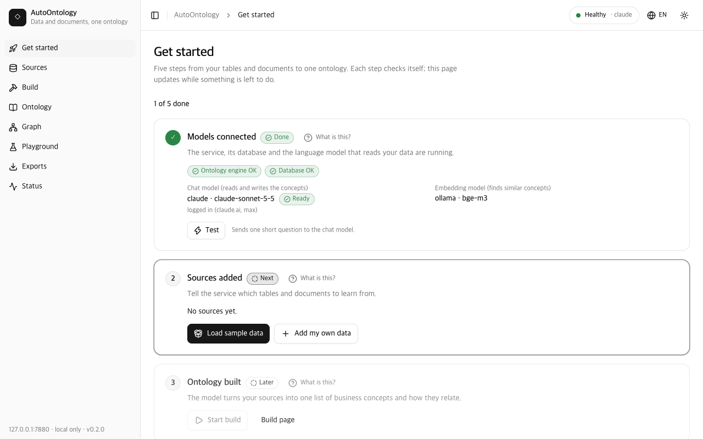
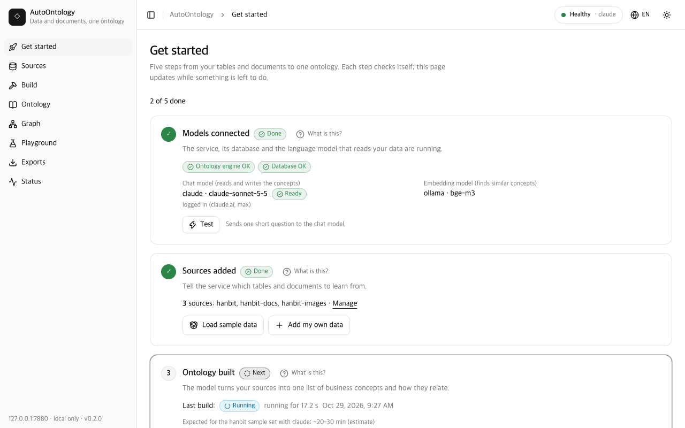

# AutoOntology guide for domain experts

**English** | [한국어](GUIDE.ko.md)

This guide is for people who know their business data (contracts, invoices, customers,
policies, manuals) but are not data engineers. It walks you from an empty computer to your
own ontology, alone, using the commands and screens exactly as they are. Every time in this
guide was measured on an Apple M4 Mac mini with 16 GB of memory unless it says
"estimate".

Contents:

- [Start with one prompt](#start-with-one-prompt) (shortcut with Claude Code)

1. [What you get in 10 minutes](#1-what-you-get-in-10-minutes)
2. [Words we use](#2-words-we-use)
3. [Before you start](#3-before-you-start)
4. [Choose a model provider](#4-choose-a-model-provider)
5. [The 10-minute path](#5-the-10-minute-path)
6. [Bring your own data](#6-bring-your-own-data)
7. [Reading the results](#7-reading-the-results)
8. [When results look wrong](#8-when-results-look-wrong)
9. [Troubleshooting](#9-troubleshooting)
10. [FAQ](#10-faq)

## Start with one prompt

With [Claude Code](https://docs.claude.com/en/docs/claude-code/overview) you can skip
the commands in section 5: paste one prompt and Claude clones the repository, checks the
prerequisites, installs everything, configures the Claude provider (your own Claude login,
no API key), builds the quickstart sample set and gives you the UI URL. Behind the prompt
is [`scripts/bootstrap.sh`](../scripts/bootstrap.sh); the repository's
[`CLAUDE.md`](../CLAUDE.md) / [`AGENTS.md`](../AGENTS.md) and the project skill
[`setup-autoontology`](../.claude/skills/setup-autoontology/SKILL.md) tell the agent how to
handle each outcome.

**Claude Code in the terminal.** Start `claude` in your home folder and paste:

```text
Clone https://github.com/kimtoma/AutoOntology into ~/AutoOntology and run `scripts/bootstrap.sh --yes --provider claude` there. It takes about 10 minutes: run it in the background and wait for it to finish. Then open the UI URL it prints and tell me what was built.
```

`--yes` makes it non-interactive: it installs uv with the official installer if it is
missing, accepts `init`'s defaults and replaces earlier `quick`/`quick-docs` sample sources
(and their database). Drop `--yes` to be asked first, and run the script in your own
terminal then. A measured run from an empty folder took 9 min 34 s (Apple M4 Mac mini,
2026-10-29, uv cache warm; the quickstart build itself 547 s).

In Korean:

```text
https://github.com/kimtoma/AutoOntology 를 ~/AutoOntology 에 클론하고 그 폴더에서 `scripts/bootstrap.sh --yes --provider claude --lang ko` 를 실행해 줘. 약 10분 걸리니 백그라운드로 실행하고 끝날 때까지 기다려 줘. 끝나면 출력된 UI 주소를 열고 무엇이 만들어졌는지 한국어로 설명해 줘.
```

**Claude desktop app.** Open the **Code** tab (Claude Code in the desktop app), choose
your home folder as the working folder with the local environment (the services must run
on your computer, not in a cloud sandbox), and paste the same prompt. The Claude provider
uses the `claude` command-line tool, so install Claude Code (CLI) and log in with `claude
auth login` on that computer even if you use the desktop app. Cowork has not been tested
for this setup and may not be able to reach Docker, Postgres or Ollama on your computer.

Already cloned? Open Claude Code in the repository and type `/setup-autoontology`, or run
`scripts/bootstrap.sh --yes --provider claude` yourself. `--dry-run` prints the plan
without changing anything; `--provider codex|ollama|openai`, `--set hanbit`, `--no-demo`
and `--lang ko` change the defaults. The script is safe to run again in the same folder (a second checkout on the same
Postgres replaces the first one's sample databases, `autoontology_src_quick*`). Ports
given as `AUTOONTOLOGY_PORT`/`BACKEND_PORT` in the shell are saved into `.env`. Its exit code
says what to do next: 3 means the provider CLI is not logged in, 4 names a missing
prerequisite (Docker or your own Postgres via `POSTGRES_*`, Ollama for the embeddings, uv,
git) with its install hint.

**Claude Enterprise (and Team, Pro, Max).** No API key is needed: AutoOntology calls the
`claude` CLI you are logged in to. Only the claude.ai login is supported; Claude Code set
up through Amazon Bedrock, Google Vertex AI or an API key reports `loggedIn: false` here.

- Log in once with `claude auth login` and pick your **organization account**; check it
  with `claude auth status` (`loggedIn: true`). The script stops with exit 3 and this hint
  when you are not logged in.
- What is sent to Anthropic: the build's prompts, which contain your table and column
  names, sample values and document text, under your organization's terms. Everything
  else stays on your computer: Postgres, the embeddings (Ollama), the files, the
  snapshots and the exports.
- Usage counts against your organization's plan limits like any other Claude Code use;
  the quickstart build made 139 calls in our measured run, the full hanbit sample about 520.
- If your administrator restricts Claude Code, the login or the calls fail; `uv run
  autoontology doctor` shows the `chat provider` row with the remedy.

**Without Claude Code**, run the same script directly. Read it first
([`scripts/bootstrap.sh`](../scripts/bootstrap.sh)); piping a script from the internet into
`bash` runs whatever it contains:

```bash
curl -fsSL https://raw.githubusercontent.com/kimtoma/AutoOntology/main/scripts/bootstrap.sh | bash -s -- --yes --provider claude
```

It clones into `./AutoOntology` (change it with `--dir`).

## 1. What you get in 10 minutes

You type six short commands. AutoOntology checks your computer, writes its settings file, loads a
small sample company ("한빛상사", a fictional Korean trading company: three tables of
customers, contracts and invoices plus five policy documents), asks a language model to
read all of it, and shows you one combined map of the business: which concepts exist
(customer, contract, invoice, payment status, approver ...), how they relate, which table
columns hold them, and the exact sentences in the documents that define them. With a Claude
subscription the whole sample took 8 to 11 minutes in our runs (a ChatGPT subscription about
15 minutes, estimate); with a local model on a laptop it took 46 minutes (section 4 has the
numbers). The
**Get started** page of the web UI shows the five steps and ticks them off as they finish:


## 2. Words we use

| Word | In plain language |
|---|---|
| **Ontology** | A shared dictionary of your business with the connections drawn in: every concept, what it means, and how it relates to the others. Here it is one file set built from your tables and your documents together. |
| **Business concept (Term)** | A concept found in your **tables**, such as "Customer" for a customers table, with its columns as attributes. The NVIDIA Auto Ontology engine names and describes it; we call it a Term. |
| **Document concept** | A concept found in your **documents** (policies, manuals, minutes, scans), such as "연체" (overdue) or "승인권자" (approver). Each one keeps the quotes it came from. |
| **Alignment** | Matching a document concept to a Term: "the 계약 in the contract policy is the same thing as the Contracts table". The match can be *same*, *broader*, *narrower* or *related*. |
| **Snapshot / revision** | The saved result of one build, numbered 1, 2, 3 ... Nothing is overwritten: each build adds a new revision, and the screens show the latest. |
| **Source** | One folder, set of uploaded files or database you registered, with a short name such as `hanbit` or `hanbit-docs`. A source holds either tables (structured) or documents. |
| **Build** | The run that reads every source, asks the model to find concepts, aligns them and saves a new revision. The first build takes the longest; later builds reuse what did not change. |
| **Export** | Writing a revision to files other tools can open (`exports/r0001/` and so on): RDF/OWL, GraphML, Ossie and OKF. |
| **Ossie** | Apache Ossie, an open file format for semantic models (datasets, entities, relationships). Analytics and BI tools that read Ossie can reuse your ontology. |
| **OKF** | Open Knowledge Format, a folder of Markdown pages (one per concept, table and document) with links between them. People can read it, and AI agents or wikis can load it as a knowledge base. |

Other abbreviations you will meet: **LLM** (large language model, the AI that reads text),
**OCR** (optical character recognition, reading text from images and scans), **CLI**
(command-line interface, the commands you type in a terminal), **RDF/OWL** (the W3C
standards for knowledge graphs), **SPARQL** (the query language for RDF), **SQL** (the
query language for tables), **NL→SQL** (natural language to SQL: ask a question in words and
get a table back).

## 3. Before you start

You need a terminal (Terminal on macOS, a shell on Linux; Windows works through WSL).
Type each "how to check" command; if it prints a version, you have it.

| You need | What it is for | How to check | How to get it |
|---|---|---|---|
| Python 3.12 and uv | Runs AutoOntology. uv installs the right Python by itself. | `uv --version` | https://docs.astral.sh/uv/ (one command) |
| git | Downloads the project. | `git --version` | Xcode command line tools (macOS) or your package manager |
| Docker **or** Postgres 17 with pgvector | The database that holds your tables and the engine's catalog. Docker starts the right one with one command. | `docker --version` or `psql --version` | https://docs.docker.com/get-docker/, or `brew install postgresql@17 pgvector` |
| **One** model provider: Ollama, a Claude subscription, a ChatGPT subscription, or an OpenAI-compatible API key | The language model that reads your data. Section 4 helps you choose. | `ollama list` / `claude auth status` / `codex login status` | https://ollama.com, https://claude.com/claude-code, https://developers.openai.com/codex |
| Ollama, even with a subscription | Embeddings (turning text into numbers so similar concepts are found). Only the small `bge-m3` model (1.2 GB) is needed unless Ollama is also your chat model. An OpenAI-compatible embedding endpoint works instead. | `ollama list` | https://ollama.com |
| Node.js 20 or newer (optional) | Reading HWP/HWPX, PDF, DOCX, PPTX, XLS/XLSX documents and images (OCR). Without it, Markdown, text, HTML, CSV and `.doc` documents still work. | `node --version` | https://nodejs.org |

Disk space (estimate): about 2 GB for the project and its tools, plus 5 GB for the `qwen3:8b` model
if you use Ollama for chat.

## 4. Choose a model provider

The provider is the language model that reads your tables and documents. You can switch
later with one command, so pick the one you can start with today.

| | Ollama (local) | Claude subscription | ChatGPT subscription (Codex) | OpenAI-compatible API |
|---|---|---|---|---|
| Cost | Free | Included in your Claude Pro/Max plan; counts against its usage limits | Included in your ChatGPT plan; counts against its usage limits | Pay per use on your API account |
| Quickstart sample (first build) | 46 min | 8 min | ~15 min (estimate) | depends on the endpoint |
| Full hanbit sample (first build) | 4-5 h (estimate) | 37 min | ~75 min (estimate) | depends on the endpoint |
| Does your data leave the machine? | **No** | Yes: prompts go to Anthropic under your account's terms | Yes: prompts go to OpenAI under your account's terms | Yes, unless the endpoint runs on your own machine |
| Setup effort | Install Ollama; `init` pulls `qwen3:8b` (5 GB) | `claude auth login` once | `codex login` once | Base URL, model name, and a key you type into `.env` yourself |
| Quality notes | Small model: slower, finds fewer concepts and merges conservatively | Best results in our tests; fast | Good results; each call is slower than Claude | Depends on the model |

The times come from the rehearsals described in the README ("Sample sets"). A build makes
one model call per document chunk plus a few hundred short judging calls, so the time
grows with the amount of document text, not with the number of table rows.

Log in once, as the same user that runs AutoOntology:

```
claude auth login        # Claude: or start `claude` and type /login; check with `claude auth status`
codex login              # ChatGPT: choose the ChatGPT account; check with `codex login status`
ollama serve             # Ollama: start it if `ollama list` says it cannot connect
```

For an OpenAI-compatible API, open `.env` in a text editor after `init` and add the line
`AUTOONTOLOGY_OPENAI_API_KEY=...` yourself. Never paste a key into a chat window or a
command that is saved in your shell history.

## 5. The 10-minute path

Open a terminal and type these commands one at a time. The comments say what each one
prints.

```
git clone --recurse-submodules https://github.com/kimtoma/AutoOntology.git
cd AutoOntology
docker compose up -d
uv sync
uv run autoontology init
uv run autoontology demo
```

**`git clone ...` and `cd AutoOntology`** download the project and the NVIDIA engine it
builds on into a folder named `AutoOntology`, then move into it. Every later command runs
in this folder.

**`docker compose up -d`** starts a Postgres database in the background and prints
`Container autoontology-db-1 Started`. If you already run Postgres 17 with pgvector,
skip it and put your server's `POSTGRES_HOST`, `POSTGRES_PORT`, `POSTGRES_USER` and
`POSTGRES_PASSWORD` into a file named `.env` in this folder instead.

**`uv sync`** installs Python and every library into `.venv`. The first time it downloads
a few hundred megabytes; it ends with `Installed N packages`.

**`uv run autoontology init`** asks a few questions and writes `.env`. It prints seven
numbered steps:

```
[1/7] Postgres
  ok    database autoontology (exists) on localhost:5432 as autoontology; extensions: pg_trgm 1.6, vector 0.8.7

[2/7] Chat provider
  PROVIDER  FOUND  LOGGED IN  NOTE
  ollama    yes    yes        http://localhost:11434 has openai/qwen3:8b, bge-m3
  openai    no     no         set AUTOONTOLOGY_OPENAI_BASE_URL in .env
  claude    yes    yes        logged in (claude.ai, max)
  codex     yes    yes        logged in (ChatGPT)
  Chat provider [claude]:
```

It suggests the first ready provider (claude, then codex, then ollama). Press Enter to
accept, or type another name. Then it asks whether to install the document reader
(kordoc, with its OCR models of about 18 MB) when Node.js is present: answer `y` unless you
only have Markdown, text, HTML, CSV and `.doc` files. Steps 5 and 6 write `.env` (an
existing file is first copied to `.env.bak-<time>`), prepare the database and check the
model with one test call:

```
models: openai/qwen3:8b answers 'pong' with completion_tokens 2 (thinking off); embeddings bge-m3
```

The last line is `next: uv run autoontology demo` (with `--set hanbit` for any
provider except Ollama, because the larger sample is quick there). `init` took 7 s (Ollama)
and 9 s (Claude) in our rehearsals once the tools were installed; installing
kordoc the first time adds about a minute (estimate). `init --yes` answers every question with the
suggested value, and `--provider claude` (or `ollama`, `codex`, `openai`) picks the
provider without asking.

**`uv run autoontology demo`** starts the two background services, registers the sample
set as sources (`quick` for the tables, `quick-docs` for the documents), shows how long the
first build should take with each provider, builds, exports and opens the web UI. While it
builds it prints one line per step:

```
[1/10] structured:quick:load: ok (0.3s)
[4/10] structured:quick:compile ...
[6/10] documents:quick-docs:extract ...
  [1/28] 한빛상사 계약관리규정 #0: 3 concept(s), 4 relation(s) via structured in 53.7s
```

At the end it prints a table of every step with its time, `build total`, the export folder
(`exports/r0001`) and the address of the web UI (http://127.0.0.1:7800/ui/). Add
`--set hanbit` for the full sample company (11 tables, 15 documents in 12 formats and 6
images), and `--no-open` to keep the browser closed.

The **Get started** page follows along. Right after the services start, step 1 (models)
is done and step 2 waits for data:



While a build runs, step 3 shows how long it has been running and its progress (here a
rebuild of the hanbit sample, in its matching step). On the first build of a sample
set it also shows the expected time for your provider:



When everything is done, all five steps are ticked (the screenshot at the top of this
guide). If the demo stops halfway (a closed laptop, a usage limit), run
`uv run autoontology demo --resume`: finished steps are kept.

## 6. Bring your own data

### Prepare the files

**Tables** (CSV, TSV, XLSX, XLSM, XLS, JSON, JSON Lines, Parquet, SQLite):

- The **first row is the header** with the column names. No title rows, merged cells or
  totals above or below the data.
- **One table per sheet** in Excel: each sheet becomes its own table named
  `<file>_<sheet>` (a file with one sheet is just `<file>`). Remove sheets that only hold
  notes or charts.
- Keep **ID columns consistent** across files: the same name and the same format for the
  same thing (`고객ID` = `C001` in both customers and contracts). This is how links between
  tables are found, even though the files declare no keys.
- Dates as `2026-09-30`, amounts as plain numbers (no currency signs or thousands
  separators inside numeric columns). Korean or English column names both work.
- Save table CSV files as **UTF-8** (in Excel: "CSV UTF-8"). CP949, the older Korean Excel
  encoding, is read only for CSV files in a documents source.

**Documents**: HWP, HWPX (and HML/HWPML), PDF, DOCX, PPTX, XLS, XLSX, DOC (Word 97-2003),
CSV/TSV, Markdown, TXT and HTML. Clear headings help: the reader splits documents along
their headings, and concepts are found per section. Documents that define your codes and
statuses in words ("수납상태는 완납, 부분수납, 미수납, 연체 중 하나다") give the best
alignment with the tables.

- HWP (the binary format) and HWPX are both read. If an old HWP fails, save it as HWPX or
  PDF in Hangul.
- `.doc` is read without extra tools, text and tables only (no images, text boxes or
  footnotes). Encrypted files fail with "save as .docx".
- A CSV in a documents source is read as one table section of at most 200 rows
  (`AUTOONTOLOGY_DOC_TABLE_MAX_ROWS`). A CSV with real data belongs in a table source.

**Images and scans** (PNG, JPG/JPEG, WEBP, and scanned PDFs):

- Scan at **300 dpi**, upright, in colour or grey. Photos of screens or whiteboards work
  when they are sharp and taken straight on.
- OCR reads printed Korean and English text, numbers and simple tables. It does not read
  handwriting, very small or blurred print, or the meaning of a chart (it reads the axis
  labels and numbers, not the trend). Letters can be misread (`ID` sometimes becomes `D`).
- Optional: set `AUTOONTOLOGY_VISION_MODEL=gemma4:e4b` in `.env` (and run
  `uv run autoontology setup`) to have a local vision model describe each image before its
  OCR text. This helps with charts and diagrams; it adds about 45 seconds per image.

### Add a source

Give each source a short name: lower-case letters, digits and `_` (documents may also use
`-`), for example `sales`, `sales-docs`. Three ways:

- **A folder on this computer** (best for many files; nothing is copied):
  `uv run autoontology source add ~/data/sales --name sales` for tables, and
  `uv run autoontology source add ~/data/policies --name sales-docs --kind documents` for
  documents. Add `--recursive` to include subfolders. In the web UI: **Sources → Add
  source → Folder**.
- **Upload** (best for a handful of files): **Sources → Add source → Upload**. The dialog
  lists each file with how it will be read and refuses the upload while an unsupported
  file is selected ("Remove N unsupported" removes them). Uploads are limited to 200 MB per
  request.
- **A database URL** (tables only; PostgreSQL, also MySQL and Snowflake when the engine
  has their driver): `uv run autoontology source add postgresql://user@host/dbname --name
  erp`, or **Sources → Add source → DB URL**. The database is read where it is; nothing is
  copied into AutoOntology.

Then build: `uv run autoontology build`, or **Get started → Start build**. Export with
`uv run autoontology export` or the **Export** button.

### When to split sources

- Put tables and documents in **separate** sources: a source is either tables or documents.
- Split documents by **topic or department** when they use the same words differently
  (sales "계약" vs. purchasing "계약"): each documents source is aligned on its own, and
  you can rebuild or remove one without touching the others.
- Split very large document folders (hundreds of files) so that one failed file does not
  hold up the rest, and so that `build --source <name>` rebuilds only what changed.
- Keep tables that reference each other (customers, contracts, invoices) in **one**
  source: links between tables are found inside a source.

## 7. Reading the results

### Ontology page

One searchable list of every concept. Each row has an **origin** badge:

- **structured**: a Term from your tables that no document matched.
- **document**: a concept found only in documents.
- **aligned**: a Term that a document concept was matched to. Open it to see what the
  documents add.

Click a concept to see its definition, its **synonyms** (names from the documents that
were folded into it, such as 고객 for Customers), its table columns, its **alignments**
(which document concepts point at it, with the verdict and the model's confidence), its
relations, and its **evidence**: the exact sentences, with the document and page. Record
IDs, numbers/dates and company names with a legal-form marker (only those: 주식회사, ㈜,
Inc., Ltd and similar; 한빛상사 is kept) never become synonyms; they are listed under the
synonyms as rejected. Search looks at names, synonyms and definitions; filters narrow by
origin and kind.


### Graph

The same ontology as a 3D network (a 2D view is used when the browser has no 3D support).
Under **View**, the **Layer** switch shows everything, only the tables' Terms
(Structured), only the document concepts (Documents) or only what was matched (Aligned);
**Evidence** adds the source documents as nodes. **Find node** jumps to a concept by name
or synonym, and clicking a node opens its details with **Neighbours only** to focus on it.
Moving dots on a link mean an accepted *same* match.


### Playground

- **Chat**: ask in plain language ("연체는 언제 되나요?"). The answer cites the concepts,
  rules and evidence it used; click a citation to open it. It answers about the latest
  revision only.
- **SQL**: ask a question about the data ("지역별 고객 수") and the engine writes SQL,
  runs it on a structured source and shows the table and the SQL.
- **SPARQL**: run read-only queries on the ontology itself. The examples menu has ready
  queries: Classes, Synonyms per Term, Aligned concepts, Relations and their evidence,
  Business rules, Concepts per document, Property domain/range, Unaligned concepts.

### Exports

Each export is a folder `exports/r<revision>/`. Who uses which file:

| File | What it is | Who opens it |
|---|---|---|
| `ontology.ttl` (Turtle), `ontology.jsonld` (JSON-LD) | The full ontology in the W3C RDF/OWL standard | Ontology editors (Protégé), knowledge-graph databases, data catalogs |
| `ontology.graphml` | Nodes and links | Graph tools (Gephi, yEd), data scientists (networkx) |
| `ossie/` | Apache Ossie semantic model, ontology and mappings, with `validation.json` | Semantic-layer and BI tools that read Ossie |
| `okf/` | Open Knowledge Format: one Markdown page per concept, table and document, with `validation.json` | People (read it like a wiki), AI agents and knowledge bases |
| `report.md` | A one-page summary with counts and file hashes | You, and whoever reviews the result |
| `upstream/` | The engine's own exports per table source | NVIDIA Auto Ontology users |

`validation.json` says `"ok": true` when the bundle passed its checks. The **Exports**
page previews every file and downloads it.


## 8. When results look wrong

**Rebuild or resume?** `uv run autoontology build --resume` continues the last build and
keeps every step whose inputs did not change (files, kordoc and OCR availability, the
model). Use it after an interruption, a usage limit or after installing kordoc. A plain
`uv run autoontology build` runs every step again but reuses the stored results of
everything that did not change (documents, extracted chunks, judgments), so it makes model
calls only for what is new; it always saves a new revision. `build --source sales-docs`
rebuilds only that source (matching and the snapshot still cover all sources).

**A concept is missing.** Check the Build page for skipped files (a warning names files
that need kordoc or the OCR models). Make sure the document defines the concept in words,
not only in a table or an image. A larger model finds more: switch provider (below).

**Two things were merged that should not be, or the opposite.** Alignment works in three
steps:

1. For each document concept that is an entity, a metric or an attribute (rules and
   processes are not matched), the five most similar Terms are picked by meaning
   (embeddings).
2. The model judges each pair: `same`, `broader` (the Term is wider: the concept is a part
   or kind of the Term), `narrower` (the Term is a part or kind of the concept), `related`,
   or `none`, with a confidence.
3. A strict rule decides: `same` is accepted only when the confidence is at least 0.90
   **and** one of the concept's names exactly equals a name of the Term (after ignoring
   case and spaces; English plurals count as singular). Record IDs (S037), numbers/dates
   and company names with a legal-form marker (주식회사 …) never count as a matching name
   and never become synonyms, and a concept named like one is never `same`. Otherwise it
   is kept as `related`, a suggestion you can review. So "계약" folds into the Contracts Term only if a name
   matches, and similar-sounding words never merge by accident.

If too little is matched, give the Term the business name: describe it in a document
("계약(Contracts)은 ...") or name the column the way people say it. If unrelated
documents pull concepts together, put them in separate documents sources.

**Switch provider.** `uv run autoontology provider use claude` (or `codex`, `ollama`,
`openai`), then restart with `uv run autoontology down && uv run autoontology up`, then
`uv run autoontology build`. `uv run autoontology provider test` checks the model first.

**Limits of small local models.** `qwen3:8b` on a laptop takes one to two minutes per
document chunk, finds fewer concepts, and its judgments are more often `related` than
`same`. That is safe (nothing is merged wrongly) but leaves more suggestions. Use it to
keep data local; use a subscription or a larger endpoint for the best ontology.

## 9. Troubleshooting

`uv run autoontology doctor` checks everything and prints a REMEDY column; `init` prints
`fix:` lines. The commands below are the ones doctor and init suggest, with a few extra
steps added (with `AUTOONTOLOGY_LANG=ko` their messages are in Korean; the commands stay the
same).

| Symptom | Cause | What to type |
|---|---|---|
| `.env` WARN "missing: using the built-in defaults" | No settings file yet | `uv run autoontology init` |
| `init stopped: Postgres is not reachable`, or doctor `postgres` FAIL | The database is not running, or `.env` points elsewhere | `docker compose up -d`, then `uv run autoontology init` again; with your own Postgres set `POSTGRES_HOST` / `POSTGRES_PORT` / `POSTGRES_USER` / `POSTGRES_PASSWORD` in `.env` |
| `docker compose up -d` fails on port 5432 | Another Postgres already uses the port | Set `POSTGRES_PORT=5433` in `.env` first, or use that Postgres |
| doctor `database autoontology` FAIL "missing", or `alembic` WARN | The catalog is not prepared | `uv run autoontology setup` |
| doctor `extension vector` FAIL | The Postgres server has no pgvector | `brew install pgvector` (or the `postgresql-17-pgvector` package), or use `docker compose`; then `uv run autoontology setup` |
| `setup`: permission denied to create database | The Postgres user cannot create databases | `ALTER USER <name> CREATEDB;` in `psql`, or create the `autoontology` database yourself |
| `init stopped: the claude CLI is not logged in`, doctor `chat provider` FAIL | Not logged in as this user | `claude auth login` (or `codex login`), then `uv run autoontology init` again |
| doctor `chat provider` FAIL "install the claude CLI and log in" | The CLI is not installed, or `claude` on PATH is a wrapper | Install it; or set `AUTOONTOLOGY_CLAUDE_BIN=/path/to/claude` (`AUTOONTOLOGY_CODEX_BIN` for codex) in `.env` |
| `init stopped: the openai provider needs a base URL` | `--yes` with openai and no URL | Set `AUTOONTOLOGY_OPENAI_BASE_URL` in `.env`, or run `init` without `--yes` |
| `init stopped: ... needs a chat model name` / `openai embeddings need a model name` | `--yes` with openai and no model | Pass `--chat-model`, or set `AUTOONTOLOGY_OPENAI_CHAT_MODEL` / `AUTOONTOLOGY_OPENAI_EMBED_MODEL` in `.env` |
| `warn  your shell sets KEY=..., which wins over .env` | A variable in your shell profile overrides `.env` | `unset KEY` and remove it from your shell profile |
| `init stopped during setup` | The line above it names the failing part | Fix that, then `uv run autoontology init` again (safe to repeat) |
| doctor `ollama` FAIL, or `warn  Ollama is not answering` | Ollama is not running | `ollama serve` (install from https://ollama.com) |
| doctor `ollama` FAIL "models missing", or chat model `openai/qwen3:8b` not found | The models or the alias are not pulled | `uv run autoontology setup` (or `setup --force-alias`) |
| doctor `model profile` FAIL/WARN | A provider value in `.env` is missing or not a known model | Set the `AUTOONTOLOGY_OPENAI_*` / `_CLAUDE_*` / `_CODEX_*` values (see `.env.example`); for Ollama use an `openai/<name>` alias |
| doctor `chat endpoint` FAIL "not bare JSON: schema not enforced" | Ollama ignores the answer format | Keep `AUTOONTOLOGY_OLLAMA_NO_THINK` on (the default) and upgrade Ollama |
| doctor `chat no-think` FAIL | The Ollama chat alias still "thinks" before answering | `uv run autoontology setup --force-alias` |
| doctor `chat endpoint` FAIL | The model did not answer the test call | `uv run autoontology provider test`, then the remedy it prints; for openai check `AUTOONTOLOGY_OPENAI_BASE_URL` / `API_KEY` / `CHAT_MODEL` |
| doctor `embedding endpoint` FAIL | The embedding model is not reachable | Check `EMBED_*` / `AUTOONTOLOGY_EMBED_PROVIDER` in `.env` and that Ollama is up |
| doctor `vector tables` FAIL "the embedder emits N dimensions" | You changed the embedding model after building | Restore the old embedding model, or remove every source (`uv run autoontology source rm <name>`) and empty the `vdb` vector tables, then build again |
| doctor `node` WARN | Node.js 20+ is missing | Install Node.js 20+ (only needed for HWP/PDF/DOCX/PPTX/XLSX documents) |
| doctor `kordoc` WARN, or build warns "N document(s) need kordoc and were skipped" | The document reader is not installed | `uv run autoontology tools install-kordoc`, then `uv run autoontology build --resume` |
| doctor `kordoc` WARN "installed with --omit-optional" | PDF and OCR support was left out | `uv run autoontology tools install-kordoc --force` |
| doctor `ocr models` WARN, or build warns "N image(s) or scanned PDF(s) need the OCR models" | The OCR models are not downloaded | `uv run autoontology tools install-kordoc`, then `uv run autoontology build --resume` |
| doctor `vision model` FAIL | `AUTOONTOLOGY_VISION_MODEL` is set but Ollama is down or the model is not pulled | `ollama serve`, then `uv run autoontology setup` |
| doctor `port ...` FAIL "in use", or `up` says a port is in use | Another program uses 7800 or 3101 | Stop it, or set `AUTOONTOLOGY_PORT` / `BACKEND_PORT` in `.env` (for example 7820 and 3121) |
| doctor `upstream connections` WARN "database gone", or ingest fails with `PoolTimeout` | A leftover connection points at a deleted database | `uv run autoontology tools prune-connections` (with the services up) |
| doctor `upstream connections` WARN "no source in this checkout" | Another copy of AutoOntology shares the database server | Nothing, if that copy is in use; otherwise `uv run autoontology tools prune-connections --include-unowned` |
| `demo stopped: source ... was kept` | A source with a sample name holds other data | `uv run autoontology demo --replace` (deletes that source's database), or remove it with `uv run autoontology source rm <name>` |
| Build calls fail with 429 `usage_limit` | Your Claude or ChatGPT plan limit is reached | Wait for the reset, then `uv run autoontology demo --resume` (or `build --resume`); or switch provider |
| A document fails with `DOC_PARSE_FAILED` or `DOC_ENCRYPTED` | An unreadable or protected `.doc` | Save it as `.docx` and add it again |
| A document fails with `FILE_TOO_LARGE` | Over 50 MB of text (`AUTOONTOLOGY_DOC_MAX_BYTES`) | Split the file, or raise the limit in `.env` |
| `/ui/` answers 503 `ui_not_built` | The web UI files are missing (a source archive) | `uv run autoontology tools build-ui` (needs Node and pnpm) |
| A build seems stuck | Local models are slow | `uv run autoontology runs` shows the step and chunk counts; logs are in `data/logs/` |

## 10. FAQ

**Is my data private?** With Ollama for chat and embeddings, nothing leaves your computer:
the services listen only on 127.0.0.1 and reject other machines. With a Claude or ChatGPT
subscription or an API, the prompts (table and column names, a few sample values, document
text) go to that provider under your account's terms. AutoOntology never sends or logs your
login tokens (for codex it only links your `auth.json` into a private folder and copies a
refreshed token back).

**Can I open it from my laptop?** Yes, from devices on your own Tailscale network: run
`tailscale serve --bg --https=8444 http://127.0.0.1:7800` on the computer that runs
AutoOntology, set `AUTOONTOLOGY_TAILSCALE_HOSTS` (and optionally
`AUTOONTOLOGY_TAILSCALE_LOGINS`) in `.env`, and restart with `down && up`. The README's
"Remote access over Tailscale" section has the details. Never use `tailscale funnel`, which
would put it on the public internet.

**What does it cost?** The software is free (MIT licence). Ollama is free. A subscription
build counts against your plan's usage limits; the full hanbit sample makes
about 520 model calls. An API is billed by your provider.

**How long does it take?** See the table in section 4. Rule of thumb: count the document
chunks (`demo` and the Build page show them); a local `qwen3:8b` takes one to two minutes
per chunk, a subscription about 6 seconds (at most two calls run at once). Tables add little: compiling the 11 hanbit tables
took 97 seconds with Claude.

**Can I work offline?** Yes, with Ollama for chat and embeddings, after `init` has
downloaded the models and kordoc once. kordoc always runs offline; only
`tools install-kordoc` uses the network.

**Korean and English mixed?** Yes. Column names, documents and questions can be in either
language or both. Concept names stay in the language of the source (Korean names stay
Korean in the exports). The web UI and the onboarding commands speak English and Korean:
the globe menu in the header switches the UI, and `AUTOONTOLOGY_LANG=ko` (or a Korean
system locale) switches the commands.

**Large files?** Tables of hundreds of thousands of rows are fine: rows are loaded into
Postgres and only the structure and a few samples go to the model. Documents cost time per
chunk (about 1,200 tokens, roughly a page); a 300-page manual is about 300 chunks. Split
very large folders into several sources. Native text documents are capped at 50 MB.

**HWP binary or HWPX?** Both are read through kordoc. HWPX (the newer XML format, the
default in recent Hangul versions) is the safer choice; if an old binary HWP fails, open
it in Hangul and save it as HWPX or PDF.

**Where are my files kept?** The registered folders are read in place. AutoOntology keeps
its own data in `data/` (sources, runs, extracted concepts, snapshots) and the exports in
`exports/`, both inside the project folder. Tables are loaded into Postgres databases named
`autoontology_src_<source>`. `uv run autoontology source rm <name> --drop-db` removes a
source and its database.
